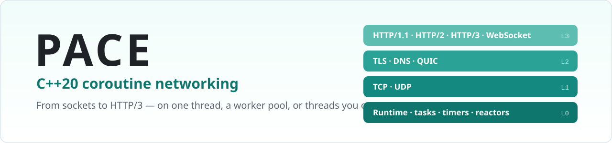
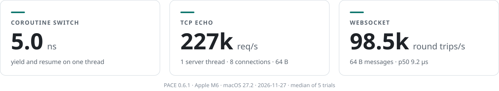
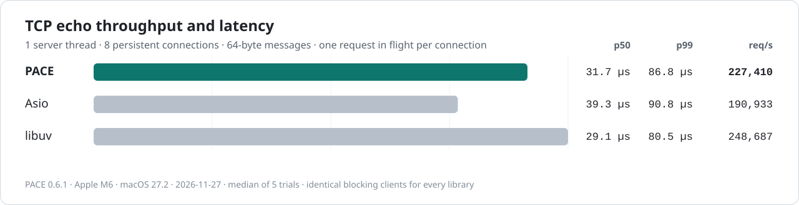

<p align="center">
  <picture>
    <source media="(prefers-color-scheme: dark)" srcset="docs/assets/readme/banner-dark.svg">
    
  </picture>
</p>

<p align="center">
  <a href="https://github.com/TabNahida/PACE/actions/workflows/ci.yml"></a>
  <a href="https://github.com/TabNahida/PACE/releases"></a>
  
  
  <a href="LICENSE"></a>
</p>

<p align="center">English · <a href="README.zh.md">简体中文</a> · <a href="https://tabnahida.github.io/PACE/">Website</a> · <a href="docs/README.md">Documentation</a></p>

**PACE is a C++20 coroutine networking library: TCP and UDP, TLS, DNS, QUIC, HTTP/1.1, HTTP/2, HTTP/3 and
WebSocket, on one thread, a fixed worker pool, or threads your application owns.**

<p align="center">
  <a href="docs/performance/README.md">
    <picture>
      <source media="(prefers-color-scheme: dark)" srcset="docs/assets/readme/numbers-dark.svg">
      
    </picture>
  </a>
</p>

<p align="center">
  <a href="docs/performance/README.md">
    <picture>
      <source media="(prefers-color-scheme: dark)" srcset="docs/assets/readme/tcp-echo-dark.svg">
      
    </picture>
  </a>
</p>

Measured on PACE 0.6.1 on one Apple M6 laptop, every library with the same clients in the same run. On this
machine libuv leads the TCP echo workload; on Linux, PACE had the highest throughput of the three in the
[0.5.0 measurement](docs/performance/tcp.md), and Asio the lowest tail latency. Numbers describe these workloads on these machines, not general
superiority. [Methodology and raw data →](docs/performance/README.md)

## 30-second example

<table>
<tr><th>Client</th><th>Server</th></tr>
<tr>
<td>

```cpp
#include <pace/http1.hpp>

#include <iostream>

int main()
{
    auto reply = pace::http::get("http://127.0.0.1:8080/hello");
    std::cout << reply.status << ' ' << reply.body;
}
```

</td>
<td>

```cpp
#include <pace/http1.hpp>

int main()
{
    pace::http::app app;
    app.get("/hello", [] { return pace::http::text("Hello from PACE\n"); });
    app.run(8080);
}
```

</td>
</tr>
</table>

The client call blocks its thread with a 30-second default deadline and returns an owned response; inside a
coroutine, `co_await pace::http::async_get(url)` does the same without blocking. The server runs its event loop on
the calling thread until stopped. Both link one target: `add_deps("pace_http1")`.
[Write them step by step →](docs/tutorial/02-http-client.md)

## Modules

Link only what you use. Every module has its own umbrella header and xmake target; `pace` and `<pace/pace.hpp>`
bring in every enabled module.

| Module | Header | Target | Builds on | Option | Implementation today |
|:--|:--|:--|:--|:--|:--|
| [Runtime](docs/reference/runtime/README.md) | `<pace/runtime.hpp>` | `pace_runtime` | — | always | PACE: tasks, timers, epoll / kqueue / IOCP / io_uring reactors |
| [Networking](docs/reference/net/README.md) | `<pace/net.hpp>` | `pace_net` | runtime | always | PACE: TCP, UDP |
| [TLS](docs/reference/tls/README.md) | `<pace/tls.hpp>` | `pace_tls` | net | `--tls=y` | OpenSSL 3 |
| [DNS](docs/reference/dns/README.md) | `<pace/dns.hpp>` | `pace_dns` | net | `--dns=y` | c-ares |
| [QUIC](docs/reference/quic/README.md) | `<pace/quic.hpp>` | `pace_quic` | net | `--quic=y` | ngtcp2 or OpenSSL QUIC |
| [HTTP](docs/reference/http/README.md) | `<pace/http.hpp>` | `pace_http` | runtime | with any HTTP | PACE: messages, routing |
| [HTTP/1.1](docs/reference/http1/README.md) | `<pace/http1.hpp>` | `pace_http1` | net, http | default on | PACE |
| [HTTP/2](docs/reference/http2/README.md) | `<pace/http2.hpp>` | `pace_http2` | net, http | `--http2=y` | nghttp2 |
| [HTTP/3](docs/reference/http3/README.md) | `<pace/http3.hpp>` | `pace_http3` | quic, http | `--http3=y` | nghttp3 |
| [WebSocket](docs/reference/websocket/README.md) | `<pace/websocket.hpp>` | `pace_websocket` | net | default on | PACE |
| [Gateway](docs/reference/gateway/README.md) | `<pace/gateway.hpp>` | in `pace_http1` | http1 | with HTTP/1.1 | PACE: static files, reverse proxy, cache, balancing |

**On the way to 1.0:** TLS 1.2/1.3, QUIC, HTTP/2, HTTP/3 and DNS are being reimplemented inside PACE, with only
cryptographic primitives taken from OpenSSL or AWS-LC. The API of each module is documented as it is today and
updated as each rewrite lands. QUIC and HTTP/3 currently require a POSIX system; see
[platform support](docs/reference/platform-support.md).

## Install

You need [xmake](https://xmake.io/) and a C++20 compiler; [platform support](docs/reference/platform-support.md)
lists the compilers and systems CI tests. Add PACE to your project, for example as `third_party/PACE`, and depend on the modules you use:

```lua
set_languages("cxx20")
includes("third_party/PACE")

target("app")
    set_kind("binary")
    add_files("main.cpp")
    add_deps("pace_http1")
```

```sh
xmake f -m release -y                                     # HTTP/1.1 and WebSocket, no third-party dependencies
xmake f -m release --tls=y --dns=y --http2=y --http3=y -y # every protocol; xmake fetches OpenSSL, c-ares, …
xmake -y
```

C++20 named modules are available with `--modules=y`: `import pace;`, or one module at a time such as
`import pace.runtime;` and `import pace.net;`. [Build options →](docs/reference/build-options.md)

## Documentation

| | |
|:--|:--|
| [Tutorial](docs/tutorial/README.md) | From the first program to HTTP/3 and a gateway, one runnable chapter at a time |
| [Guides](docs/guides/README.md) | Recipes for specific tasks: tuning, HTTP configuration |
| [Reference](docs/reference/README.md) | Every public type and function, its errors, threading and lifetime rules |
| [Explanation](docs/explanation/README.md) | Architecture, execution model, ownership and API design |
| [Performance](docs/performance/README.md) | Every measurement with its method, raw data and history |
| [Migration](docs/migration/README.md) | Upgrading between versions |

The same documentation is published at [tabnahida.github.io/PACE](https://tabnahida.github.io/PACE/), in English
and Chinese.

## License

[MIT](LICENSE) · © 2026 Tab Nahida
