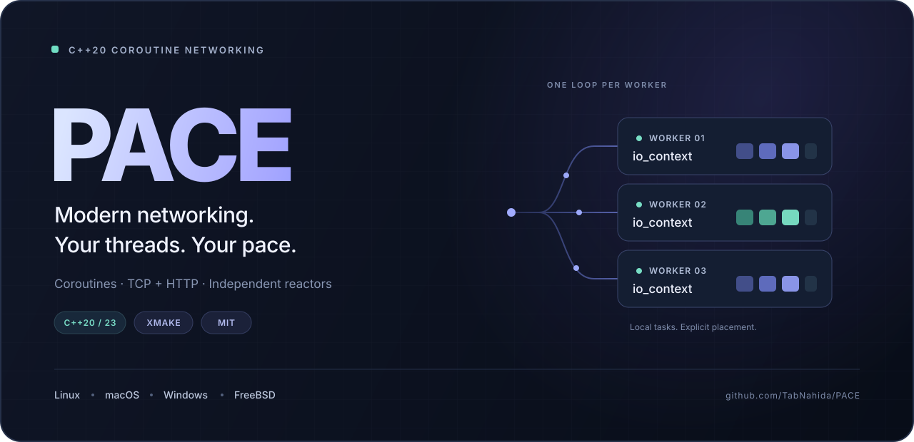

# PACE

<p align="center">
  
</p>

<p align="center">
  <a href="https://github.com/TabNahida/PACE/actions/workflows/ci.yml"></a>
  
  <a href="LICENSE"></a>
</p>

<p align="center"><a href="README.md">English</a> · 简体中文 · <a href="docs/architecture.md">架构说明</a> · <a href="benchmarks/README.md">性能测试方法</a></p>

## 性能对比

**超越 libuv 和 Asio 是目标，目前并非已经证实的结论。** PACE 目前是可运行的早期原型。基准程序使用相同的 TCP echo 工作负载，对比 PACE 协程、独立版 Asio 协程以及 libuv 原生回调 API。

<!-- benchmark-results:start -->
公开的对比结果正在准备中，目前不宣称任何加速比例。基准脚本保留每次测试结果、运行环境、吞吐量波动范围和 p50/p99 延迟；后续会在这里展示实测数据并链接到原始证据。

| 测试负载 | PACE | libuv | 独立版 Asio |
|---|---|---|---|
| 单服务线程、本机回环 TCP echo | 待测 | 待测 | 待测 |
<!-- benchmark-results:end -->

详细说明见[测试方法与复现命令](benchmarks/README.md)。[GitHub Actions](https://github.com/TabNahida/PACE/actions/workflows/ci.yml) 已配置 Linux、macOS、Windows 和 FreeBSD 的构建、测试及性能产物上传。共享运行器存在噪声，应在同一个任务中比较不同后端，并检查多轮结果的波动；TCP echo 结果不能直接代表 HTTP 性能或多核扩展能力。

## 简洁 API，明确所有权，独立事件循环

PACE（Parallel Async Coroutine Engine）是一个基于 C++20 的异步网络库，提供协程任务、定时器、TCP 和 HTTP/1.0–1.1。固定数量的工作线程各自拥有一个事件循环，协程始终在分配给它的循环中执行，让常规 I/O 路径保持线程局部性。

- **执行方式可选。** 使用 `pace::runtime` 管理多个工作线程，或者直接在线程中运行独立的 `pace::io_context`。
- **使用自然的控制流。** 通过 `co_await` 组合惰性 `pace::task<T>`，搭配 RAII socket、`std::span` 和 `std::string_view`。
- **直接编写 HTTP 服务。** 协程处理函数返回 `pace::http::response`，库负责 Content-Length 消息边界和持久连接。
- **保持核心轻量。** 依赖 xmake 和系统 socket API 构建；Asio、libuv 仅用于可选性能对比，不是库本身的依赖。

## 一个可运行的 HTTP 服务

```cpp
#include <pace/pace.hpp>

pace::task<pace::http::response> hello(pace::http::request request) {
    if (request.target == "/")
        co_return pace::http::response{.body = "Hello from PACE!\n"};
    co_return pace::http::response{.status = 404, .body = "Not found\n"};
}

int main() {
    pace::io_context io;
    pace::tcp_listener listener(io, {"127.0.0.1", 8080});
    io.spawn(pace::http::serve(listener, hello));
    io.run();
}
```

[完整 HTTP 示例](examples/http_server.cpp) 还包含工作线程数量设置和信号触发的关闭流程。[TCP echo 示例](examples/echo_server.cpp) 展示了 `accept()`、`read_some()` 和 `write_all()` 的用法。

需要多个循环时，构造 `pace::runtime workers(4)`，通过 `workers.context(index).spawn(...)` 分配任务，再调用 `workers.run()`。该调用负责启动并等待工作线程，`workers.stop()` 会唤醒所有循环。任务分配是显式的；目前不迁移任务，也不自动绑定 CPU 核心。

## 构建与运行

安装 [xmake](https://xmake.io/guide/quick-start.html) 2.9.8 或更新版本，以及支持标准协程的 C++20 编译器。CI 使用 xmake 3.0.9。Windows 需要 Visual Studio C++ 工具链。普通构建不需要第三方运行时依赖。

FreeBSD 请通过上游源码或安装器安装 **xmake-io**。FreeBSD 软件包中名为 `xmake` 的工具属于另一个项目；CI 工作流提供了固定版本的源码构建示例。

```sh
git clone https://github.com/TabNahida/PACE.git
cd PACE
xmake f -m release -y
xmake -y
xmake test -v

# 在不同终端中启动：
xmake run http_server 8080 1
xmake run echo_server 9000 1
```

访问 `http://127.0.0.1:8080/`，或者向 `/echo` 发送 POST 请求。支持 `SO_REUSEPORT` 的平台可以将最后的 `1` 改为 `4` 等工作线程数量。这两个服务示例在 Windows 上使用一个工作线程；运行时本身仍支持多个 Windows 工作循环。

```sh
# 使用更新的语言标准。
xmake f -m release --cxxstandard=cxx23 -y
xmake -y

# Linux/macOS/FreeBSD：启用 AddressSanitizer 和 UndefinedBehaviorSanitizer。
xmake f -m debug --sanitizers=y -y
xmake -y
xmake test -v

# 构建包含 Asio、libuv 的可选性能对比程序。
xmake f -m release --sanitizers=n --benchmarks=y -y
xmake -y pace_bench
python3 scripts/run_benchmarks.py --require-all --repeats 5 --clients 8 \
  --requests 5000 --warmup 500 --bytes 64 --output benchmarks/results/local
```

Windows 上将 `python3` 替换为 `python`，在 PowerShell 中把基准命令写成一行。脚本自动查找 `build/` 下最新的 `pace_bench`，也可以通过 `--executable` 显式指定。输出包含 Markdown 和 JSON 汇总以及全部原始测量结果。

构建目标包括 `pace`、`pace_runtime_tests`、`pace_network_tests`、`http_server`、`echo_server`，以及可选的 `pace_bench`。还可通过 `--tests=n`、`--examples=n` 关闭测试或示例。

## 平台支持

| 平台 | 事件后端与唤醒机制 | CI 配置 |
|---|---|---|
| Linux | `epoll` + `eventfd` | 原生构建、测试、性能对比；C++20/23；sanitizer 任务 |
| macOS | `kqueue` + `EVFILT_USER` | 原生构建、测试、性能对比 |
| Windows | `WSAPoll` + 回环 socket | 原生构建、测试、性能对比 |
| FreeBSD | `kqueue` + `EVFILT_USER` | FreeBSD 14.3 虚拟机构建、测试、性能对比 |

kqueue 实现面向 64 位系统。Windows 当前使用功能基线 `WSAPoll`，IOCP 后端尚待实现；当前 Windows 实现不支持 `SO_REUSEPORT`。这些平台已有源代码实现，实际验证情况请查看[工作流状态和产物](https://github.com/TabNahida/PACE/actions/workflows/ci.yml)。

## 执行与生命周期规则

每个 `io_context` 只在一个线程上运行。`spawn()`、`post()` 和 `stop()` 可从其他线程调用；socket 操作以及关闭、取消操作应在所属循环上执行。同一个 socket 可以同时有一个挂起的读操作和一个挂起的写操作。操作结束之前，socket 对象和缓冲区必须保持有效；所有 socket 销毁之前，所属 context 必须继续存在。

任务是惰性、仅可移动且只能消费一次的：使用 `co_await operation()` 或 `co_await std::move(task)`。协程挂起期间，其可调用对象也必须保持有效；通常可优先使用具名协程函数，并将需要持有的值作为参数传入。Context 即使空闲也会运行到显式停止，并且只能运行一次。销毁之前必须先停止，再等待运行线程结束。详见[架构与生命周期说明](docs/architecture.md)。

## 当前范围

当前版本用于开发与实测，尚未达到经过生产环境验证的成熟度。HTTP 层支持 HTTP/1.0、HTTP/1.1、Content-Length 请求体、持久连接，以及可配置的请求头大小、请求体大小和每连接请求次数限制。**尚未实现请求超时**，缓慢客户端可以长期占用连接。

暂不支持 TLS、HTTP/2、chunked 传输编码、HTTP 流式请求体、协议升级、CONNECT 隧道、DNS 解析、IPv6、异步文件 I/O，以及单操作取消或截止时间。当前端点使用数字 IPv4 地址。阻塞操作和重 CPU 工作应移出事件循环线程。

近期工作将依据实测瓶颈推进：完善取消和超时、扩大协议测试覆盖、实现 Windows 原生完成式 I/O，以及可复现的多工作线程和 HTTP 压测。所有性能结论都会关联公开证据。

## 许可证

[MIT](LICENSE) · Copyright © 2026 Tab Nahida.
