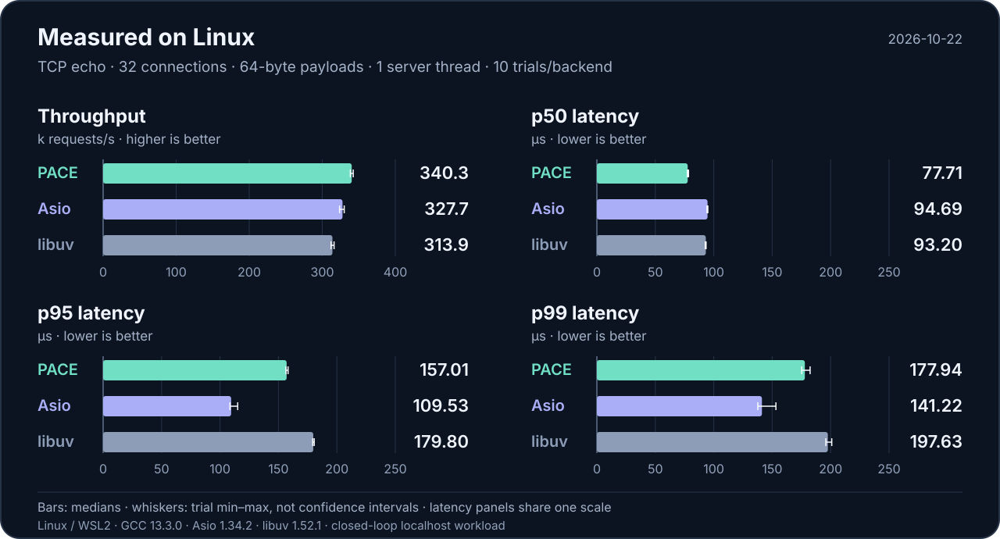

<p align="center">
  
</p>

<p align="center">
  <a href="https://github.com/TabNahida/PACE/actions/workflows/ci.yml"></a>
  <a href="LICENSE"></a>
</p>

<p align="center"><a href="README.md">English</a> · 简体中文 · <a href="docs/README.zh-CN.md">文档</a> · <a href="docs/reference/README.zh-CN.md">API</a></p>

**从 Socket 到 HTTP/3 的 C++20 协程网络库。** PACE（Parallel Async Coroutine Engine）支持单线程、固定工作线程池，也可以运行在应用自己管理的线程上。

- **按顺序编写异步代码。** 通过 `co_await` 等待连接、读写与定时器。
- **自己决定任务在哪里执行。** 每个工作线程拥有独立事件循环，任务放置和线程归属清晰可控。
- **只构建需要的模块。** 核心没有第三方运行时依赖，协议模块按需启用。

<p align="center">
  <a href="docs/performance.md"></a>
</p>

<p align="center"><a href="docs/performance.md">完整性能数据、测试方法与原始记录 →</a></p>

## 四层架构，按需组合

| 层级 | 模块 | 聚合目标 |
|:--|:--|:--|
| **3 · 应用协议** | [HTTP/1.1](docs/reference/http.md) · [HTTP/2](docs/reference/http2.md) · [HTTP/3](docs/reference/http3.md) · [WebSocket](docs/reference/websocket.zh-CN.md) | `pace_application` |
| **2 · 基础协议扩展** | [TLS](docs/reference/tls.zh-CN.md) · [DNS](docs/reference/dns.md) · [QUIC](docs/reference/quic.md) | `pace_extensions` |
| **1 · 网络核心** | [TCP](docs/reference/tcp.md) · [UDP](docs/reference/udp.md) · Socket API | `pace_net` |
| **0 · 运行时** | 事件循环 · 原生轮询 · 任务 · 定时器 · 工作线程 | `pace_runtime` |

可以链接单个模块、某一层，或通过 `pace` 使用已启用的完整协议栈。HTTP/1.1 与 WebSocket 默认启用；TLS、DNS、QUIC、HTTP/2 和 HTTP/3 按需开启。QUIC 与 HTTP/3 要求 POSIX，Windows 暂不支持，详见[平台矩阵](docs/reference/platform.md)。

[架构设计 →](docs/architecture.md) · [构建选项与项目集成 →](docs/tutorial/01-build.md)

## 直接获取 HTTP 响应

```cpp
auto reply = pace::http::get("http://127.0.0.1:8080/health");
```

一次调用直接返回响应，不需要 `run`，阻塞当前线程，默认总超时 30 秒。
协程里使用 `co_await pace::http::async_get(url)`。TCP、UDP 也提供 `exchange` / `async_exchange`。

[从第一个客户端开始 →](docs/tutorial/00-quick-start.zh-CN.md) ·
[接口与 0.3.1 迁移说明 →](docs/reference/direct-clients.zh-CN.md)

这些客户端接口属于当前源码，尚未发布。

## 一个小型 HTTP 服务

```cpp
#include <pace/http.hpp>

int main() {
    pace::http::app app;
    app.get("/", [] { return pace::http::text("Hello, PACE!\n"); });
    app.run(8080);
}
```

使用 `add_deps("pace_http1")` 链接。[一步步写出这个 HTTP 服务 →](docs/tutorial/00-quick-start.zh-CN.md)

继续学习：[TCP](docs/tutorial/03-tcp.zh-CN.md) · [UDP](docs/tutorial/07-udp.zh-CN.md) · [DNS](docs/tutorial/08-dns-tls.zh-CN.md) · [QUIC](docs/tutorial/11-quic-http3.zh-CN.md) · [HTTP/3](docs/tutorial/11-quic-http3.zh-CN.md) · [WebSocket](docs/tutorial/09-websocket.zh-CN.md)

## 快速开始

需要 [xmake](https://xmake.io/guide/quick-start.html) 2.9.8+ 和支持 C++20 的编译器。

```sh
git clone https://github.com/TabNahida/PACE.git
cd PACE
xmake f -m release -y
xmake -y tutorial_http
xmake run tutorial_http
```

示例会启动本地服务、验证一次请求后退出。要持续监听 8080 端口，运行 `xmake run tutorial_http serve`。

<details>
<summary>在 Linux 上启用所有协议</summary>

```sh
xmake f -m release --tls=y --dns=y --quic=y --http2=y --http3=y -y
xmake -y
```

只需要 Socket 时，通过 `--http1=n --websocket=n` 关闭默认应用协议。依赖与各模块目标见[构建指南](docs/tutorial/01-build.md)。

</details>

## 继续探索

| | |
|:--|:--|
| [教程](docs/tutorial/README.zh-CN.md) | 任务、协议、工作线程与优雅退出 |
| [API 参考](docs/reference/README.zh-CN.md) | 接口、所有权、错误处理与协议限制 |
| [执行模型](docs/tutorial/05-execution.md) | 当前线程、固定工作线程与应用自有线程 |
| [平台支持](docs/reference/platform.md) | Linux、macOS、FreeBSD 与 Windows 后端 |
| [性能数据](docs/performance.md) | 本地 Linux 测量、取舍与复现步骤 |

PACE 正在积极开发，API 与协议覆盖仍在演进。当前限制请参阅 [API 文档](docs/reference/README.zh-CN.md)。

[MIT](LICENSE) · © 2026 Tab Nahida
