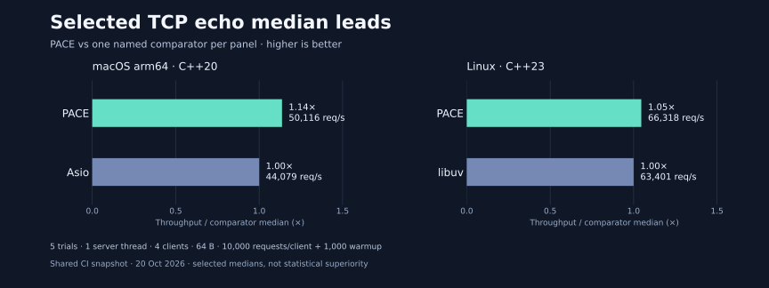

# PACE

<p align="center">
  
</p>

<p align="center">
  <a href="https://github.com/TabNahida/PACE/actions/workflows/ci.yml"></a>
  
  <a href="LICENSE"></a>
</p>

<p align="center"><a href="README.md">English</a> · 简体中文 · <a href="docs/README.zh-CN.md">开始使用</a> · <a href="docs/reference/README.zh-CN.md">API 参考</a> · <a href="docs/performance.md">性能结果</a></p>

PACE（Parallel Async Coroutine Engine）是一个 C++20 协程网络库。任务可以运行在固定数量的独立工作线程事件循环、调用线程，或应用自行管理的线程上。使用 `co_await` 编写 TCP、UDP、HTTP/1.1、WebSocket，以及可选的 TLS/HTTPS 和 HTTP/2。

## 实测优势选摘

<p align="center">
  <a href="docs/performance.md"></a>
</p>

选自 **2026 年 10 月 21 日 TCP echo 实测中位数**，各图的平台与负载不同，内存包含客户端和服务端。这些结果不代表综合排名，也不是 HTTP/TLS 性能测试。[三个库的完整吞吐、延迟、内存、原始数据与测试方法 →](docs/performance.md)

## 运行第一个任务

安装 [xmake](https://xmake.io/guide/quick-start.html) 2.9.8+ 和支持 C++20 协程的编译器，然后运行：

```sh
git clone https://github.com/TabNahida/PACE.git
cd PACE
xmake f -m release -y
xmake -y tutorial_tasks
xmake run tutorial_tasks
```

程序打印 `Hello, PACE` 后退出。最小完整应用如下：

```cpp
#include <pace/pace.hpp>
#include <iostream>

pace::task<void> hello(pace::io_context& io) {
    std::cout << "Hello, PACE\n";
    io.stop();
    co_return;
}

int main() {
    pace::io_context io;
    io.spawn(hello(io));
    io.run();
}
```

`io.run()` 在调用线程上执行，直到显式停止。需要多线程时，创建 `pace::runtime workers(4)`，通过 `workers.context(index)` 提交任务，再调用 `workers.run()`；`run_on_current_thread()` 则使用调用线程加三个后台线程。[执行方式说明 →](docs/tutorial/05-execution.md)

## 选择协议

| 任务 | 可运行示例 | 指南 |
|---|---|---|
| TCP 客户端与回显服务 | `xmake run tutorial_tcp` | [TCP](docs/tutorial/03-tcp.md) |
| UDP 数据报 | `xmake run tutorial_udp` | [UDP](docs/reference/udp.md) |
| HTTP 客户端 / 服务端 | `xmake run tutorial_http_client` / `tutorial_http` | [HTTP](docs/tutorial/04-http.md) |
| TLS / HTTPS | `xmake run tutorial_tls` | [TLS](docs/reference/tls.md) · [HTTPS](docs/reference/http.md) |
| HTTP/2 请求 | `xmake run tutorial_http2` | [HTTP/2](docs/reference/http2.md) |
| WebSocket 消息 | `xmake run tutorial_websocket` | [WebSocket](docs/reference/websocket.md) |

使用 `xmake -y` 构建示例。TLS 和 HTTP/2 默认关闭；先运行 `xmake f -m release --tls=y --http2=y -y`，由 xmake 解析 OpenSSL 和 nghttp2 依赖。默认核心没有第三方运行时依赖；Asio 和 libuv 仅用于可选性能对比。[构建选项与应用集成 →](docs/tutorial/01-build.md)

## 下一步

- [教程](docs/tutorial/README.zh-CN.md)：任务、协议、工作线程与有序关闭。
- [API 参考](docs/reference/README.zh-CN.md)：签名、所有权、错误与并发限制。
- [性能与调优](docs/performance.md)：吞吐、延迟、进程内存、线程扩展性与复现命令。
- [架构](docs/architecture.md)：Linux `epoll`、macOS/FreeBSD `kqueue`、Windows `WSAPoll`。

PACE 仍在开发中，尚未经过生产环境的充分验证。端点目前使用数字 IPv4；DNS、IPv6、异步文件 I/O、HTTP 流式 body 和单操作截止时间仍待实现，Windows 尚无 IOCP 后端。socket 和借用的缓冲区必须存活到异步操作结束，阻塞业务应移出事件循环线程。各协议的当前限制请查阅对应参考页。

[MIT](LICENSE) · Copyright © 2026 Tab Nahida.
