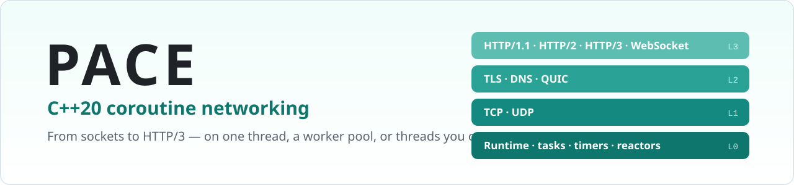
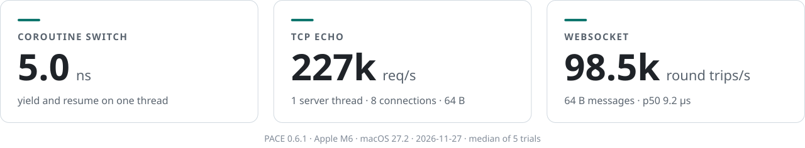
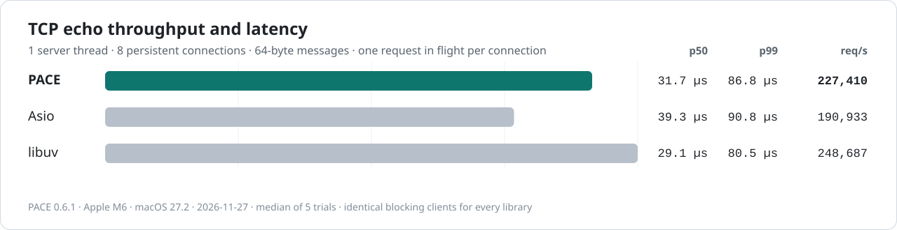

<!-- source-hash: 1320b975dbb6 -->
<p align="center">
  <picture>
    <source media="(prefers-color-scheme: dark)" srcset="docs/assets/readme/banner-dark.svg">
    
  </picture>
</p>

<p align="center">
  <a href="https://github.com/TabNahida/PACE/actions/workflows/ci.yml"></a>
  <a href="https://github.com/TabNahida/PACE/releases"></a>
  
  
  <a href="LICENSE"></a>
</p>

<p align="center"><a href="README.md">English</a> · 简体中文 · <a href="https://tabnahida.github.io/PACE/zh/">网站</a> · <a href="docs/README.zh.md">文档</a></p>

**PACE 是一个 C++20 协程网络库：TCP 与 UDP、TLS、DNS、QUIC、HTTP/1.1、HTTP/2、HTTP/3 和 WebSocket，
可以运行在单个线程、固定的工作线程池，或者由应用自己管理的线程上。**

<p align="center">
  <a href="docs/performance/README.zh.md">
    <picture>
      <source media="(prefers-color-scheme: dark)" srcset="docs/assets/readme/numbers-dark.svg">
      
    </picture>
  </a>
</p>

<p align="center">
  <a href="docs/performance/README.zh.md">
    <picture>
      <source media="(prefers-color-scheme: dark)" srcset="docs/assets/readme/tcp-echo-dark.svg">
      
    </picture>
  </a>
</p>

以上数据在 PACE 0.6.1 上测得：同一台 Apple M6 笔记本，同一次运行，各库使用相同的客户端。在这台机器上，TCP 回显
负载中 libuv 领先；在 Linux 上的 [0.5.0 测量](docs/performance/tcp.zh.md)中，PACE 吞吐量最高，Asio 尾延迟最低。
这些数字只描述这些负载在这些机器上的表现，不代表全面的优劣。[测量方法与原始数据 →](docs/performance/README.zh.md)

## 30 秒示例

<table>
<tr><th>客户端</th><th>服务端</th></tr>
<tr>
<td>

```cpp
#include <pace/http1.hpp>

#include <iostream>

int main()
{
    auto reply = pace::http::get("http://127.0.0.1:8080/hello");
    std::cout << reply.status << ' ' << reply.body;
}
```

</td>
<td>

```cpp
#include <pace/http1.hpp>

int main()
{
    pace::http::app app;
    app.get("/hello", [] { return pace::http::text("Hello from PACE\n"); });
    app.run(8080);
}
```

</td>
</tr>
</table>

客户端调用会阻塞当前线程，默认截止时间 30 秒，返回的响应自己持有全部数据；在协程里用
`co_await pace::http::async_get(url)` 可以得到同样的结果而不阻塞线程。服务端在调用线程上运行事件循环，直到被停止。
两者都只需链接一个 target：`add_deps("pace_http1")`。[一步步写出这两个程序 →](docs/tutorial/02-http-client.zh.md)

## 模块

只链接需要的部分。每个模块都有自己的伞头和 xmake target；`pace` 与 `<pace/pace.hpp>` 包含所有已启用的模块。

| 模块 | 头文件 | Target | 依赖 | 选项 | 当前实现 |
|:--|:--|:--|:--|:--|:--|
| [运行时](docs/reference/runtime/README.zh.md) | `<pace/runtime.hpp>` | `pace_runtime` | — | 始终 | PACE：任务、定时器、epoll / kqueue / IOCP / io_uring 反应器 |
| [网络](docs/reference/net/README.zh.md) | `<pace/net.hpp>` | `pace_net` | runtime | 始终 | PACE：TCP、UDP |
| [TLS](docs/reference/tls/README.zh.md) | `<pace/tls.hpp>` | `pace_tls` | net | `--tls=y` | OpenSSL 3 |
| [DNS](docs/reference/dns/README.zh.md) | `<pace/dns.hpp>` | `pace_dns` | net | `--dns=y` | c-ares |
| [QUIC](docs/reference/quic/README.zh.md) | `<pace/quic.hpp>` | `pace_quic` | net | `--quic=y` | ngtcp2 或 OpenSSL QUIC |
| [HTTP](docs/reference/http/README.zh.md) | `<pace/http.hpp>` | `pace_http` | runtime | 启用任一 HTTP 时 | PACE：消息、路由 |
| [HTTP/1.1](docs/reference/http1/README.zh.md) | `<pace/http1.hpp>` | `pace_http1` | net、http | 默认开启 | PACE |
| [HTTP/2](docs/reference/http2/README.zh.md) | `<pace/http2.hpp>` | `pace_http2` | net、http | `--http2=y` | nghttp2 |
| [HTTP/3](docs/reference/http3/README.zh.md) | `<pace/http3.hpp>` | `pace_http3` | quic、http | `--http3=y` | nghttp3 |
| [WebSocket](docs/reference/websocket/README.zh.md) | `<pace/websocket.hpp>` | `pace_websocket` | net | 默认开启 | PACE |
| [网关](docs/reference/gateway/README.zh.md) | `<pace/gateway.hpp>` | 在 `pace_http1` 中 | http1 | 随 HTTP/1.1 | PACE：静态文件、反向代理、缓存、负载均衡 |

**迈向 1.0：** TLS 1.2/1.3、QUIC、HTTP/2、HTTP/3 和 DNS 正在 PACE 内部重新实现，只从 OpenSSL 或 AWS-LC 取用
密码学原语。各模块的 API 按当前状态记录，每完成一项重写就同步更新。QUIC 与 HTTP/3 目前需要 POSIX 系统，详见
[平台支持](docs/reference/platform-support.zh.md)。

## 安装

需要 [xmake](https://xmake.io/) 和支持 C++20 的编译器；CI 实际测试的编译器与系统见
[平台支持](docs/reference/platform-support.zh.md)。把 PACE 加入工程（例如放在 `third_party/PACE`），然后依赖所需的模块：

```lua
set_languages("cxx20")
includes("third_party/PACE")

target("app")
    set_kind("binary")
    add_files("main.cpp")
    add_deps("pace_http1")
```

```sh
xmake f -m release -y                                     # HTTP/1.1 与 WebSocket，无第三方依赖
xmake f -m release --tls=y --dns=y --http2=y --http3=y -y # 全部协议；xmake 会获取 OpenSSL、c-ares 等
xmake -y
```

加上 `--modules=y` 即可使用 C++20 具名模块：`import pace;`，或按模块导入，例如 `import pace.runtime;` 和
`import pace.net;`。[构建选项 →](docs/reference/build-options.zh.md)

## 文档

| | |
|:--|:--|
| [教程](docs/tutorial/README.zh.md) | 从第一个程序到 HTTP/3 和网关，每章都有能运行的程序 |
| [指南](docs/guides/README.zh.md) | 针对具体任务的做法：调优、HTTP 配置 |
| [参考](docs/reference/README.zh.md) | 每个公开类型和函数，及其错误、线程与生命周期规则 |
| [设计说明](docs/explanation/README.zh.md) | 架构、执行模型、所有权与 API 设计 |
| [性能](docs/performance/README.zh.md) | 每一次测量的方法、原始数据与历史 |
| [迁移](docs/migration/README.zh.md) | 版本升级指南 |

同一套文档也发布在 [tabnahida.github.io/PACE](https://tabnahida.github.io/PACE/zh/)，提供中英文两个版本。

## 许可证

[MIT](LICENSE) · © 2026 Tab Nahida
