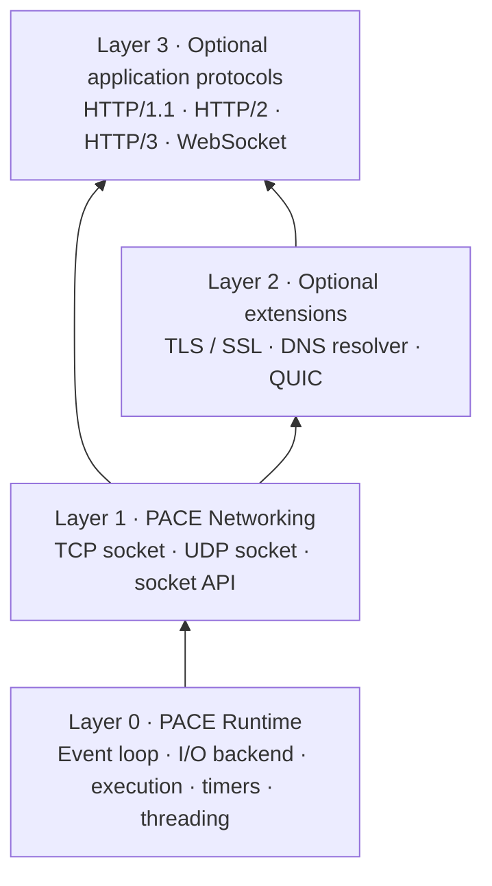
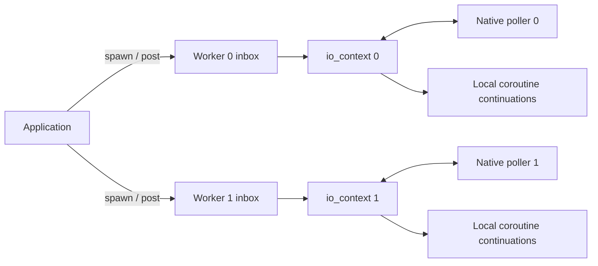

# Architecture and execution contract

PACE separates its coroutine runtime, sockets, base protocol extensions and application protocols into four layers. It is under active development; API and scheduling decisions may change as tests and measurements improve.

## Four independently linkable layers



| Layer | xmake targets | Implementation |
|---|---|---|
| 0, core | `pace_runtime` | `src/runtime/`: reactor, poller, execution, timers and worker runtime |
| 1, core | `pace_net` | `src/networking/`: TCP and UDP; depends only on runtime |
| 2, optional | `pace_tls`, `pace_dns`, `pace_quic`; aggregate `pace_extensions` | `src/extensions/` |
| 3, optional | `pace_http1`, `pace_http2`, `pace_http3`, `pace_websocket`; aggregate `pace_application` | `src/application/` |

`pace` is a compatibility aggregate target exporting the enabled modules. It no
longer produces one monolithic `libpace.a`: applications link the individual
static libraries through xmake's dependency graph. Existing `add_deps("pace")`
and public include paths remain supported. Narrow consumers can instead use
`add_deps("pace_net")` with `<pace/networking.hpp>`, or select an individual
protocol. `<pace/extensions.hpp>` and `<pace/application.hpp>` group the upper
layers. Public protocol headers remain at their existing paths.

HTTP/1 and WebSocket default on for source compatibility and can be disabled;
all third-party protocols default off. QUIC requires OpenSSL 3.5+ but does not
enable the TCP TLS module. HTTP/3 enables QUIC plus nghttp3, without depending on
HTTP/1 or HTTP/2. TLS uses OpenSSL, DNS uses c-ares, and HTTP/2 uses nghttp2.
QUIC/HTTP3 require POSIX; Windows builds reject these options until a native
transport adapter is implemented. See the [platform matrix](reference/platform.md).
`http_types.hpp` holds transport-independent HTTP messages and handlers, so
HTTP/2 and HTTP/3 do not depend on the HTTP/1 parser. Core networking has no
upward protocol dependencies. Buffer ownership remains explicit through spans,
views and owning message bodies; there is no separate buffer allocator module.

## One reactor per worker

`pace::io_context` owns a readiness poller, a ready queue, a timer heap, active coroutine roots, and socket wait registrations. Only one thread may execute a context's `run()` method. Coroutines submitted to that context resume on its running thread and do not migrate between contexts.

`pace::runtime` owns a fixed vector of contexts. `run()` creates one worker thread per context and joins all workers before returning. `run_on_current_thread()` instead runs context zero on the calling thread and creates N−1 workers; with one context it creates no worker. Both modes block, drain and join before returning, and share a single-use guard. The default count is the reported hardware concurrency, with a minimum of one; an explicit positive count overrides it. Access `runtime.context(index)` to choose where work is submitted. The runtime does not currently provide work stealing, automatic task balancing, or CPU affinity.

For applications with their own threading model, create independent contexts and run them on application-owned threads. A runtime is optional.



Cross-thread submissions enter a mutex-protected inbox. The first submission after a drain wakes the poller; further submissions share that notification. An atomic pending flag lets the reactor skip inbox allocation and locking when nothing arrived. Enqueue and the empty transition both occur under the inbox mutex, so the first producer after a drain cannot lose its wakeup. Work submitted from the same running context enters its local queues directly.

Ready coroutine and posted-function batches are bounded at 256 items so continuously ready application work still gives the loop opportunities to inspect timers, I/O, and shutdown. A task-only loop skips a zero-timeout native poll when it has no registered descriptors. It still checks inbox submissions and timers on every turn. Once a socket has a registration, normal readiness polling continues.

Optional [stage profiling](../benchmarks/profiling.md) and [component microbenchmarks](../benchmarks/components.md) separate operation cost from kernel waiting. Profiling is disabled by default and must remain disabled for comparative performance measurements.

## Readiness backends

| Target | I/O notification | Cross-thread wakeup |
|---|---|---|
| Linux | `epoll`, persistent level-triggered interests | Nonblocking `eventfd` |
| macOS / FreeBSD, 64-bit | `kqueue`, `EV_ONESHOT` read/write filters | `EVFILT_USER` |
| Windows | `WSAPoll` readiness array | Nonblocking UDP loopback sockets |

The internal poller emits a token with readable, writable, and error flags. On
Linux the reactor retains matching interests across successive coroutine waits,
then reconciles dirty subscriptions before its next poll. A resumed reader can
rearm without an `epoll_ctl` call; an actually idle direction is removed before
polling to avoid spinning on stale readiness. Standalone poller users retain the
one-shot default. On kqueue and Windows event delivery disarms the descriptor
and the reactor rearms remaining waiters. For kqueue, separate read/write events
are merged and any undelivered counterpart is disarmed. Wakeups are internal.

Socket registrations have tokens independent of the native socket handle, allowing the reactor to discard stale deliveries after cancellation and handle reuse. `UINT64_MAX` is reserved for the internal wakeup token. Windows handles retain their native pointer width.

Windows currently uses a correctness-first readiness baseline. WSAPoll scans its array and is not an IOCP completion backend; platform support alone does not imply equivalent scaling or performance. Linux and kqueue performance also require workload-specific measurement.

## Tasks and object ownership

`pace::task<T>` is a lazy, move-only, single-consumer coroutine. Creating a task constructs its coroutine state but does not execute the function body. `io_context::spawn(task<void>)` transfers a root task to the context. Awaiting a child task transfers ownership into its awaiter; final suspension resumes its parent through coroutine transfer.

```cpp
// Both forms consume one task exactly once.
co_await stream.write_all(message);
auto pending = stream.read_some(buffer);
const auto count = co_await std::move(pending);
```

An lvalue task is intentionally not awaitable. A task object that still owns its state destroys that state when destroyed. Root-task ownership belongs to the context until completion. Task exceptions propagate through `co_await`; an unhandled root task or posted-function exception initiates context shutdown, and `run()` rethrows the recorded exception after draining. A runtime propagates worker failure after requesting all other contexts to stop and joining its workers.

The coroutine frame does not automatically own every object referenced by the coroutine:

- Keep a socket or listener alive until every operation using it has finished. Moving a socket while an operation on that object is suspended is not supported.
- Keep memory referenced by `std::span` and `std::string_view` valid throughout the awaited operation. A string literal is safe; a temporary owning string whose lifetime ends before the lazy task runs is not.
- Keep the context alive until all sockets and listeners using it have been destroyed.
- A coroutine lambda accesses captures through its closure object. That closure must outlive the coroutine; immediately invoking a temporary capturing coroutine lambda is unsafe. Prefer named coroutine functions with owned values passed as parameters, or explicitly maintain the callable's lifetime.

HTTP handler functions are stored by value in the serving tasks. Shared state reachable from handlers still belongs to the application and requires synchronization if used from different worker contexts.

## Thread affinity and concurrency

`spawn()`, `post()`, and `stop()` are thread-safe entry points. Socket operations, explicit cancellation, socket closure, and timer/yield awaiting belong to the owning context. Creation and setup may be performed before that context starts; object cleanup may also occur after its run thread has joined.

One read waiter and one write waiter can be outstanding per socket simultaneously. A second waiter in the same direction is rejected. Accepting a connection is a read-side operation on its listener. Use `post()` to request socket manipulation from a different thread; do not close a live socket concurrently with its reactor.

Cooperative scheduling means a coroutine runs until it suspends or finishes. `co_await io.yield()` schedules another turn, and `co_await io.sleep_for(duration)` uses a steady-clock timer. An expired or zero-duration sleep still yields. Blocking calls and long CPU computations delay every coroutine assigned to that worker. There is no built-in blocking-work executor yet.

## Stopping a context

Contexts keep running when idle. Call `stop()` explicitly; it is safe from another thread and wakes a blocked poller. The reactor cancels registered socket waits and timers with `std::errc::operation_canceled`, then resumes queued work so coroutine frames and resources can unwind. Awaiting I/O or yielding after shutdown also observes cancellation. New submissions after stop are rejected.

A context is single-use: `run()` cannot be called concurrently, nested inside another running PACE context on the same thread, or restarted after it returns. Destruction does not join an externally owned run thread. Stop the context, join that thread, then destroy sockets/listeners and finally the context. `runtime.run()` and `runtime.run_on_current_thread()` perform worker joins before returning. Caller mode cannot be nested inside another running PACE context.

`tcp::stream::close()` cancels its registered read/write operations before releasing the native socket. Destroying the socket object itself while a suspended member operation still refers to it is invalid: close it on its loop, allow the operation to resume and complete, then destroy the object. A listener passed to `http::serve()` must outlive that serving task and its accepted connections. Stopping the owning context cancels both accept and accepted-connection waits.

Stop is cooperative, not a forced thread interruption. An application coroutine that never suspends or returns, or application code blocked in a synchronous call, can prevent shutdown from completing. Per-operation stop tokens and deadlines are not implemented.

## TCP and HTTP

The canonical TCP header is `<pace/tcp.hpp>`. It declares `pace::tcp::listener`, `pace::tcp::stream`, `pace::tcp::endpoint`, and `pace::tcp::listen_options`; `endpoint` currently represents a numeric IPv4 address and port. `<pace/net.hpp>` forwards to this header and retains the original top-level names as source compatibility aliases. The umbrella `<pace/pace.hpp>` also retains those aliases.

TCP uses nonblocking numeric IPv4 sockets. Operations first attempt the native call; when it would block, they await the relevant readiness event and retry. `write_all()` retains its input view until the complete buffer has been sent. Socket errors use `std::system_error`. Linux sends suppress `SIGPIPE` per operation; platforms with `SO_NOSIGPIPE` configure it on the socket.
After a short TCP read, the next nonempty read waits for level readiness before
retrying `recv`, avoiding the common redundant EAGAIN call. This is a hint,
not an EOF decision: queued data, new arrivals and peer shutdown are still
reported by the poller and verified with `recv`. Full-buffer reads keep the
immediate-read path; the hint follows move operations.

`co_await stream.close_gracefully()` half-closes the send side, then drains peer input until EOF, a 100 ms deadline, or 64 KiB of discarded data. Both bounds are configurable. A cancellable timer avoids blocking the reactor while waiting for the peer. The operation always releases the socket, including on cancellation or error, and requires that no other socket operation is outstanding. HTTP uses this bounded close after its final response so unread rejected-request bytes do not immediately reset the connection. Reaching either bound can still terminate a noncooperating peer before an orderly close; this is a shutdown bound, not a request timeout.

The multithreaded echo and HTTP examples create one listener per worker on the same port using `SO_REUSEPORT` where available. This lets the operating system distribute incoming connections. The current Windows implementation does not provide this listener-sharing strategy; those examples require one worker on Windows. Separate ports and outbound connections can still use multiple Windows contexts.

The HTTP/1 layer supports clients and servers, Content-Length and chunked framing, trailers, and sequential persistent connections. Default limits are 16 KiB of request headers, 1 MiB of request body, and 1,000 requests per connection; field counts, trailers and chunk metadata have separate bounds. Framing headers are generated by the library. Bodies are buffered. See the [HTTP reference](reference/http.md) for validation and response semantics.

[UDP](reference/udp.md) preserves datagram boundaries and reports source addresses and truncation. [TLS](reference/tls.md) uses optional OpenSSL with certificate-chain and hostname verification, SNI and ALPN. Its initial stream API permits one outstanding async operation total, including read versus write. It uses a custom socket BIO to preserve Windows handle width and suppress SIGPIPE on supported platforms.

[HTTP/2](reference/http2.md) uses optional nghttp2 for framing, HPACK and flow control. The client owns one connection for a batch of multiplexed requests; the server buffers bounded stream bodies and invokes completed handlers sequentially per connection. [WebSocket](reference/websocket.md) handles HTTP upgrades on its own owned transport, then validates masking, fragmentation, UTF-8 and control frames. The HTTP/1 parser does not transfer its buffered transport into another protocol.

[DNS](reference/dns.md) integrates c-ares with readiness and timers. It resolves
A/AAAA and CNAME records without a blocking network lookup thread.
[QUIC](reference/quic.md) uses OpenSSL's native QUIC/TLS 1.3 implementation over
UDP and exposes bidirectional/unidirectional streams. [HTTP/3](reference/http3.md)
uses nghttp3 for HTTP framing and QPACK over those streams. These protocols are
optional and are tested against local peers.

CONNECT tunneling, streaming HTTP bodies, IPv6 transport and asynchronous file
operations are not exposed. Header/body limits bound individual message parsing;
they do not generally bound connection lifetimes. Each protocol reference states
its deadlines, ownership and concurrency limits.

## Measurement and validation

The first benchmark measures one server reactor under a closed-loop localhost TCP echo workload. PACE and Asio use coroutines; libuv uses callbacks. Payloads and completed-request counts are validated, runs are repeated in rotating backend order, and every raw result is preserved. See the [benchmark methodology](../benchmarks/README.md) for timing boundaries, limitations, and reproducible commands.

This workload does not establish HTTP performance, multiworker scalability, open-loop tail latency, or general superiority over another library. CI runs functional builds on Linux, macOS, and Windows, plus a FreeBSD VM, and preserves correctness-check artifacts. Published performance measurements come from local Linux. Current [workflow results](https://github.com/TabNahida/PACE/actions/workflows/ci.yml), tests, and evidence files determine what has actually been validated.

The separate [worker/execution scaling study](../benchmarks/scaling.md) keeps total clients fixed, balances them across one listening port per context, and compares runtime-managed threads, caller participation and application-owned threads. Startup, warmup, steady state and shutdown have separate timing windows. [Complete performance results](performance.md) include the README chart's unselected comparisons and negative findings.
