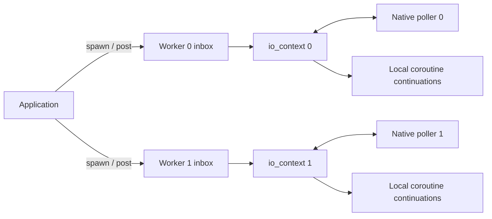

# Architecture and execution contract

PACE currently provides a coroutine networking runtime, TCP sockets, and an HTTP/1.0–1.1 server layer. The implementation is an early prototype; API and scheduling decisions may change as tests and measurements improve.

## One reactor per worker

`pace::io_context` owns a readiness poller, a ready queue, a timer heap, active coroutine roots, and socket wait registrations. Only one thread may execute a context's `run()` method. Coroutines submitted to that context resume on its running thread and do not migrate between contexts.

`pace::runtime` owns a fixed vector of contexts. `run()` creates one worker thread per context and joins all workers before returning. The default count is the reported hardware concurrency, with a minimum of one; an explicit positive count overrides it. Access `runtime.context(index)` to choose where work is submitted. The runtime does not currently provide work stealing, automatic task balancing, or CPU affinity.

For applications with their own threading model, create independent contexts and run them on application-owned threads. A runtime is optional.



Cross-thread submissions enter a mutex-protected inbox and wake the poller. The reactor drains submissions into its local queues. Work submitted from the same running context can enter those queues directly. Ready coroutine and posted-function batches are bounded so continuously ready application work still gives the event loop opportunities to inspect timers, I/O, and shutdown.

## Readiness backends

| Target | I/O notification | Cross-thread wakeup |
|---|---|---|
| Linux | `epoll`, persistent registration with `EPOLLONESHOT` | Nonblocking `eventfd` |
| macOS / FreeBSD, 64-bit | `kqueue`, `EV_ONESHOT` read/write filters | `EVFILT_USER` |
| Windows | `WSAPoll` readiness array | Nonblocking UDP loopback sockets |

The internal poller emits a token with readable, writable, and error flags. Event delivery disarms the whole descriptor; the reactor rearms any remaining waiter. For kqueue, read and write filters may produce separate native events, so the adapter merges them and disarms any undelivered counterpart. Windows removes delivered registrations from its active polling array. Wakeup events are consumed internally.

Socket registrations have tokens independent of the native socket handle, allowing the reactor to discard stale deliveries after cancellation and handle reuse. `UINT64_MAX` is reserved for the internal wakeup token. Windows handles retain their native pointer width.

Windows currently uses a correctness-first readiness baseline. WSAPoll scans its array and is not an IOCP completion backend; platform support alone does not imply equivalent scaling or performance. Linux and kqueue performance also require workload-specific measurement.

## Tasks and object ownership

`pace::task<T>` is a lazy, move-only, single-consumer coroutine. Creating a task constructs its coroutine state but does not execute the function body. `io_context::spawn(task<void>)` transfers a root task to the context. Awaiting a child task transfers ownership into its awaiter; final suspension resumes its parent through coroutine transfer.

```cpp
// Both forms consume one task exactly once.
co_await stream.write_all(message);
auto pending = stream.read_some(buffer);
const auto count = co_await std::move(pending);
```

An lvalue task is intentionally not awaitable. A task object that still owns its state destroys that state when destroyed. Root-task ownership belongs to the context until completion. Task exceptions propagate through `co_await`; an unhandled root task or posted-function exception initiates context shutdown, and `run()` rethrows the recorded exception after draining. A runtime propagates worker failure after requesting all other contexts to stop and joining its workers.

The coroutine frame does not automatically own every object referenced by the coroutine:

- Keep a socket or listener alive until every operation using it has finished. Moving a socket while an operation on that object is suspended is not supported.
- Keep memory referenced by `std::span` and `std::string_view` valid throughout the awaited operation. A string literal is safe; a temporary owning string whose lifetime ends before the lazy task runs is not.
- Keep the context alive until all sockets and listeners using it have been destroyed.
- A coroutine lambda accesses captures through its closure object. That closure must outlive the coroutine; immediately invoking a temporary capturing coroutine lambda is unsafe. Prefer named coroutine functions with owned values passed as parameters, or explicitly maintain the callable's lifetime.

HTTP handler functions are stored by value in the serving tasks. Shared state reachable from handlers still belongs to the application and requires synchronization if used from different worker contexts.

## Thread affinity and concurrency

`spawn()`, `post()`, and `stop()` are thread-safe entry points. Socket operations, explicit cancellation, socket closure, and timer/yield awaiting belong to the owning context. Creation and setup may be performed before that context starts; object cleanup may also occur after its run thread has joined.

One read waiter and one write waiter can be outstanding per socket simultaneously. A second waiter in the same direction is rejected. Accepting a connection is a read-side operation on its listener. Use `post()` to request socket manipulation from a different thread; do not close a live socket concurrently with its reactor.

Cooperative scheduling means a coroutine runs until it suspends or finishes. `co_await io.yield()` schedules another turn, and `co_await io.sleep_for(duration)` uses a steady-clock timer. An expired or zero-duration sleep still yields. Blocking calls and long CPU computations delay every coroutine assigned to that worker. There is no built-in blocking-work executor yet.

## Stopping a context

Contexts keep running when idle. Call `stop()` explicitly; it is safe from another thread and wakes a blocked poller. The reactor cancels registered socket waits and timers with `std::errc::operation_canceled`, then resumes queued work so coroutine frames and resources can unwind. Awaiting I/O or yielding after shutdown also observes cancellation. New submissions after stop are rejected.

A context is single-use: `run()` cannot be called concurrently, nested inside another running PACE context on the same thread, or restarted after it returns. Destruction does not join an externally owned run thread. Stop the context, join that thread, then destroy sockets/listeners and finally the context. `runtime.run()` performs the worker joins before returning.

`tcp_stream::close()` cancels its registered read/write operations before releasing the native socket. Destroying the socket object itself while a suspended member operation still refers to it is invalid: close it on its loop, allow the operation to resume and complete, then destroy the object. A listener passed to `http::serve()` must outlive that serving task and its accepted connections. Stopping the owning context cancels both accept and accepted-connection waits.

Stop is cooperative, not a forced thread interruption. An application coroutine that never suspends or returns, or application code blocked in a synchronous call, can prevent shutdown from completing. Per-operation stop tokens and deadlines are not implemented.

## TCP and HTTP

TCP uses nonblocking numeric IPv4 sockets. Operations first attempt the native call; when it would block, they await the relevant readiness event and retry. `write_all()` retains its input view until the complete buffer has been sent. Socket errors use `std::system_error`. Linux sends suppress `SIGPIPE` per operation; platforms with `SO_NOSIGPIPE` configure it on the socket.

`co_await stream.close_gracefully()` half-closes the send side, then drains peer input until EOF, a 100 ms deadline, or 64 KiB of discarded data. Both bounds are configurable. A cancellable timer avoids blocking the reactor while waiting for the peer. The operation always releases the socket, including on cancellation or error, and requires that no other socket operation is outstanding. HTTP uses this bounded close after its final response so unread rejected-request bytes do not immediately reset the connection. Reaching either bound can still terminate a noncooperating peer before an orderly close; this is a shutdown bound, not a request timeout.

The multithreaded echo and HTTP examples create one listener per worker on the same port using `SO_REUSEPORT` where available. This lets the operating system distribute incoming connections. The current Windows implementation does not provide this listener-sharing strategy; those examples require one worker on Windows. Separate ports and outbound connections can still use multiple Windows contexts.

The HTTP layer parses HTTP/1.0 and HTTP/1.1, uses Content-Length framing, and serves persistent connections sequentially. Default limits are 16 KiB of request headers, 1 MiB of request body, and 1,000 requests per connection; applications can pass a `pace::http::limits` value. Response framing headers are generated by the library and must not be supplied as custom headers.

TLS, chunked encoding, HTTP/2, protocol upgrades, CONNECT tunneling, streaming bodies, and request timeouts are absent. Header/body limits bound individual message parsing; they do not bound connection lifetimes or provide a complete resource policy for untrusted deployments. DNS, IPv6, and asynchronous file operations are also future work.

## Measurement and validation

The first benchmark measures one server reactor under a closed-loop localhost TCP echo workload. PACE and Asio use coroutines; libuv uses callbacks. Payloads and completed-request counts are validated, runs are repeated in rotating backend order, and every raw result is preserved. See the [benchmark methodology](../benchmarks/README.md) for timing boundaries, limitations, and reproducible commands.

This workload does not establish HTTP performance, multiworker scalability, open-loop tail latency, or general superiority over another library. CI is configured to run native builds on Linux, macOS, and Windows, plus a FreeBSD VM, and to preserve benchmark artifacts. Current [workflow results](https://github.com/TabNahida/PACE/actions/workflows/ci.yml), tests, and evidence files determine what has actually been validated.
