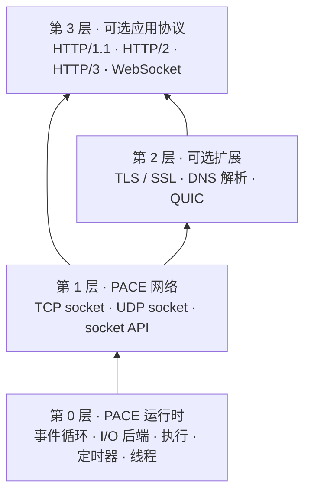
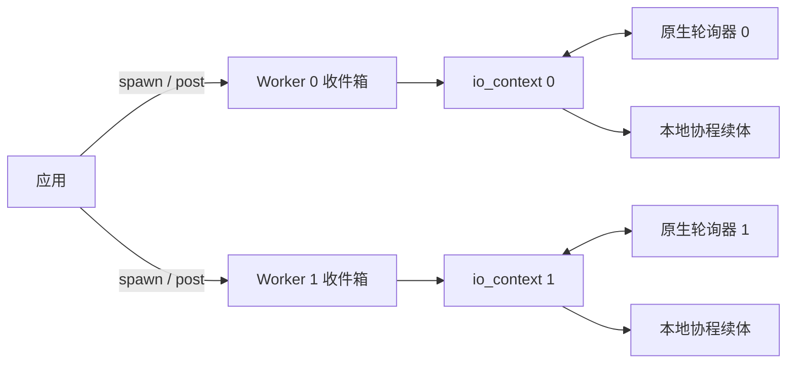

<!-- source-hash: f36fbfd887dc -->
# 架构与执行契约

[English](architecture.md) · [原理阐释](README.zh.md)

PACE 把协程运行时、socket、基础协议扩展和应用协议分成四层，每层由可以独立链接的模块组成。本页说明这些模块
如何组合、反应器如何运行任务，以及由此设计得出的所有权和线程规则。[执行模型](execution-model.zh.md)和
[所有权](ownership.zh.md)两页对后两点有更深入的讨论。

## 四个可独立链接的层



| 层 | 模块 | 总头文件 | xmake 目标 | 构建选项 |
|---|---|---|---|---|
| 0，核心 | runtime | `<pace/runtime.hpp>` | `pace_runtime` | 始终构建 |
| 1，核心 | net | `<pace/net.hpp>` | `pace_net` | 始终构建 |
| 2，可选 | tls、dns、quic | `<pace/tls.hpp>`、`<pace/dns.hpp>`、`<pace/quic.hpp>` | `pace_tls`、`pace_dns`、`pace_quic` | `--tls=y`、`--dns=y`、`--quic=y` |
| 3 | http | `<pace/http.hpp>` | `pace_http`（仅头文件） | 始终构建 |
| 3，默认开启 | http1、gateway | `<pace/http1.hpp>`、`<pace/gateway.hpp>` | `pace_http1` | `--http1=y` |
| 3，可选 | http2、http3 | `<pace/http2.hpp>`、`<pace/http3.hpp>` | `pace_http2`、`pace_http3` | `--http2=y`、`--http3=y` |
| 3，默认开启 | websocket | `<pace/websocket.hpp>` | `pace_websocket` | `--websocket=y` |

所有模块的布局相同。公开头文件位于 `include/pace/<module>/`，另有一个总头文件 `<pace/<module>.hpp>` 包含全部
内容；实现只从 `src/<module>/` 编译；模块的 xmake 目标只安装自己的头文件，只链接自己依赖的模块，因此
`xmake build pace_tls` 只构建运行时、网络和 TLS。只供实现使用的头文件放在实现旁边的 `src/<module>/` 中，
既不安装，也不属于 API；公开头文件中没有 `detail` 命名空间或目录。`<pace/pace.hpp>` 包含本次构建启用的全部
模块，仅头文件的目标 `pace` 链接全部模块并安装 `<pace/pace.hpp>`。它不会生成一个整体的 `libpace.a`：应用通过 xmake 的依赖图链接各个静态库。
只需要一部分功能的使用者可以写 `add_deps("pace_net")` 并包含 `<pace/net.hpp>`。

`pace_http` 包含 HTTP/1、HTTP/2 和 HTTP/3 共用的部分：`<pace/http/types.hpp>` 中的消息类型，以及
`<pace/http/router.hpp>` 中的 router 和 handler 适配器。因此 HTTP/2 和 HTTP/3 不依赖 HTTP/1 解析器。
HTTP/1 模块（`<pace/http1/protocol.hpp>`）包含 HTTP/1 的客户端和服务端、URL 客户端调用 `fetch`/`get`/`post`
及其 `async_*` 形式，以及小巧的 `http::app`。网关服务（`<pace/gateway.hpp>`：静态文件、反向代理、响应缓存）
目前编译在 `pace_http1` 中，因为 `http::app` 的 `mount()` 和 `proxy()` 会调用它们，而反向代理使用 HTTP/1 客户端。

HTTP/1 和 WebSocket 默认开启，可以关闭；所有需要第三方库的模块默认关闭。TLS 使用 OpenSSL，DNS 使用 c-ares，
HTTP/2 使用 nghttp2，HTTP/3 在 QUIC 模块之上使用 nghttp3。QUIC 默认使用 ngtcp2 加 OpenSSL；
`--quic_backend=openssl` 改用 OpenSSL 原生 QUIC。两种 QUIC 后端都不依赖 TCP 上的 TLS 模块，HTTP/3 也既不依赖
HTTP/1，也不依赖 HTTP/2。QUIC 和 HTTP/3 需要 POSIX；Windows 构建会拒绝这些选项。参见
[平台矩阵](../reference/platform-support.zh.md)和[构建选项](../reference/build-options.zh.md)。
核心网络层不依赖任何上层协议。缓冲区所有权通过 span、视图和持有数据的消息 body 明确表达；没有单独的缓冲区
分配器模块。

使用 `--modules=y` 时，每个模块同时也是一个 C++20 命名模块（`import pace.runtime;`、`import pace.net;`、
`import pace.http;`、`import pace.http1;`、`import pace.gateway;`、`import pace.tls;` 等），构建在 `pace_module`
目标中。每个命名模块只导出自己的名字，所以导入 `pace.net` 的代码还要导入 `pace.runtime`；`import pace;` 导入全部。
模块接口由 `modules/exports.json` 生成，重新导出头文件中的同一批声明，因此使用头文件和使用模块的代码共享同一个
ABI，可以在同一个程序中混用。即使某个模块的库被禁用，对应的命名模块仍然存在，只是不导出任何名字。

## 每个 worker 一个反应器

`pace::io_context` 持有一个就绪轮询器、一个就绪队列、一个定时器堆、活动的协程根任务以及 socket 等待注册。
同一时间只能有一个线程执行某个上下文的 `run()`。提交到该上下文的协程在它的运行线程上恢复，不会在上下文之间迁移。

`pace::runtime` 持有一组数量固定的上下文。`run()` 为每个上下文创建一个 worker 线程，并在返回前 join 所有 worker。
`run_on_current_thread()` 则在调用线程上运行 0 号上下文，另建 N−1 个 worker；只有一个上下文时不创建 worker。
两种方式都会阻塞、排空并 join 后才返回，并共用同一个“只能运行一次”的保护。默认数量是系统报告的硬件并发数，
至少为 1；显式给出的正数会覆盖它。通过 `runtime.context(index)` 选择把任务提交到哪里。runtime 不提供工作窃取、
自动任务均衡或 CPU 亲和性。

有自己线程模型的应用，可以创建独立的上下文，在应用自己的线程上运行它们。runtime 是可选的。



跨线程提交的工作进入一个由互斥锁保护的收件箱。排空之后的第一次提交会唤醒轮询器，后续提交共用这次通知。
一个原子的 pending 标志让反应器在没有新提交时跳过收件箱的分配和加锁。入队和“变为空”的转换都在收件箱互斥锁下
进行，所以排空后的第一个生产者不会丢失唤醒。从同一个正在运行的上下文提交的工作直接进入其本地队列。

就绪协程和投递函数的批次以 256 项为上限，这样即使应用工作持续就绪，循环也有机会检查定时器、I/O 和关闭。
只有任务的循环在没有注册任何描述符时会跳过零超时的原生轮询，但每一轮仍会检查收件箱和定时器。
一旦某个 socket 有了注册，就恢复正常的就绪轮询。

可选的[阶段 profiling](../../benchmarks/profiling.md)（`--profiling=y`）和[组件微基准](../../benchmarks/components.md)
把操作本身的开销与内核等待分开。profiling 默认关闭，做性能对比测量时必须保持关闭。

## 就绪通知后端

| 目标平台 | I/O 通知 | 跨线程唤醒 |
|---|---|---|
| Linux | `epoll`，持久的水平触发兴趣 | 非阻塞 `eventfd` |
| macOS / FreeBSD，64 位 | `kqueue`，`EV_ONESHOT` 读/写过滤器 | `EVFILT_USER` |
| Windows 64 位，build 20348+ | IOCP socket 状态通知 | `PostQueuedCompletionStatus` |
| Windows 兼容路径 / x86 | `WSAPoll` 就绪数组 | 非阻塞 UDP 回环 socket |
| Linux 可选 `--uring=y` | io_uring 一次性 poll | 非阻塞 `eventfd` |

内部轮询器产生带有可读、可写和错误标志的令牌。在 Linux 上，反应器在相继的协程等待之间保留匹配的兴趣，
并在下一次轮询前调和有变化的订阅。恢复后的读者可以不调用 `epoll_ctl` 就重新等待；真正空闲的方向会在轮询前移除，
避免在过时的就绪状态上空转。单独使用轮询器时仍保持一次性的默认行为。在 kqueue 和 Windows 上，事件投递会解除
描述符的监听，由反应器为剩余的等待者重新注册。对 kqueue，分开的读、写事件会被合并，未投递的另一方向会被解除。
唤醒是内部机制。

socket 注册使用与原生 socket 句柄无关的令牌，反应器因此能在取消和句柄复用之后丢弃过时的投递。`UINT64_MAX`
保留给内部唤醒令牌。Windows 句柄保持其原生的指针宽度。

[可选择的后端](../reference/runtime/io-backends.zh.md)（`pace::io_backend`，按上下文或按 runtime 选择）包括 IOCP
socket 通知和可选的 io_uring 轮询。读写仍使用非阻塞 socket 调用；这些路径不会提交重叠 I/O 或直接的 io_uring
数据传输。WSAPoll 仍是 Windows 的兼容路径。性能取决于具体负载。

## 任务与对象所有权

`pace::task<T>` 是惰性的、只能移动的、单一消费者的协程。创建任务会构造其协程状态，但不执行函数体。
`io_context::spawn(task<void>)` 把一个根任务交给上下文。await 子任务时，所有权转移到其 awaiter；
子任务在最终挂起点通过协程转移恢复父任务。

```cpp
// 两种写法都恰好消费一个任务一次。
co_await stream.write_all(message);
auto pending = stream.read_some(buffer);
const auto count = co_await std::move(pending);
```

左值任务有意设计为不可 await。仍持有状态的任务对象在销毁时销毁该状态。根任务在完成之前归上下文所有。
任务异常经由 `co_await` 传播；根任务或投递函数中未处理的异常会触发上下文关闭，`run()` 在排空后重新抛出记录下的
异常。runtime 在请求其他所有上下文停止并 join 其 worker 之后，传播 worker 的失败。

协程帧并不会自动持有协程引用的每个对象：

- 在所有使用 socket 或 listener 的操作结束之前，保持它们存活。不支持在该对象上有操作挂起时移动 socket。
- `std::span` 和 `std::string_view` 引用的内存，在被 await 的操作期间必须一直有效。字符串字面量是安全的；
  在惰性任务开始运行前就结束生命周期的临时字符串则不安全。
- 在所有使用该上下文的 socket 和 listener 销毁之前，保持上下文存活。
- 协程 lambda 通过闭包对象访问捕获。闭包必须比协程活得更久；立即调用一个带捕获的临时协程 lambda 是不安全的。
  优先使用具名协程函数，并把持有数据的值作为参数传入，或者显式维护可调用对象的生命周期。`pace::run(factory)`
  在关闭之前一直持有传给它的 factory，因此在那里使用带捕获的协程 lambda 是安全的。

HTTP handler 函数按值保存在提供服务的任务中。handler 能访问到的共享状态仍归应用所有；如果在不同 worker 上下文中
使用，需要同步。

## 线程亲和性与并发

`spawn()`、`post()` 和 `stop()` 是线程安全的入口。socket 操作、显式取消、关闭 socket 以及等待定时器或 yield，
都属于所属的上下文。创建和设置可以在该上下文启动之前进行；对象清理也可以在其运行线程 join 之后进行。

每个 socket 可以同时有一个读等待者和一个写等待者。同一方向的第二个等待者会被拒绝。接受连接是 listener 上的
读方向操作。需要从其他线程操作 socket 时，用 `post()` 发出请求；不要在反应器运行的同时并发关闭一个活动的 socket。

协作式调度意味着协程一直运行到挂起或结束。`co_await io.yield()` 让出一轮，`co_await io.sleep_for(duration)`
使用 steady clock 定时器。已到期或零时长的 sleep 仍会让出。阻塞调用和长时间的 CPU 计算会延迟该 worker 上的所有
协程。没有内置的阻塞任务执行器；请把这类工作放在应用自己的线程上运行。

## 停止上下文

上下文空闲时也会继续运行。需要显式调用 `stop()`；它可以从其他线程安全调用，并会唤醒阻塞中的轮询器。反应器以
`std::errc::operation_canceled` 取消已注册的 socket 等待和定时器，然后恢复排队的工作，让协程帧和资源得以展开。
关闭之后再 await I/O 或 yield，同样会观察到取消。stop 之后的新提交会被拒绝。

上下文只能使用一次：`run()` 不能并发调用，不能嵌套在同一线程上另一个正在运行的 PACE 上下文中，返回后也不能
重新启动。析构不会 join 外部持有的运行线程。正确的顺序是：停止上下文，join 那个线程，销毁 socket 和 listener，
最后销毁上下文。`runtime.run()` 和 `runtime.run_on_current_thread()` 在返回前会 join worker。调用者参与模式不能
嵌套在另一个正在运行的 PACE 上下文中。

`tcp::stream::close()` 在释放原生 socket 之前，先取消其已注册的读写操作。在挂起的成员操作仍引用 socket 对象时
销毁它是无效的：应在其循环上关闭它，让操作恢复并完成，然后再销毁对象。传给 `http::serve()` 的 listener 必须比
该服务任务及其接受的连接活得更久。停止所属的上下文会同时取消 accept 和已接受连接上的等待。

stop 是协作式的，不是强制中断线程。从不挂起也不返回的应用协程，或阻塞在同步调用中的应用代码，都可能让关闭无法
完成。局部取消令牌会沿着被 await 的任务和结构化子任务传播；
[操作边界](../reference/runtime/structured-concurrency.zh.md)会组合出最早的截止时间，而不会停止无关的工作。
带作用域的回调定时器支持在完成时取消；HTTP/1 服务端可以设置接收和写入期限。

## TCP 与 HTTP

TCP 头文件是 `<pace/net/tcp.hpp>`，由 `<pace/net.hpp>` 包含。它声明了 `pace::tcp::listener`、`pace::tcp::stream`、
`pace::tcp::endpoint` 和 `pace::tcp::listen_options`；`endpoint` 表示数字形式的 IPv4/IPv6 地址、端口、地址族
以及可选的数字 IPv6 scope。

TCP 使用非阻塞的数字 IPv4/IPv6 socket。IPv6 listener 默认只接受 IPv6；应用需要显式选择双栈绑定。操作先尝试
原生调用；会阻塞时，就等待相应的就绪事件后重试。`write_all()` 在整个缓冲区发送完之前一直借用其输入视图。
socket 错误以 `std::system_error` 报告。Linux 在每次发送时抑制 `SIGPIPE`；支持 `SO_NOSIGPIPE` 的平台在 socket
上设置该选项。
一次短读之后，下一次非空读取会先等待水平就绪再重试 `recv`，省去常见的多余 EAGAIN 调用。这只是一个提示，
不是对 EOF 的判断：已排队的数据、新到达的数据和对端关闭仍由轮询器报告并经 `recv` 确认。读满缓冲区的读取
保留立即读取的路径；这个提示会随移动操作一起转移。

`co_await stream.close_gracefully()` 先半关闭发送方向，然后排空对端输入，直到遇到 EOF、100 ms 期限或丢弃了
64 KiB 数据为止。两个上限都可以配置。等待对端时使用可取消的定时器，不会阻塞反应器。该操作总会释放 socket，
包括被取消或出错时，并要求没有其他 socket 操作未完成。HTTP 在发送最终响应后使用这种有界关闭，避免未读取的
被拒请求字节立即导致连接被重置。达到任一上限时，仍可能在有序关闭之前终止不配合的对端；这是关闭阶段的上限，
不是请求超时。

多线程的 echo 和 HTTP 示例在支持的平台上使用 `SO_REUSEPORT`，为每个 worker 在同一端口上创建一个 listener，
由操作系统分配新连接。Windows 实现不提供这种共享 listener 的做法；这些示例在 Windows 上要求只用一个 worker。
使用不同端口或发起出站连接时，Windows 上仍可使用多个上下文。

HTTP/1 模块支持客户端和服务端、Content-Length 与 chunked 分帧、trailer，以及顺序复用的持久连接。默认限额为请求头
16 KiB、请求 body 1 MiB、每个连接 1,000 个请求；字段数量、trailer 和 chunk 元数据另有上限。分帧相关的头字段由库生成。
基本 API 会缓冲 body；可选的请求头准入在上传之前为每个请求选择 body 上限，持有数据的响应 source 通过有界缓冲区
流式发送，并带有背压。验证和响应语义见 [HTTP/1 参考](../reference/http1/README.zh.md)。

[UDP](../reference/net/udp.zh.md) 保留数据报边界，并报告来源地址和截断情况。[TLS](../reference/tls/README.zh.md)
使用可选的 OpenSSL，提供证书链和主机名验证、SNI 与 ALPN。一个 TLS stream 总共只允许一个未完成的异步操作，
读和写也算在一起。OpenSSL 通过一个构建在 PACE 自身传输之上的自定义 BIO 读写，从不直接接触 socket；这样能保持
Windows 句柄宽度，并在支持的平台上抑制 SIGPIPE。

[HTTP/2](../reference/http2/README.zh.md) 使用可选的 nghttp2 处理分帧、HPACK 和流控。客户端为一批多路复用的请求
持有一个连接。服务端在限额内缓冲各个流的 body；一个 driver 持有会话和传输，收齐的请求被分派给并发运行的 handler，
并发数最多为 `max_concurrent_handlers`。[WebSocket](../reference/websocket/README.zh.md) 在自己持有的传输上处理
HTTP 升级，然后验证掩码、分片、UTF-8 和控制帧。HTTP/1 解析器不会把自己已缓冲的传输转交给其他协议。

[DNS](../reference/dns/README.zh.md) 把 c-ares 接入就绪通知和定时器。它解析 A/AAAA 和 CNAME 记录，
不需要阻塞的网络查询线程。
[QUIC](../reference/quic/README.zh.md) 在 UDP 上提供双向流和单向流。默认传输是 ngtcp2 加 OpenSSL 提供的 TLS 1.3，
也可以使用 OpenSSL 原生 QUIC。[HTTP/3](../reference/http3/README.zh.md) 在这些流之上使用 nghttp3 处理 HTTP 分帧
和 QPACK，handler 的并发模型与 HTTP/2 相同。这些协议都是可选的，并已针对本地对端测试。

CONNECT 隧道、流式接收 HTTP 请求 body 和异步文件操作都没有对外提供。HTTP/2 和 HTTP/3 仍缓冲 body；HTTP/1 通过
应用持有的 source 提供已知长度的流式响应。头部和 body 的限额约束单条消息的解析，一般并不约束连接的生命周期。
各协议的参考页说明各自的期限、所有权和并发限制。

## 测量与验证

第一个基准测试在闭环的本机 TCP echo 负载下测量单个服务端反应器。PACE 和 Asio 使用协程，libuv 使用回调。
正文和完成的请求数都经过验证，各后端按轮换顺序重复运行，每一份原始结果都被保留。计时边界、局限和可复现的命令见
[基准测试方法](../../benchmarks/README.md)。

这一负载不能说明 HTTP 性能、多 worker 扩展性、开环尾延迟，也不能说明比其他库全面更优。CI 在 Linux、macOS 和
Windows 上运行功能构建，另有 FreeBSD 虚拟机、模拟架构和移动 SDK 编译，并保存正确性检查的产物；参见
[CI 覆盖范围](../contributing/ci.zh.md)。公开的性能数据来自本地 Linux。实际验证了什么，以当前的
[工作流结果](https://github.com/TabNahida/PACE/actions/workflows/ci.yml)、测试和证据文件为准。

单独的 [worker/执行扩展性研究](../../benchmarks/scaling.md)保持客户端总数不变，把它们均衡到每个上下文一个的监听端口上，
比较 runtime 管理的线程、调用者参与和应用自有线程三种方式。启动、预热、稳态和关闭各有独立的计时窗口。
[完整的性能结果](../performance/README.zh.md)包括 README 图表中未选用的对比和负面结果。

## 内嵌 HTTP 网关

第 3 层包含[目录挂载和反向代理](../reference/gateway/README.zh.md)。连接池和负载均衡计数器归各个反应器所有，有界的
响应缓存则使用分片的 CLOCK 槽位和不可变快照。运行时的描述符也使用带代数检查的连续槽位来分发事件。这些结构不需要
针对特定机器做缓存调优。
