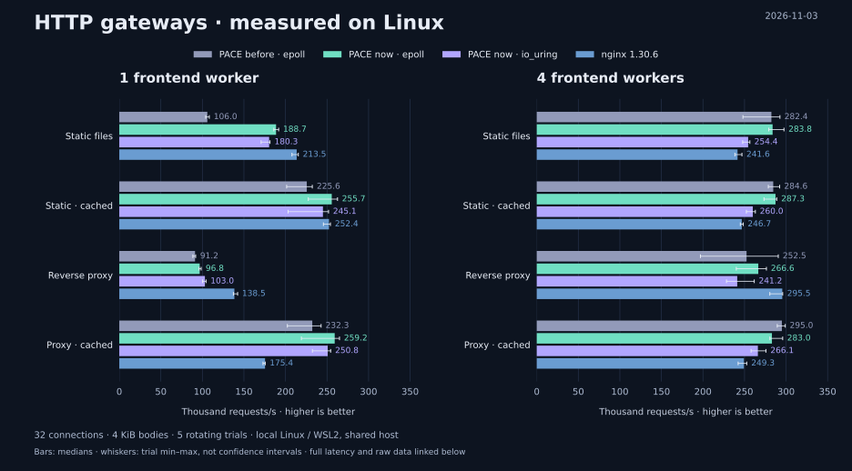

# Gateway optimization · local Linux · 3 November 2026

[Documentation](README.md) · [Gateway API and limits](reference/http-gateway.md) · [Earlier nginx comparison](gateway-performance.md) · [TCP/Asio/libuv results](performance.md)

This is a same-session, rotating **before/after** comparison on local Linux / WSL2,
not a comparison against numbers from another run. The homepage uses epoll for
both PACE versions, with nginx beside them; it does not choose whichever PACE
backend wins each case. All four scenarios and both worker counts are shown.



[All 160 trials, latency percentiles, CPU, memory and source/binary fingerprints](../benchmarks/results/linux-gateway-2026-11-03/optimized.json).
The complete matrix validated **25.6 million measured responses** byte for byte.

## Results and limits

With **one frontend worker**, PACE epoll throughput increased by **78.1%** for static
files, **13.3%** for cached static files, **6.2%** for uncached proxies and **11.6%**
for cached proxies. Static service CPU per request fell from 9.44 to 5.25 μs
(44.4% less), consistent with removing work rather than just changing scheduling.
The cached-proxy median is 259.2k requests/s versus nginx's 175.4k (+47.8%).
nginx still leads uncached static throughput (213.5k versus 188.7k), uncached proxy
throughput (138.5k versus 96.8k), and static-service p99 latency.

With four workers, static throughput is nearly flat even though server CPU per
request falls; shared-host scheduling and the single load-generator thread limit
what this workload can establish. Cached-proxy throughput **regressed 4.1%** in the
complete matrix (295.0k → 283.0k). A longer seven-pair confirmation also found a
**3.1% regression** (296.7k → 287.3k; median paired ratio 0.974), while server CPU per
request fell. The confirmation retains a single-worker improvement (238.4k → 259.4k).
We retain this limitation rather than claiming universal scaling gains. Both PACE
cached-proxy medians in the complete matrix still exceed nginx's corresponding
medians. io_uring remains mixed and Linux's automatic backend remains epoll.

[Longer cached-proxy confirmation, all 28 trials](../benchmarks/results/linux-gateway-2026-11-03/proxy-cache-confirmation.json).
Each trial measures 640,000 requests (20,000 per connection), rather than the main
matrix's 160,000. No results from this longer run replace bars in the main chart.

## Complete matrix

Medians of five trials. Throughput and its observed min–max are **thousand requests/s**;
latencies are μs. Percentiles are medians of each trial's percentile, not pooled
samples. Whiskers/ranges are not confidence intervals. CPU is frontend process-tree
CPU divided by completed measured requests, excluding the client and origins.

| Scenario | Workers | Implementation | Throughput | Min–max | p50 | p95 | p99 | CPU μs/request |
|---|---:|---|---:|---:|---:|---:|---:|---:|
| static | 1 | PACE before / epoll | 106.0 | 104.0–108.3 | 282.6 | 428.2 | 588.7 | 9.44 |
| static | 1 | PACE now / epoll | 188.7 | 185.9–191.8 | 156.7 | 293.5 | 332.5 | 5.25 |
| static | 1 | PACE now / io_uring | 180.3 | 170.7–181.4 | 173.3 | 201.8 | 284.5 | 5.50 |
| static | 1 | nginx | 213.5 | 207.8–215.4 | 145.3 | 178.0 | 233.1 | 4.62 |
| static | 4 | PACE before / epoll | 282.4 | 248.1–292.6 | 108.8 | 148.0 | 197.0 | 11.31 |
| static | 4 | PACE now / epoll | 283.8 | 279.2–297.5 | 103.1 | 154.3 | 196.8 | 8.56 |
| static | 4 | PACE now / io_uring | 254.4 | 247.8–256.4 | 112.9 | 174.7 | 214.2 | 9.62 |
| static | 4 | nginx | 241.6 | 238.4–246.9 | 119.7 | 186.4 | 222.6 | 8.00 |
| static_cached | 1 | PACE before / epoll | 225.6 | 201.4–232.3 | 125.6 | 237.6 | 302.2 | 4.31 |
| static_cached | 1 | PACE now / epoll | 255.7 | 227.5–262.6 | 113.8 | 213.7 | 254.7 | 3.94 |
| static_cached | 1 | PACE now / io_uring | 245.1 | 203.1–251.8 | 125.5 | 150.4 | 238.8 | 4.06 |
| static_cached | 1 | nginx | 252.4 | 245.7–254.1 | 123.3 | 147.1 | 185.6 | 3.94 |
| static_cached | 4 | PACE before / epoll | 284.6 | 278.7–292.3 | 98.4 | 152.6 | 179.2 | 7.38 |
| static_cached | 4 | PACE now / epoll | 287.3 | 273.5–288.8 | 98.7 | 155.0 | 179.8 | 6.94 |
| static_cached | 4 | PACE now / io_uring | 260.0 | 252.2–263.1 | 108.3 | 169.9 | 203.8 | 7.81 |
| static_cached | 4 | nginx | 246.7 | 245.0–248.4 | 118.0 | 182.1 | 207.9 | 7.12 |
| proxy | 1 | PACE before / epoll | 91.2 | 88.5–91.9 | 340.8 | 478.7 | 632.6 | 10.94 |
| proxy | 1 | PACE now / epoll | 96.8 | 96.0–98.5 | 320.9 | 443.2 | 519.7 | 10.25 |
| proxy | 1 | PACE now / io_uring | 103.0 | 100.2–104.4 | 304.2 | 351.6 | 450.9 | 9.75 |
| proxy | 1 | nginx | 138.5 | 137.4–142.4 | 222.8 | 268.8 | 439.2 | 7.19 |
| proxy | 4 | PACE before / epoll | 252.5 | 197.0–290.6 | 105.7 | 156.7 | 236.3 | 12.69 |
| proxy | 4 | PACE now / epoll | 266.6 | 240.1–276.4 | 104.4 | 153.0 | 222.2 | 12.38 |
| proxy | 4 | PACE now / io_uring | 241.2 | 228.3–261.7 | 120.3 | 171.3 | 245.0 | 13.44 |
| proxy | 4 | nginx | 295.5 | 280.4–295.9 | 102.3 | 151.6 | 212.6 | 10.81 |
| proxy_cached | 1 | PACE before / epoll | 232.3 | 202.3–242.8 | 123.5 | 234.8 | 287.8 | 4.25 |
| proxy_cached | 1 | PACE now / epoll | 259.2 | 219.2–265.0 | 113.1 | 213.6 | 248.0 | 3.81 |
| proxy_cached | 1 | PACE now / io_uring | 250.8 | 232.4–254.3 | 123.4 | 149.6 | 206.8 | 3.94 |
| proxy_cached | 1 | nginx | 175.4 | 172.9–175.6 | 178.3 | 208.7 | 287.8 | 5.69 |
| proxy_cached | 4 | PACE before / epoll | 295.0 | 289.4–299.0 | 95.9 | 149.1 | 183.5 | 7.38 |
| proxy_cached | 4 | PACE now / epoll | 283.0 | 280.5–295.9 | 100.3 | 157.8 | 188.9 | 7.19 |
| proxy_cached | 4 | PACE now / io_uring | 266.1 | 257.9–275.8 | 106.0 | 166.6 | 200.9 | 7.94 |
| proxy_cached | 4 | nginx | 249.3 | 242.3–252.7 | 113.5 | 177.7 | 212.6 | 8.75 |

## What changed and why

- **Static files:** the previous FNV-1a loop had a dependent multiply for every byte.
  A compact portable seed-zero XXH64 implementation processes 32-byte blocks with
  independent accumulators. It preserves content-based validators, including
  same-size/same-timestamp edits; golden vectors come from upstream xxHash 0.8.3.
  Ordinary paths also avoid a redundant root `dup/close`, and HTTP-date formatting
  avoids locale/iostream construction. Symlink containment and file-size bounds remain.
- **HTTP/1:** reserve wire-buffer capacity, append header fields without intermediate
  concatenation strings, and avoid the conditional-expression body copy. Read buffers
  no longer zero bytes that `read_some` will overwrite. Header filtering compares
  views case-insensitively; proxy exchanges use one less coroutine wrapper. Existing
  framing validation, bounded reads, cancellation and deadlines still apply.
- **Hot cache reads:** `get_copy()` keeps one snapshot per cache/reactor. Consecutive
  hits check a read-mostly shard generation and steady-clock expiry, without taking
  the shard mutex, writing CLOCK metadata or incrementing the snapshot's shared
  reference count. Counter writes belong to the reader; statistics includes live and
  retired readers. Mutations invalidate the fast path. Generic `get()` remains available.
- **CPU cache ownership:** generation storage is separated from the shard mutex and
  shared statistics by 128-byte alignment, and reader counters are independently
  aligned. This avoids putting unrelated writers on common 64/128-byte lines without
  tuning to this CPU model. Borrowed context-service lookup also avoids shared owner
  count changes when locating a connection pool or reader. No CPU affinity, special
  ISA requirement or host-specific cache-size constant is used.
- **Proxy cache age:** Date/Age is normalized on insertion; hits add monotonic resident
  time instead of repeatedly parsing the same Date. This remains a conservative HTTP
  cache subset, not a full RFC cache implementation.

This does **not** eliminate all contention. Misses and writes still lock shared
shards; alternating keys miss the one-entry local memo; service-task ownership
still uses shared reference counts; networking, allocation and the kernel have
other shared state. A separate per-reactor service-ownership experiment added a
lookup and did not provide a stable net improvement (single-worker median worsened),
so it was **not shipped**. Its [raw results](../benchmarks/results/linux-gateway-2026-11-03/ownership-experiment.json)
and [exact experimental patch](../benchmarks/results/linux-gateway-2026-11-03/ownership-experiment.patch)
are retained to make that decision reviewable.

Each reactor can pin one evicted snapshot per cache until its next cache lookup or
context destruction: at most `max_object_bytes` of body plus headers/key/reader
metadata. This is additional retained memory, not extra stored cache entries.
The cache's configured budget is not an RSS cap. Bodies are still copied, and
uncached file reads still run synchronously on the reactor. These tradeoffs are
spelled out in the [reference](reference/http-gateway.md#reactor-local-cache-hits).

## Isolated contention and hashing diagnostics

The component benchmark removes sockets, origins and the HTTP load generator.
Both cache paths return and validate the same owned 4 KiB response copy for one
hot key. `shared` uses `get()` followed by a copy; `local` uses `get_copy()` on each
thread's own reactor. There are no concurrent writes in this diagnostic; mutation
correctness is covered separately by tests. Five rotated trials, 200,000 operations
per worker per trial. These are **cache operations, not HTTP requests**.

| Workers | Shared path M copies/s | Local snapshot M copies/s | Ratio of medians |
|---:|---:|---:|---:|
| 1 | 8.99 | 9.97 | 1.11× |
| 2 | 4.61 | 19.68 | 4.26× |
| 4 | 4.79 | 38.92 | 8.13× |
| 8 | 3.59 | 66.60 | 18.56× |

For the same 4 KiB hashing workload, FNV-1a measured 0.329 million hashes/s and
XXH64 6.379 million hashes/s (19.4×). The input changes each iteration to
prevent loop-invariant hoisting. This isolates the dependent byte loop; the
end-to-end static improvement is much smaller because open/read/HTTP/socket work remains.

[All component trials, checksums and CPU time](../benchmarks/results/linux-gateway-2026-11-03/components-optimized.json).
The cache result measures the combined removal of shared locks, reference traffic
and metadata writes; it does not isolate a speedup attributable only to padding.
Hardware `cache-misses` counters are unavailable here (`perf_event_open` returned
ENOENT), so **no measured LLC-miss, HITM or cache-coherence traffic reduction is claimed**.

## Validation

- ASan/UBSan: all 31 protocol/runtime tests pass on epoll and all 31 on io_uring.
- Added cross-reactor replacement/clear barriers, concurrent mutation/read/retirement
  stress, exact hit statistics, TTL and live-snapshot eviction tests, response-copy
  independence and lazy-task lifetime checks after service/context destruction.
- XXH64 golden vectors cover empty input, unaligned views, block/tail boundaries and
  long contents. Static validators detect same-size edits with preserved timestamps.
- Native Windows IOCP/WSAPoll, macOS, Linux, FreeBSD and QEMU targets including big-endian
  s390x exercise correctness, not remote performance rankings. Mobile jobs compile only.
- ThreadSanitizer was built but could not start on this WSL2 host:
  `FATAL: ThreadSanitizer: unexpected memory mapping`. It is **not** a passing TSan result.

## Reproduce and interpret

The main matrix uses Linux 6.18.40.1 / WSL2, GCC 13.3 release builds, nginx 1.30.6,
32 persistent connections, one outstanding GET each, 4096-byte bodies, 200 warmup
and 5000 measured requests per connection. It rotates four implementations for
five repeats, with fresh processes/caches each time. Observed host one-minute load
ranged from 1.48 to 5.03; this is a shared host, not an isolated capacity test.
The earlier screening run experienced a load surge and remains linked as
[diagnostic data](../benchmarks/results/linux-gateway-2026-11-03/optimization-screen-contended.json),
not substituted into the main table.

The old binary is built from `94ed51dd6ca0b8407cf554bce72bcfe0fc37e3d7` and the optimized
implementation from `bf7e8c7` with identical release configuration. Source-file and
binary hashes identify each measured build in the JSON. The later ownership
experiment was reverted; subsequent changes add tests/docs, not a different measured
implementation. Keep a separate build directory/checkout for the old binary.

```sh
xmake f -m release --uring=y --protocol_benchmarks=y --tests=n --examples=n -y
xmake -y
python3 scripts/run_gateway_benchmarks.py \
  --pace build/linux/x86_64/release/pace_http_gateway \
  --baseline /path/to/94ed51d/pace_http_gateway \
  --load build/linux/x86_64/release/pace_http_load --nginx /path/to/nginx \
  --backends baseline,epoll,io_uring,nginx --output /tmp/optimized.json
python3 scripts/run_gateway_components.py \
  --binary build/linux/x86_64/release/pace_gateway_components \
  --output /tmp/components.json
python3 scripts/plot_gateway_optimization.py /tmp/optimized.json /tmp/homepage.svg
python3 scripts/plot_gateway_optimization.py /tmp/optimized.json /tmp/all.svg --all-backends
```

The independent epoll load generator links no PACE code and verifies status,
Content-Length and every response byte. It is closed-loop, without pipelining or
coordinated-omission correction. Proxy trials use the same two PACE epoll origins
(two workers each) for every frontend, including the old binary and nginx.

nginx enables sendfile, TCP_NODELAY/reuseport, upstream keep-alive and disables
access logging. Cache implementations differ: PACE stores RAM response snapshots,
nginx static `open_file_cache` retains descriptors/metadata with OS page-cache data,
and nginx proxy caching uses files plus a shared key zone. Both are warmed; exact
configs are in each trial. The comparison measures these complete configured paths.

CPU is `/proc` process-tree accounting sampled around the measured phase. Summed
VmHWM includes startup/warmup, may double-count shared nginx pages, and excludes
page cache; it cannot establish allocator efficiency. See the
[original methodology](gateway-performance.md#what-the-test-measures) for remaining
limits and the archived TCP/Asio/libuv study for that separate workload.
