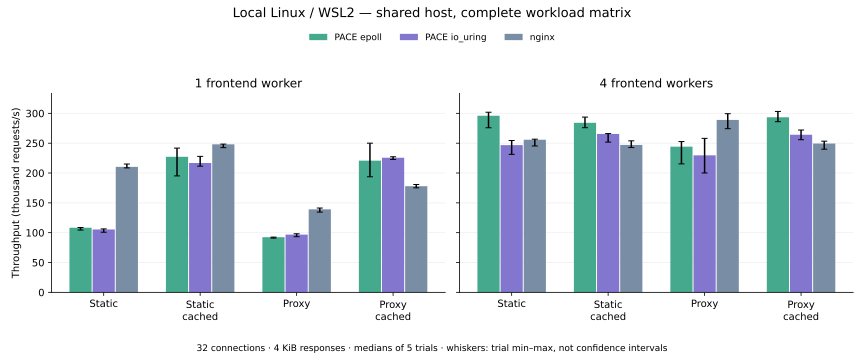

# Local Linux gateway comparison with nginx

Measured 2026-11-03 on a **shared local Linux / WSL2 host**. A first run coincided
with heavy CPU-intensive background jobs. After those jobs finished, we repeated
the same complete matrix once, with lower background load and per-trial host load
snapshots. The chart/table show that second run; both complete runs remain linked.
Neither run is an isolated bare-metal peak or a production capacity guarantee.
No remote-runner performance figures are used.



[Lower-load raw trials and complete metrics](../benchmarks/results/linux-gateway-2026-11-03/nginx.json) ·
[Earlier contended run, all 120 trials](../benchmarks/results/linux-gateway-2026-11-03/nginx-contended.json)

Each full run completed 120 trials and validated all 19.2 million measured responses.
nginx led single-worker static throughput and uncached proxy throughput at both
worker counts. PACE epoll's cached-proxy median was 220.7k versus nginx's 177.9k
requests/s with one worker (+24.1%), and 293.4k versus 249.4k with four (+17.6%).
The one-worker epoll p99 was worse (313 versus 257 μs); with four workers it was
better (178 versus 229 μs). Four-worker static cases also favored PACE epoll's
throughput in this run. This is a workload result, not a universal library advantage.
io_uring did not consistently outperform epoll, so Linux still defaults to epoll.

## Complete throughput and p99 results

All figures below are medians of five trials. The min–max column is the observed
throughput range, not a confidence interval. p50/p95, each trial's p99 and resource
measurements are in the raw data. Throughput is **thousand requests/second**; p99 is μs.

| Scenario | Workers | Backend | Throughput | Min–max | p99 μs |
|---|---:|---|---:|---:|---:|
| static | 1 | epoll | 108.3 | 104.5–108.7 | 576 |
| static | 1 | io_uring | 105.4 | 100.8–106.4 | 494 |
| static | 1 | nginx | 210.3 | 208.6–215.1 | 266 |
| static | 4 | epoll | 296.0 | 275.8–301.9 | 222 |
| static | 4 | io_uring | 246.7 | 231.3–254.5 | 226 |
| static | 4 | nginx | 255.8 | 245.3–256.7 | 215 |
| static_cached | 1 | epoll | 227.1 | 195.2–241.7 | 305 |
| static_cached | 1 | io_uring | 216.8 | 211.5–227.9 | 296 |
| static_cached | 1 | nginx | 248.1 | 242.6–248.5 | 225 |
| static_cached | 4 | epoll | 284.1 | 276.0–293.7 | 206 |
| static_cached | 4 | io_uring | 265.4 | 251.9–266.1 | 211 |
| static_cached | 4 | nginx | 247.1 | 242.7–254.0 | 218 |
| proxy | 1 | epoll | 92.4 | 90.9–92.6 | 573 |
| proxy | 1 | io_uring | 96.7 | 93.2–98.1 | 508 |
| proxy | 1 | nginx | 139.1 | 134.4–141.3 | 404 |
| proxy | 4 | epoll | 244.2 | 215.2–252.7 | 274 |
| proxy | 4 | io_uring | 229.6 | 200.0–258.1 | 280 |
| proxy | 4 | nginx | 288.9 | 274.2–299.4 | 240 |
| proxy_cached | 1 | epoll | 220.7 | 193.7–250.0 | 313 |
| proxy_cached | 1 | io_uring | 225.6 | 222.7–227.2 | 248 |
| proxy_cached | 1 | nginx | 177.9 | 175.1–180.8 | 257 |
| proxy_cached | 4 | epoll | 293.4 | 286.0–303.2 | 178 |
| proxy_cached | 4 | io_uring | 264.2 | 255.8–272.1 | 221 |
| proxy_cached | 4 | nginx | 249.4 | 239.9–253.3 | 229 |

## What the test measures

- Local Linux 6.18.40.1 / WSL2, GCC 13.3, release builds without sanitizers or stage profiling; nginx 1.30.6. Exact CPU details and compiler/nginx output are in the JSON. Source HEAD, working-tree source hashes and binary SHA-256 fingerprints are recorded; benchmark sources were finalized during development, so the file hashes identify the measured code beyond HEAD alone.
- One or four frontend workers, 32 persistent TCP connections, one outstanding GET per connection, 4096-byte bodies. Each connection warms up for 200 requests, then completes 5000 measured requests. Five trials per combination, rotating backend order and fresh processes for each trial.
- An independent C++ epoll client links no PACE code. It checks status, framing, exact length and **every payload byte**. Request latency begins before send and ends at full response validation. Timing starts after a warmup barrier; startup/connection establishment are excluded.
- A closed-loop workload with no pipelining, coordinated-omission correction or open-loop overload generation. Client and servers share the host; client scheduling/validation and background tasks can limit throughput.
- Proxy scenarios use the same two PACE epoll origins (two workers each) for all frontends, round-robin selection, keep-alive pools, no retry, buffering and identical public responses. This compares a complete frontend path, not nginx's upstream implementation against itself.
- All frontends disable access logging. nginx enables sendfile, TCP_NODELAY and reuseport; it is built with its normal event backend. PACE uses explicit epoll or io_uring, and the runner verifies the selected backend.
- Caching is **not the same implementation**: PACE keeps bounded response snapshots in RAM; nginx `open_file_cache` caches file descriptors/metadata and sendfile uses the OS page cache. nginx proxy cache uses a file cache with hot OS pages and a shared key zone. Fresh per-trial caches are warmed before measurement. Both cache configurations and limits are preserved in each trial.
- Static reads in PACE are buffered and synchronous; nginx sendfile avoids that copy path. Proxy cache hits avoid upstream exchanges entirely. These are application behavior changes, not measurements of CPU cache misses.
- Server CPU uses `/proc` process-tree counters sampled at the warmup barrier and after completion. It excludes the client/origins. The RSS figure sums per-process VmHWM and includes startup/warmup; shared nginx pages can be counted more than once, and page-cache memory is not included. Neither metric isolates library allocations or supports a memory-efficiency claim.

## Reproduce

```sh
xmake f -m release --uring=y --protocol_benchmarks=y --tests=n --examples=n -y
xmake -y pace_http_gateway
xmake -y pace_http_load
python3 scripts/run_gateway_benchmarks.py \
  --pace build/linux/x86_64/release/pace_http_gateway \
  --load build/linux/x86_64/release/pace_http_load \
  --nginx /path/to/nginx \
  --output /tmp/gateway-results.json
python3 scripts/plot_gateway_benchmarks.py /tmp/gateway-results.json /tmp/gateway.svg
```

The chart renderer requires matplotlib. The test runner uses Python's standard
library. nginx was compiled from its official 1.30.6 tarball with
`--without-http_rewrite_module --without-http_gzip_module --with-threads`; the
runner creates isolated configs/directories and never changes a system nginx
service. The exact build arguments appear in `nginx -V` in the report.

Use an idle, controlled host for capacity planning. Keep release flags, connection
counts, payloads, CPU allocation and cache state equal across implementations.
Inspect all scenarios and latency percentiles, rather than selecting only a winning
throughput bar. [Gateway contracts and current limits](reference/http-gateway.md)
explain what is implemented; this is not a full nginx feature/performance replacement.

## Descriptor-layout A/B experiment

An alternate release binary changes only `src/runtime/io_context.cpp` back to the
previous node-based descriptor map. Both use the same cache, HTTP code and epoll.
[The exact baseline patch](../benchmarks/results/linux-gateway-2026-11-03/layout-baseline.patch)
can be applied to this branch in a separate checkout. Build it with the same
release options and supply it through `--baseline PATH --backends baseline,epoll`.

| Connections | Map baseline median k req/s | Dense slots median k req/s | Median paired ratio |
|---|---:|---:|---:|
| 32 | 114.9 | 138.2 | 1.112 |
| 256 | 217.9 | 217.5 | 0.969 |

[32-connection raw trials](../benchmarks/results/linux-gateway-2026-11-03/layout-32.json) ·
[256-connection raw trials](../benchmarks/results/linux-gateway-2026-11-03/layout-256.json).
Each uses one worker, static response caching, 4 KiB payloads and five rotated
pairs. The host's background workload subsided during these runs, causing large
variation, including a 2.24× outlier pair. **This experiment does not establish a
general speedup from the layout change.** The implementation removes a hash lookup
and per-descriptor node allocation, but CPU cache misses were not measured and
larger concurrency showed no median throughput improvement. Keep that distinction
separate from the much larger benefit of avoiding file reads/upstream exchanges
through application caching.
