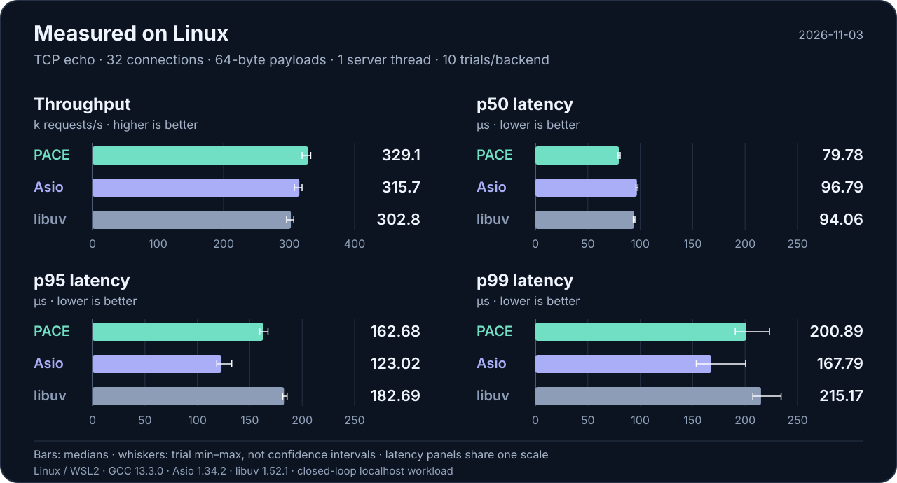
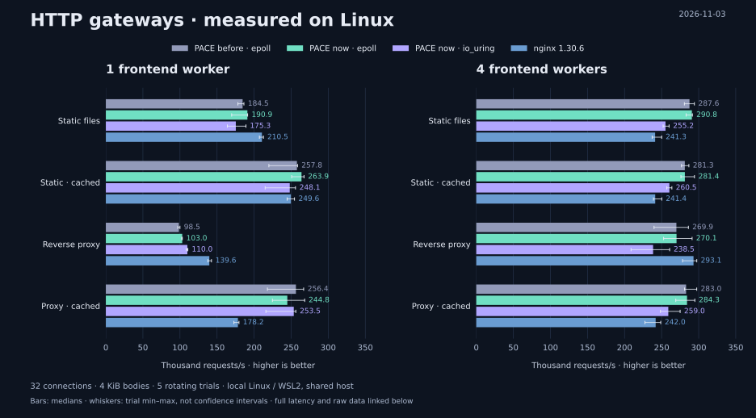

# Performance · PACE 0.5.0 · local Linux

[Documentation](README.md) · [TCP methodology](../benchmarks/README.md) · [Gateway API](reference/http-gateway.md)

This report contains two separate comparisons on the final 0.5.0 production
source: **PACE / standalone Asio / libuv TCP echo**, and **PACE / nginx HTTP
gateways**. TCP is the shared transport workload for the three libraries; it is
not an overall score for HTTP, DNS, TLS or QUIC. nginx is compared on HTTP
workloads only. All performance measurements below were collected on local
Linux / WSL2 on 3 November 2026, with GCC 13.3.0 and a shared host. Remote CI
checks correctness and portability; it supplies no performance rankings.

## TCP libraries — PACE, Asio and libuv

One server thread, 32 persistent loopback connections, 64-byte payloads, one request in flight per connection. Each trial performs 60,000 measured + 5,000 warmup requests per client. Ten rotating trials per backend validate all **57.6 million measured round trips**. Same blocking clients and TCP_NODELAY for all backends; Asio 1.34.2 and libuv 1.52.1.

| Library | Requests/s | Trial min–max | p50 µs | p95 µs | p99 µs | Peak process MiB |
|---|---:|---:|---:|---:|---:|---:|
| pace | 329,097 | 319,851–333,075 | 79.78 | 162.68 | 200.89 | 21.367 |
| asio | 315,704 | 308,084–319,800 | 96.79 | 123.02 | 167.79 | 20.943 |
| libuv | 302,783 | 296,177–307,197 | 94.06 | 182.69 | 215.17 | 19.250 |

PACE throughput is 4.2% above Asio and 8.7% above libuv in this session. Its p50 is 17.6% and 15.2% lower, respectively. **Asio has better p95/p99, and PACE uses more whole-process peak memory than both comparators.** These results do not establish superiority across workloads or machines.

All table values are trial medians. Latency values are medians of per-trial percentiles, not pooled percentiles. Whiskers show observed trial min–max, not confidence intervals. Peak Linux VmHWM includes the server, client threads and stored latency samples, including startup/warmup; it does not isolate library memory.

[Every TCP trial, environment and commands](../benchmarks/results/linux-release-0.5.0/tcp/report.json) · [Raw JSONL](../benchmarks/results/linux-release-0.5.0/tcp/raw.jsonl) · [Earlier TCP analysis](performance-2026-10-22.md)

## HTTP gateways — PACE and nginx

32 persistent connections, 4 KiB response bodies, one outstanding GET per
connection, 10,000 measured + 200 warmup requests per connection, five rotating
trials per case. All **51.2 million measured responses** in the 160-trial matrix
are checked byte for byte by the independent epoll load generator. Fresh
frontends and caches per trial. The default PACE backend is epoll; io_uring
results are shown separately, never selected on a best-of basis.

“Before” is the previous optimized PR head `a343fa6`, not the older unoptimized
gateway. Both versions use the same final-version origin servers in this
matrix. nginx 1.30.6 uses sendfile, TCP_NODELAY, reuseport, persistent upstreams,
no access log and no proxy retry. Proxy cases use two identical PACE epoll
origins with two workers each for every frontend. The runner retains complete
nginx configurations, source/binary hashes, host load, every trial and resource
measurements. PACE response caching is in memory; nginx proxy caching uses its
file cache, and nginx static caching uses open_file_cache. These policies are
not equivalent cache implementations.

| Workload | Workers | Backend | Requests/s | Trial min–max | p50 µs | p95 µs | p99 µs | Frontend CPU µs/request |
|---|---:|---|---:|---:|---:|---:|---:|---:|
| static | 1 | PACE before · epoll | 184,487 | 178,149–186,246 | 158.88 | 298.37 | 373.00 | 5.38 |
| static | 1 | PACE 0.5 · epoll | 190,946 | 169,725–191,251 | 155.04 | 287.60 | 337.39 | 5.25 |
| static | 1 | PACE 0.5 · io_uring | 175,332 | 163,945–189,000 | 173.01 | 227.58 | 287.14 | 5.66 |
| static | 1 | nginx | 210,538 | 207,140–212,542 | 147.00 | 180.54 | 250.79 | 4.69 |
| static | 4 | PACE before · epoll | 287,613 | 280,739–294,223 | 105.37 | 155.49 | 196.77 | 9.09 |
| static | 4 | PACE 0.5 · epoll | 290,836 | 283,034–291,532 | 103.88 | 153.75 | 204.15 | 8.84 |
| static | 4 | PACE 0.5 · io_uring | 255,237 | 252,062–260,064 | 116.77 | 175.34 | 237.22 | 9.94 |
| static | 4 | nginx | 241,251 | 237,237–250,096 | 119.63 | 186.06 | 226.37 | 8.16 |
| static_cached | 1 | PACE before · epoll | 257,779 | 219,919–258,555 | 113.77 | 213.48 | 248.75 | 3.88 |
| static_cached | 1 | PACE 0.5 · epoll | 263,933 | 250,645–267,339 | 111.20 | 207.83 | 241.09 | 3.78 |
| static_cached | 1 | PACE 0.5 · io_uring | 248,081 | 214,933–255,798 | 122.94 | 156.36 | 228.47 | 4.00 |
| static_cached | 1 | nginx | 249,617 | 244,545–254,477 | 124.77 | 153.25 | 196.12 | 4.00 |
| static_cached | 4 | PACE before · epoll | 281,308 | 276,727–286,781 | 100.46 | 156.84 | 182.88 | 7.12 |
| static_cached | 4 | PACE 0.5 · epoll | 281,368 | 276,068–294,303 | 103.12 | 159.95 | 185.66 | 7.16 |
| static_cached | 4 | PACE 0.5 · io_uring | 260,508 | 256,960–263,847 | 107.98 | 169.63 | 197.83 | 7.69 |
| static_cached | 4 | nginx | 241,384 | 239,011–250,251 | 120.41 | 185.55 | 217.01 | 7.34 |
| proxy | 1 | PACE before · epoll | 98,546 | 97,121–99,982 | 314.73 | 439.59 | 525.57 | 10.16 |
| proxy | 1 | PACE 0.5 · epoll | 103,028 | 102,280–103,197 | 299.42 | 420.81 | 500.45 | 9.69 |
| proxy | 1 | PACE 0.5 · io_uring | 109,958 | 108,450–110,612 | 282.77 | 334.03 | 455.13 | 9.06 |
| proxy | 1 | nginx | 139,601 | 137,656–142,471 | 221.78 | 270.63 | 369.26 | 7.09 |
| proxy | 4 | PACE before · epoll | 269,945 | 239,782–286,135 | 104.80 | 152.46 | 239.87 | 12.28 |
| proxy | 4 | PACE 0.5 · epoll | 270,139 | 252,701–291,134 | 104.73 | 164.40 | 257.85 | 12.47 |
| proxy | 4 | PACE 0.5 · io_uring | 238,510 | 208,780–260,870 | 119.10 | 175.46 | 248.78 | 13.19 |
| proxy | 4 | nginx | 293,050 | 278,282–297,445 | 102.08 | 152.66 | 206.93 | 10.78 |
| proxy_cached | 1 | PACE before · epoll | 256,413 | 217,970–266,831 | 111.91 | 212.27 | 261.06 | 3.84 |
| proxy_cached | 1 | PACE 0.5 · epoll | 244,817 | 224,733–268,232 | 117.06 | 212.30 | 289.91 | 4.09 |
| proxy_cached | 1 | PACE 0.5 · io_uring | 253,515 | 215,893–256,257 | 120.97 | 164.76 | 223.34 | 3.94 |
| proxy_cached | 1 | nginx | 178,187 | 172,769–179,592 | 174.43 | 206.28 | 272.53 | 5.56 |
| proxy_cached | 4 | PACE before · epoll | 283,020 | 280,946–297,374 | 100.24 | 158.00 | 191.52 | 7.25 |
| proxy_cached | 4 | PACE 0.5 · epoll | 284,299 | 269,110–294,829 | 100.55 | 158.59 | 212.08 | 7.38 |
| proxy_cached | 4 | PACE 0.5 · io_uring | 259,037 | 248,411–274,988 | 109.72 | 174.36 | 227.24 | 7.81 |
| proxy_cached | 4 | nginx | 241,976 | 227,498–248,812 | 116.36 | 186.46 | 247.19 | 9.12 |

The four-worker uncached proxy is essentially flat in throughput (+0.1%) and
its p99 is worse (239.87 → 257.85 µs). The single-worker cached proxy drops
4.5% in this complete matrix, with wide, overlapping trial ranges; a longer
follow-up is recorded below. Small multicore changes should not be interpreted
as demonstrated scaling gains. io_uring improves the one-worker uncached proxy
relative to epoll here but loses in several other cases; it remains opt-in.

### Longer cached-proxy confirmation

After the complete matrix, the same frozen binaries were compared in seven alternating baseline/epoll pairs per worker count, with 20,000 measured requests per connection (17.92 million checked responses total). This is a separate follow-up, not a replacement for the matrix or its chart.

| Workers | Before requests/s | 0.5.0 requests/s | Change | Median paired ratio |
|---:|---:|---:|---:|---:|
| 1 | 250,183 | 268,423 | +7.3% | 1.009 |
| 4 | 284,432 | 295,179 | +3.8% | 1.038 |

The single-worker drop from the original matrix does not recur in this longer window; multicore throughput remains close and variable. This does not establish a universal improvement or eliminate the observed tail-latency regressions. Both sessions remain public. [All confirmation trials](../benchmarks/results/linux-release-0.5.0/proxy-cache-confirmation.json).

### Why reverse proxy still trails nginx

With 1 frontend worker(s), uncached PACE epoll proxy throughput changes from **98,546 to 103,028 requests/s (+4.5%)**. nginx reaches 139,601; PACE is 26.2% below it in this case.

With 4 frontend worker(s), uncached PACE epoll proxy throughput changes from **269,945 to 270,139 requests/s (+0.1%)**. nginx reaches 293,050; PACE is 7.8% below it in this case.

The remaining difference has identifiable implementation costs, not evidence
of a global proxy lock. PACE owns each request/response as strings and vectors,
parses the upstream HTTP message completely, then validates and re-encodes it
for the downstream connection. Fixed bodies still pass through pending/body
and encoded-wire buffers. Each exchange also owns a structured cancellation
boundary, timer and callback registrations. nginx uses request pools and
buffer chains in its dedicated upstream engine (`ngx_http_request.c`,
`ngx_http_upstream.c` in the measured nginx source). These design differences
explain plausible remaining work; this report does **not** assign an unsupported
percentage of CPU time to each one.

This iteration reserves header storage once, visits token lists without a
temporary owning vector, bypasses body-reader coroutines when the complete
fixed-length body is already buffered, and removes a pass-through upstream
coroutine. A separate Linux/glibc allocation census finds **62.03 → 52.04
allocation calls per exchange (16.1% fewer)** on one frontend thread. It includes
startup/warmup and is intrusive; its timings are discarded. It measures calls,
not allocated bytes, peak memory, cache misses or nginx allocation behavior.
[Allocation counters](../benchmarks/results/linux-release-0.5.0/proxy-allocations.json)
and [probe source](../benchmarks/diagnostics/allocation_probe.c) are preserved.

Per-worker pools/cursors remain reactor-owned. The earlier reactor-local cache
snapshot, isolated hit counters and generation invalidation reduce shared
hot-key writes; see the [cache investigation](gateway-optimization.md). Shared
cache misses/mutations still lock shards, and service ownership still has shared
reference counts. No hardware cache-miss or false-sharing improvement is
claimed: this WSL2 host does not expose the needed PMU counters. The earlier
four-worker cached-proxy regression is retained in that report; it is not erased
by changing the baseline in this follow-up.

A specialized streaming/buffer-chain proxy could remove more copies and owned
objects, but requires explicit backpressure, framing, cancellation and cache
contracts. This release retains bounded full-body buffering and total deadlines;
it does not disable validation, retry requests or drop cancellation to win the
benchmark.

### Measurement limits

The single HTTP load-generator thread and loopback TCP can limit scaling;
four-worker results are not a server capacity ceiling. The host is shared, so
ranges include scheduling interference. Frontend CPU comes from /proc process
trees around the measurement barrier, has tick granularity, and excludes the
separate origin processes. Gateway JSON also retains summed process VmHWM:
that includes warmup and can double-count shared pages; it excludes the kernel
page cache and is not comparable to the TCP executable’s memory figure. This
closed-loop workload does not correct coordinated omission or predict WAN,
TLS, large-body or overloaded-service latency.

[Every gateway trial and configuration](../benchmarks/results/linux-release-0.5.0/gateway.json) ·
[Reproduction and exploratory results](../benchmarks/results/linux-release-0.5.0/README.md) ·
[Earlier nginx matrix](gateway-performance.md) ·
[HTTP/WebSocket/HTTP2/HTTP3 investigations](protocol-performance.md)
