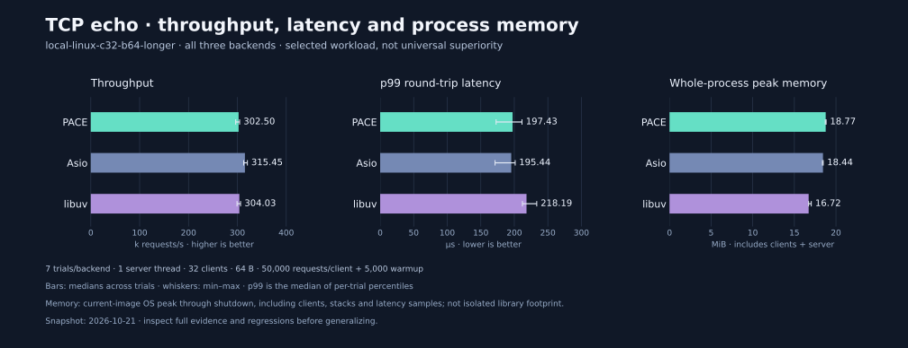

# Performance results and tuning

[Documentation](README.md) · [Benchmark methodology](../benchmarks/README.md) · [中文阅读入口](README.zh-CN.md)

PACE's performance goal is to exceed Asio and libuv on useful workloads. The
measurements below do **not** establish that goal across platforms. This page
includes every backend and workload in the current comparison, the measurements
behind the README's selected bar chart, and earlier optimization studies.

## Read the metrics

The current TCP runner records the following for every backend under the same
workload. Report all three backends together; a throughput lead alone does not
establish a latency or memory advantage.

| Metric | What it measures | How to read it |
|---|---|---|
| Throughput, requests/s | Verified complete request/response round trips divided by the measured wall-clock interval | Higher is better for this fixed workload; it does not measure connection setup or HTTP processing. |
| p50 latency, µs | Median client-observed round-trip latency among measured requests | Typical request; lower is better. |
| p95 / p99 latency, µs | Nearest-rank 95th / 99th percentile of the same measured requests | Tail latency; approximately 5% / 1% of samples are slower. Lower is better. |
| Maximum latency, µs | Slowest measured request in one trial | Useful for finding stalls; sensitive to trial length and host scheduling. |
| Peak process memory, MiB | OS process high-water mark, sampled after server/client shutdown and before result aggregation | Includes server, blocking clients, runtime, stacks and stored latency samples; it is **not the library's isolated footprint**. |

Tables report the median across independent trials for each metric. A median of
trial p99 values is not a pooled p99 across all requests. Likewise `median_max_us`
is the median of trial maxima; `max_max_us` in JSON is the worst request across
all trials. Min–max bars show the observed range, not a confidence interval.

Memory covers the **current executable image**, including startup and warmup;
it does not share throughput's measured-only time window. Linux reads
`/proc/self/status`'s `VmHWM`, macOS uses
`task_info(MACH_TASK_BASIC_INFO).resident_size_max`, and Windows uses
`GetProcessMemoryInfo().PeakWorkingSetSize`. Linux RSS accounting is approximate.
FreeBSD peak memory is explicitly unavailable: its process-history counter can
include pre-exec launcher memory, and a current-image provider has not been
verified. Its throughput and latency remain measured.

JSON preserves availability, source, scope and window. Compare memory only within
the same OS, toolchain and workload; OS accounting differs, and more requests
also allocate more latency samples. No steady-state allocation or isolated-server
claim is made. `--check-memory` verifies peak retention after allocation/free and
independence from a launcher with an extra 128 MiB. This runs separately from timing.

The historical 20 October reports below predate p95 and memory collection. Their missing values
remain unreported; they cannot be reconstructed from p50/p99 or throughput. The
current format uses `extended_metrics_version: 2` and requires every completed
request to contribute one latency sample. The initial version 1 POSIX memory
measurements were affected by inherited launcher peaks; the
[diagnostic trials](../benchmarks/results/local-metrics-diagnostic-2026-10-21/README.md)
are preserved and excluded from current memory comparisons.
[Exact timing boundaries and validation](../benchmarks/README.md).

中文说明：吞吐越高、同一负载下的延迟越低通常越好，但必须结合尾延迟一起看。
p95/p99 是单轮请求的延迟分位数，汇总表取各轮分位数的中位数；峰值内存包含
服务端、客户端和样本存储，且覆盖当前程序启动、预热和测量过程，不是 PACE 本身的
内存占用。FreeBSD 暂无已验证的当前程序峰值来源，明确显示不可用。历史报告未采集
的 p95 与内存不会补算；第一版受启动器影响的内存数据保留作诊断，不用于优势结论。

## Current local comparison · 21 October 2026

The initial 84 fresh processes measured PACE, Asio 1.34.2 and libuv 1.52.1:
seven rotating trials per backend for each of four workloads. All use one server thread,
loopback TCP, one outstanding request per connection and 1,000 warmup requests
per client. The client verifies every response byte. These measurements exercise
TCP and the reactor; they do not benchmark UDP, TLS, HTTP or WebSocket.

The complete local results are below. Values are medians across seven trials;
latency is in µs and peak process memory is in MiB. Request counts are **per
client**, and intentionally differ between workloads to keep runs bounded.

| Clients × bytes | Requests/client | Backend | Requests/s | p50 µs | p95 µs | p99 µs | Peak MiB |
|---|---:|---|---:|---:|---:|---:|---:|
| 1 × 64 | 30,000 | PACE | 44,156 | 20.38 | 33.85 | 48.12 | 4.676 |
| 1 × 64 | 30,000 | Asio | 44,488 | 20.41 | 33.08 | 47.99 | 4.273 |
| 1 × 64 | 30,000 | libuv | 45,832 | 20.30 | 31.25 | 47.36 | 4.484 |
| 4 × 64 | 30,000 | PACE | 148,906 | 24.85 | 36.71 | 53.48 | 5.543 |
| 4 × 64 | 30,000 | Asio | 151,258 | 24.65 | 36.21 | 52.91 | 5.176 |
| 4 × 64 | 30,000 | libuv | 157,434 | 23.72 | 35.19 | 51.60 | 5.266 |
| 32 × 64 | 5,000 | PACE | 301,919 | 101.17 | 120.50 | 173.73 | 7.762 |
| 32 × 64 | 5,000 | Asio | 321,471 | 95.52 | 117.31 | 162.65 | 7.438 |
| 32 × 64 | 5,000 | libuv | 302,702 | 93.76 | 182.35 | 209.62 | 5.973 |
| 4 × 4,096 | 10,000 | PACE | 131,993 | 28.50 | 42.43 | 61.84 | 4.977 |
| 4 × 4,096 | 10,000 | Asio | 130,509 | 29.24 | 44.43 | 63.06 | 4.598 |
| 4 × 4,096 | 10,000 | libuv | 135,953 | 26.96 | 40.19 | 61.01 | 4.688 |

PACE's 32-client p95 is 33.9% lower than libuv's (120.50 vs 182.35 µs), with
observed trial ranges of 115.53–141.27 and 180.30–183.56 µs. Its p99 is 17.1%
lower (173.73 vs 209.62 µs), but those trial ranges overlap. Asio has lower
median p95/p99 than PACE in this workload. At four clients with 4 KiB messages,
PACE's throughput median is only 1.1% higher than Asio's, with overlapping
ranges; this is not convincing evidence of a repeatable throughput advantage.

**PACE uses more peak process memory than both comparators in every local
workload.** At 32 clients it records 7.762 MiB, versus Asio's 7.438 and libuv's
5.973 MiB. These are whole-process measurements, not library allocation counts.
A broader claim that PACE is faster or smaller is not supported by these trials.

[All local trials, metric ranges, host/compiler, binary hash and reproduction commands](../benchmarks/results/local-metrics-2026-10-21/README.md).

中文结论：本地 32 连接测试中，PACE 相比 libuv 的 p95 中位数低约 33.9%，
p99 低约 17.1%，但 Asio 的这两个指标仍更低。所有本地负载中，PACE 的进程
峰值内存都高于两个对照库。README 只展示明确标注负载和对照对象的优势选摘；
这里保留全部结果，不据此宣称综合领先。

### Longer check of the selected latency advantage

After examining the short trials, we repeated the 32-client / 64-byte workload
with **50,000 measured + 5,000 warmup requests per client**. Each of the 21 fresh
processes measured about five seconds, compared with less than one second in
the initial matrix. This is a follow-up on the selected workload, not an
independent predeclared search for the best metric. Every outcome is retained.



| Backend | Requests/s | p50 µs | p95 µs | p99 µs | Peak MiB |
|---|---:|---:|---:|---:|---:|
| PACE | 302,496 | 100.97 | 127.81 | 197.43 | 18.766 |
| Asio | 315,445 | 95.82 | 122.45 | 195.44 | 18.441 |
| libuv | 304,033 | 94.74 | 183.92 | 218.19 | 16.719 |

The README latency panel uses this longer check: PACE's p95 median is **30.5% lower than
libuv's**, with ranges of 122.47–130.19 and 183.32–186.44 µs. Its p99 is 9.5%
lower. Asio still has better throughput and lower p95/p99; PACE still records
more peak process memory than both libraries. Additional stored latency samples
raise process memory in all three, so do not compare memory against the shorter
workload as a library regression. This remains one localhost session on WSL2.

[All longer trials, ranges and provenance](../benchmarks/results/local-metrics-confirmation-2026-10-21/README.md).

中文复核：将每连接测量请求数增加到 50,000 后，每轮约五秒，PACE 相对 libuv
的 p95 中位数仍低约 30.5%。README 使用这一批复核数据。Asio 的吞吐和尾延迟
仍更好，PACE 的峰值进程内存仍更高，不能宣称综合领先。

## Current four-platform CI comparison

[Actions run 39608371946](https://github.com/TabNahida/PACE/actions/runs/39608371946)
passed all seven jobs and uses source head `3eb014c` and checkout merge `f84f15ba5eb43835a1da298f18bc4d50bc28cb6f`.
The common workload is **one server thread, four clients, 64-byte messages,
10,000 measured + 1,000 warmup requests per client**, five rotating trials per
backend. Below are medians; the archive includes every trial and metric range.
Compare within one platform/job only: hosts and OS memory accounting differ.

| Platform | Backend | Requests/s | p50 µs | p95 µs | p99 µs | Peak MiB |
|---|---|---:|---:|---:|---:|---:|
| Linux C++20 | PACE | 68,827 | 58.84 | 68.06 | 75.01 | 4.906 |
| Linux C++20 | Asio | 70,212 | 56.90 | 66.87 | 72.83 | 4.562 |
| Linux C++20 | libuv | 67,935 | 42.10 | 85.92 | 99.64 | 4.625 |
| Linux C++23 | PACE | 112,249 | 35.21 | 40.62 | 46.40 | 5.039 |
| Linux C++23 | Asio | 116,049 | 33.91 | 39.12 | 44.67 | 4.711 |
| Linux C++23 | libuv | 109,598 | 29.92 | 49.42 | 55.07 | 4.777 |
| macOS arm64 | PACE | 47,384 | 80.38 | 138.96 | 253.96 | 6.312 |
| macOS arm64 | Asio | 40,271 | 81.08 | 168.12 | 424.12 | 6.297 |
| macOS arm64 | libuv | 57,233 | 63.79 | 113.12 | 175.50 | 6.281 |
| Windows x64 | PACE | 36,169 | 104.20 | 174.10 | 244.30 | 6.750 |
| Windows x64 | Asio | 37,280 | 104.90 | 133.60 | 171.20 | 6.738 |
| Windows x64 | libuv | 37,960 | 103.20 | 161.60 | 242.30 | 7.785 |
| FreeBSD 14.3 VM | PACE | 359,152 | 9.96 | 12.09 | 33.94 | unavailable |
| FreeBSD 14.3 VM | Asio | 347,325 | 10.52 | 13.21 | 35.13 | unavailable |
| FreeBSD 14.3 VM | libuv | 410,070 | 8.94 | 10.63 | 31.39 | unavailable |

The README additionally selects **macOS throughput vs Asio (+17.7%)** and
**Windows peak process memory vs libuv (−13.3%)**. Neither is a complete ranking:
libuv has higher macOS throughput, while PACE has the lowest Windows throughput
and a slightly higher p99 than libuv. Asio uses slightly less Windows peak
memory than PACE. macOS throughput ranges overlap; the median lead is not a
claim of statistical significance. Shared CI runners can vary substantially.

FreeBSD peak memory is **unavailable**, with null raw bytes and no numeric memory
aggregate. Throughput and latency are still measured. Native memory providers
passed separate peak-retention and inflated-launcher checks, preserved with
[all remote trials, environment and validation evidence](../benchmarks/results/ci-metrics-2026-10-21/README.md).

中文说明：CI 中 macOS 的 PACE 吞吐中位数比 Asio 高约 17.7%，但仍低于 libuv；
Windows 的进程峰值内存比 libuv 低约 13.3%，但吞吐也更低。表格保留所有指标，
不能把不同平台的优势拼成综合排名。FreeBSD 内存不可用，其吞吐与延迟照常报告。

## Reproduce the current measurements

Build an uninstrumented release binary. Keep the host otherwise idle while
running comparisons; profiling and sanitizer builds are separate diagnostics.

```sh
xmake f -m release -o build/fair --sanitizers=n --profiling=n --benchmarks=y -y
xmake -y pace_bench
python3 scripts/run_benchmarks.py --build-dir build/fair --check-memory
python3 scripts/run_benchmarks.py --build-dir build/fair --require-all \
  --repeats 7 --clients 32 --requests 50000 --warmup 5000 --bytes 64 \
  --output benchmark-results/local.json
```

The combined JSON includes all raw records, aggregates, commands and environment
metadata. On Windows, use `python` and put each command on one line. The local
archive lists the other three workload commands. CI also runs components,
worker-count comparisons and separate stage profiling on all four platforms.

Generate the checked-in figures with matplotlib (a documentation-only dependency):

```sh
python3 scripts/render_performance_chart.py \
  --evidence benchmarks/results/local-metrics-confirmation-2026-10-21/c32-b64.json \
  --output docs/assets/multimetric-performance.svg
python3 scripts/render_selected_advantages.py \
  --panel benchmarks/results/ci-metrics-2026-10-21/macos-latest-cxx20.json requests_per_second asio \
  --panel benchmarks/results/local-metrics-confirmation-2026-10-21/c32-b64.json p95_us libuv \
  --panel benchmarks/results/ci-metrics-2026-10-21/windows-latest-cxx20.json peak_process_memory_bytes libuv \
  --output docs/assets/selected-performance.svg
```

Both renderers validate every raw record and recompute the stored summaries.
The complete figure shows all three libraries. The selected renderer accepts only
a real median lead against the named comparator. Whiskers are observed min–max
ranges, not confidence intervals or evidence of statistical significance.

## Historical TCP comparison · 20 October 2026

The [previous five-platform-job comparison](../benchmarks/results/ci-workers-2026-10-20/README.md)
used source head `72327e4a2f5b787deeb902d188e26c67f9799441`, five trials/backend,
four persistent connections, 64-byte messages and 10,000 measured requests/client.
It measured throughput and p50/p99, but no p95 or peak memory. Its selected
macOS-vs-Asio and Linux-C++23-vs-libuv throughput leads appeared in the earlier
README chart. They are retained as historical evidence, not used to describe
current protocol additions or the current README selection.

## Earlier reactor optimization study

The [previous runtime study](../benchmarks/results/ci-runtime-2026-10-20/README.md)
measured a change that coalesces producer wakeups, skips an empty inbox
allocation/lock, and avoids unnecessary native polling when only runnable tasks
remain. Timers and newly submitted work are still checked each bounded turn.

Eight alternating paired runs used matching GCC C++20 `-O3 -DNDEBUG -pthread`
builds, the same five linked library sources, and no instrumentation. Component
costs are batch-average ns/op, not per-operation latency percentiles.

| Component | Local before ns/op | Local after ns/op | Earlier CI paired after/before |
|---|---:|---:|---:|
| Empty native poll | 74.60 | 58.26 | 0.8405 |
| Yield | 125.72 | 18.88 | 0.0838 |
| Same-context post | 129.11 | 22.09 | 0.0991 |
| Cross-thread enqueue, batch 256 | 325.27 | 22.89 | 0.0520 |
| Root task completion | 31.66 | 30.61 | 0.9562 |
| Zero-duration timer | 138.52 | 33.13 | 0.1495 |
| Lazy task | 5.70 | 5.69 | 0.9523 |
| Synchronous await chain, depth 4 | 35.84 | 35.86 | **1.0454** |

Lower favors the candidate for these components. Cross-thread enqueue excludes
batch-drain waits; it is **not** end-to-end completion latency. Exact boundaries,
compiler and environment are in the [component guide](../benchmarks/components.md)
and [local matched study](../benchmarks/results/component-2026-10-20/README.md).

The synchronous await chain regressed about **4.5% in CI**, despite unchanged task
headers; local matched measurements were unchanged. The cause is not established.
The CI TCP median paired ratio was **1.0347**, 8/8 wins, exploratory 95% interval
1.0288–1.0396. [Local TCP pairs](../benchmarks/results/tcp-profile-2026-10-20/README.md)
were inconclusive (ratio 1.0492, interval 0.9786–1.1440, 6/8 wins).

An [inbox reuse experiment](../benchmarks/inbox-reuse-experiment.md) reduced
allocation but regressed TCP throughput by 3.62% and was reverted. Smaller
component cost alone is not sufficient evidence for an end-to-end optimization.

## Where the time goes

[Optional stage instrumentation](../benchmarks/profiling.md) measures send, recv,
polling, registration, inbox, timers, callbacks and coroutine execution. Probes
cover server lifetime, including startup/warmup/shutdown, and add overhead.
Instrumented throughput is rejected by the fair comparison runner.

In the local after sample, send accounted for about 45.7% of observed wall time,
blocking poll 34.7%, recv 9.3%, exclusive coroutine execution 4.0%, and poller
updates 2.9%. Blocking poll includes idle time; it is not CPU overhead. The inbox
improved from about 83.9 to 16.7 ns/turn but initially represented only about
0.74% of observed time. [Raw stages and commands](../benchmarks/results/tcp-profile-2026-10-20/README.md)
and [all-platform stages](../benchmarks/results/ci-runtime-2026-10-20/README.md#stage-diagnostics)
show why scheduler speedups cannot be translated directly into TCP speedups.

## Worker count and execution placement

`runtime(n)` already accepts any positive number of workers. Hardware concurrency
is a default hint, not an affinity assignment or a requirement. Use a measured
worker budget that leaves capacity for clients, application work and the OS.

- One busy connection has one outstanding request in the current echo test;
  extra workers cannot make that connection parallel.
- More active contexts may help with enough independent connections, but also
  add threads, polling, wakeups and scheduling competition.
- `io_context::run()` supports application-owned threads. Socket work remains on
  its context; execute CPU-heavy or blocking application work elsewhere and post
  completion back to the owner. See the [execution tutorial](tutorial/README.md).
- Measure startup separately from steady-state throughput. Removing an idle
  coordinator thread or a thread creation does not prove faster socket I/O.

The [worker/execution study](../benchmarks/results/worker-scaling-2026-10-20/README.md)
measured 150 fresh-process trials locally: five per cell, three execution modes,
two fixed connection counts. The host reports 24 logical CPUs. Uninstrumented
GCC 13.3 C++20 release builds use 64-byte messages, 10,000 measured and 1,000 warmup
requests per client, with balanced connections on one port per worker.

| Workers | 8 clients: `run()` req/s | 48 clients: `run()` req/s |
|---|---:|---:|
| 1 | 303,599 | 314,390 |
| 2 | 276,037 | 579,760 |
| 4 | 228,556 | 813,434 |
| 8 | 210,373 | 1,086,909 |
| 24 | Not measured | 2,380,521 |
| 48 | Not measured | 1,931,579 |

These medians show why worker count is a workload choice. In the eight-client
sample, one worker had the highest throughput; with 48 clients, 24 workers had
the highest `run()` median, but a wide 1.12–2.61 million req/s range. Doubling to
48 workers did not improve that median. Do not divide the columns to estimate
scaling: changing client count changes the workload too.

The new `run_on_current_thread()` runs context zero on the caller and creates
N−1 background workers. For one worker in the eight-client study, median launch
cost fell from **50.1 µs to 1.9 µs** and shutdown from 154.9 µs to 76.9 µs.
Steady throughput was **1.8% lower** in that sample (297,995 vs 303,599 req/s);
other mode/worker cells also show no consistent caller-mode throughput win.
The API saves one thread and reduces small-runtime startup work; it is not
advertised as a universal TCP throughput optimization. Existing `run()` behavior
and its hardware-concurrency default are retained.

See [all modes, ranges, p99 and lifecycle measurements](../benchmarks/results/worker-scaling-2026-10-20/README.md)
and the [reproduction guide](../benchmarks/scaling.md). This is a separate
PACE-only workload; its numbers must not be compared directly against the
one-thread Asio/libuv table above.

### Remote worker measurements

The [successful four-platform CI study](../benchmarks/results/ci-workers-2026-10-20/README.md)
adds 180 scaling trials: three per cell for all three modes and 1/2/4/8 workers,
eight fixed clients, 5,000 measured + 500 warmup requests per client. All seven
jobs passed, including C++20/23 Linux builds, tutorials, plain/profile tests,
benchmark validation and sanitizers. The `run()` throughput medians below show
that the local eight-client result does not generalize to every host:

| Platform (reported logical CPUs) | 1 worker | 2 workers | 4 workers | 8 workers |
|---|---:|---:|---:|---:|
| Linux C++20 (4) | 96,939 | 172,882 | 190,415 | 191,350 |
| Linux C++23 (4) | 67,342 | 120,040 | 119,421 | 129,018 |
| macOS arm64 (3) | 66,948 | 60,976 | 70,215 | 52,936 |
| Windows x64 (4) | 36,427 | 53,096 | 74,367 | 86,430 |
| FreeBSD VM (4) | 259,126 | 273,775 | 268,238 | 257,059 |

Units are requests/s; compare within rows only. Eight workers beat four in the
Windows median, while macOS and FreeBSD favored smaller counts. Three trials
per cell are exploratory; all modes, spreads, lifecycle timings and p99 are in
the [unabridged reports](../benchmarks/results/ci-workers-2026-10-20/README.md).
This supports keeping count and execution placement configurable, without
equating workers to reported CPU count or promising a fixed optimum.

## Reproduce and interpret

Use the [benchmark commands](../benchmarks/README.md),
[component runner](../benchmarks/components.md), and
[profiling guide](../benchmarks/profiling.md). All four platforms run correctness
tests and publish uninstrumented comparison artifacts through
[GitHub Actions](https://github.com/TabNahida/PACE/actions/workflows/ci.yml).

Correctness gates reject missing backends, malformed/incomplete results, wrong
request counts, corrupt payloads and timeout failures. They do not enforce an
arbitrary speed ratio on shared runners. For a release performance claim, use
dedicated hardware, predeclare all workload scenarios, run longer rotated trials
across sessions, and evaluate p99 alongside throughput. See the proposed
[acceptance criteria](../benchmarks/README.md#acceptance-criteria).

These closed-loop localhost tests do not establish HTTP performance, overload
latency or remote-network capacity. [Older CI results](../benchmarks/results/ci-2026-10-20/README.md)
remain available as historical evidence, not a controlled comparison across runs.
