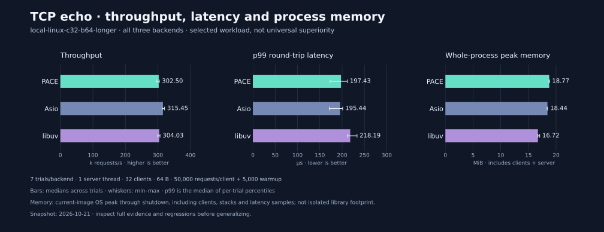

<!-- source-hash: d64a251be810 -->
# 历史性能研究 · 2026 年 10 月 20–21 日

[English](2026-10-20-21.md) · [性能历史](README.zh.md)

这些报告早于四层架构和 10 月 22 日的 Linux 反应器优化，作为历史证据保留，
不代表当前的性能结论。参见[当前的本地 Linux 报告](../README.zh.md)。

# 性能结果与调优

[文档](../../README.zh.md) · [基准测试方法](../../../benchmarks/README.md)

PACE 的性能目标是在有实际意义的负载上超过 Asio 和 libuv。下面的测量结果
**并不能**证明这一目标在各平台上成立。本页包含当前对比中的全部后端和负载、
README 中选摘柱状图背后的测量数据，以及更早的优化研究。

## 指标说明

当前的 TCP 运行器在相同负载下为每个后端记录以下指标。三个后端的结果应一并
报告；仅凭吞吐量领先，不能说明延迟或内存上也有优势。

| 指标 | 测量内容 | 解读方式 |
|---|---|---|
| 吞吐量，请求/秒 | 经过校验的完整请求/响应往返次数除以测量期间的墙钟时间 | 对这一固定负载越高越好；不衡量连接建立或 HTTP 处理。 |
| p50 延迟，µs | 被测请求中客户端观察到的往返延迟中位数 | 代表典型请求；越低越好。 |
| p95 / p99 延迟，µs | 同一批被测请求按最近秩法计算的第 95 / 99 百分位数 | 尾延迟；约有 5% / 1% 的样本更慢。越低越好。 |
| 最大延迟，µs | 一轮试验中最慢的被测请求 | 便于发现停顿；对试验时长和主机调度敏感。 |
| 进程峰值内存，MiB | 操作系统记录的进程内存高水位，在服务器/客户端关闭之后、结果汇总之前采样 | 包括服务器、阻塞客户端、运行时、栈和保存的延迟样本；**不是库本身的独立占用**。 |

表格中每个指标报告的是多次独立试验的中位数。各轮 p99 的中位数并不等于把所有
请求合并后计算的 p99。同样，`median_max_us` 是各轮最大值的中位数；JSON 中的
`max_max_us` 是所有轮次中最慢的单个请求。最小–最大误差线表示观察到的范围，
不是置信区间。

内存统计的是**当前可执行映像**，包括启动和预热阶段；它与吞吐量所用的“仅测量
阶段”时间窗口不同。Linux 读取 `/proc/self/status` 的 `VmHWM`，macOS 使用
`task_info(MACH_TASK_BASIC_INFO).resident_size_max`，Windows 使用
`GetProcessMemoryInfo().PeakWorkingSetSize`。Linux 的 RSS 统计是近似值。
FreeBSD 的峰值内存明确标记为不可用：它的进程历史计数器可能包含 exec 之前启动器
的内存，而针对当前映像的数据来源尚未经过验证。其吞吐量和延迟仍照常测量。

JSON 保留了可用性、来源、范围和时间窗口。只能在相同的操作系统、工具链和负载下
比较内存：各操作系统的统计方式不同，请求越多，分配的延迟样本也越多。本页不声称
稳态零分配，也不声称测得的是独立服务器的内存。`--check-memory` 会验证分配/释放
之后峰值是否保留，以及结果是否不受额外占用 128 MiB 的启动器影响。这项检查与计时
分开运行。

下文 10 月 20 日的历史报告早于 p95 和内存的采集。缺失的数值仍不报告，也无法从
p50/p99 或吞吐量推算出来。当前格式使用 `extended_metrics_version: 2`，并要求每个
完成的请求都贡献一个延迟样本。最初版本 1 的 POSIX 内存测量受到了从启动器继承的
峰值影响；相应的[诊断试验](../../../benchmarks/results/local-metrics-diagnostic-2026-10-21/README.md)
予以保留，但不纳入当前的内存对比。
[精确的计时边界与校验](../../../benchmarks/README.md)。

## 当前本地对比 · 2026 年 10 月 21 日

最初的 84 个全新进程测量了 PACE、Asio 1.34.2 和 libuv 1.52.1：四种负载中，每个
后端各进行七轮轮换试验。全部使用一个服务器线程、回环 TCP、每个连接一个未完成
请求，每个客户端预热 1,000 个请求。客户端会校验每个响应字节。这些测量考察的是
TCP 和反应器，不对 UDP、TLS、HTTP 或 WebSocket 做基准测试。

完整的本地结果如下。数值为七轮试验的中位数；延迟单位为 µs，进程峰值内存单位为
MiB。请求数是**每个客户端**的数量，各负载有意取不同的值，以控制运行时长。

| 客户端数 × 字节数 | 每客户端请求数 | 后端 | 请求/秒 | p50 µs | p95 µs | p99 µs | 峰值 MiB |
|---|---:|---|---:|---:|---:|---:|---:|
| 1 × 64 | 30,000 | PACE | 44,156 | 20.38 | 33.85 | 48.12 | 4.676 |
| 1 × 64 | 30,000 | Asio | 44,488 | 20.41 | 33.08 | 47.99 | 4.273 |
| 1 × 64 | 30,000 | libuv | 45,832 | 20.30 | 31.25 | 47.36 | 4.484 |
| 4 × 64 | 30,000 | PACE | 148,906 | 24.85 | 36.71 | 53.48 | 5.543 |
| 4 × 64 | 30,000 | Asio | 151,258 | 24.65 | 36.21 | 52.91 | 5.176 |
| 4 × 64 | 30,000 | libuv | 157,434 | 23.72 | 35.19 | 51.60 | 5.266 |
| 32 × 64 | 5,000 | PACE | 301,919 | 101.17 | 120.50 | 173.73 | 7.762 |
| 32 × 64 | 5,000 | Asio | 321,471 | 95.52 | 117.31 | 162.65 | 7.438 |
| 32 × 64 | 5,000 | libuv | 302,702 | 93.76 | 182.35 | 209.62 | 5.973 |
| 4 × 4,096 | 10,000 | PACE | 131,993 | 28.50 | 42.43 | 61.84 | 4.977 |
| 4 × 4,096 | 10,000 | Asio | 130,509 | 29.24 | 44.43 | 63.06 | 4.598 |
| 4 × 4,096 | 10,000 | libuv | 135,953 | 26.96 | 40.19 | 61.01 | 4.688 |

在 32 个客户端时，PACE 的 p95 比 libuv 低 33.9%（120.50 对 182.35 µs），观察到的
各轮范围分别为 115.53–141.27 和 180.30–183.56 µs。其 p99 低 17.1%（173.73 对
209.62 µs），但两者的各轮范围有重叠。在这一负载下，Asio 的 p95/p99 中位数都低于
PACE。在四个客户端、4 KiB 消息的负载下，PACE 的吞吐量中位数只比 Asio 高 1.1%，
且范围重叠；这不足以证明存在可重复的吞吐量优势。

**在每一种本地负载下，PACE 的进程峰值内存都高于两个对照库**。32 个客户端时它记录
为 7.762 MiB，而 Asio 为 7.438 MiB，libuv 为 5.973 MiB。这些是整个进程的测量值，
不是库的分配计数。这些试验不支持“PACE 更快或更小”的更宽泛结论。

[全部本地试验、指标范围、主机/编译器、二进制哈希和复现命令](../../../benchmarks/results/local-metrics-2026-10-21/README.md)。

### 对选摘延迟优势的更长时间复核

在检查了短时试验之后，我们以**每客户端 50,000 个测量请求 + 5,000 个预热请求**
重复了 32 客户端 / 64 字节负载。21 个全新进程每个测量约五秒，而最初矩阵中每轮
不到一秒。这是针对选摘负载的后续复核，并不是事先声明、独立进行的最佳指标搜索。
所有结果均予以保留。



| 后端 | 请求/秒 | p50 µs | p95 µs | p99 µs | 峰值 MiB |
|---|---:|---:|---:|---:|---:|
| PACE | 302,496 | 100.97 | 127.81 | 197.43 | 18.766 |
| Asio | 315,445 | 95.82 | 122.45 | 195.44 | 18.441 |
| libuv | 304,033 | 94.74 | 183.92 | 218.19 | 16.719 |

README 的延迟面板使用的就是这次更长时间的复核：PACE 的 p95 中位数**比 libuv 低
30.5%**，范围分别为 122.47–130.19 和 183.32–186.44 µs。其 p99 低 9.5%。Asio 的
吞吐量仍然更高，p95/p99 也更低；PACE 的进程峰值内存仍高于两个库。保存的延迟样本
增多后，三者的进程内存都会上升，因此不要把这里的内存与较短负载对比并视为库的
回归。这仍然只是 WSL2 上的一次本机会话。

[全部更长时间的试验、范围与来源](../../../benchmarks/results/local-metrics-confirmation-2026-10-21/README.md)。

## 当前四平台 CI 对比

[Actions 运行 39608371946](https://github.com/TabNahida/PACE/actions/runs/39608371946)
的全部七个作业均已通过，使用的源码头为 `3eb014c`，检出的合并提交为
`f84f15ba5eb43835a1da298f18bc4d50bc28cb6f`。
共同负载为**一个服务器线程、四个客户端、64 字节消息、每客户端 10,000 个
测量请求 + 1,000 个预热请求**，每个后端五轮轮换试验。下表为中位数；存档中包含每一轮
试验和各指标的范围。只能在同一平台/作业内比较：各主机以及操作系统的内存统计方式不同。

| 平台 | 后端 | 请求/秒 | p50 µs | p95 µs | p99 µs | 峰值 MiB |
|---|---|---:|---:|---:|---:|---:|
| Linux C++20 | PACE | 68,827 | 58.84 | 68.06 | 75.01 | 4.906 |
| Linux C++20 | Asio | 70,212 | 56.90 | 66.87 | 72.83 | 4.562 |
| Linux C++20 | libuv | 67,935 | 42.10 | 85.92 | 99.64 | 4.625 |
| Linux C++23 | PACE | 112,249 | 35.21 | 40.62 | 46.40 | 5.039 |
| Linux C++23 | Asio | 116,049 | 33.91 | 39.12 | 44.67 | 4.711 |
| Linux C++23 | libuv | 109,598 | 29.92 | 49.42 | 55.07 | 4.777 |
| macOS arm64 | PACE | 47,384 | 80.38 | 138.96 | 253.96 | 6.312 |
| macOS arm64 | Asio | 40,271 | 81.08 | 168.12 | 424.12 | 6.297 |
| macOS arm64 | libuv | 57,233 | 63.79 | 113.12 | 175.50 | 6.281 |
| Windows x64 | PACE | 36,169 | 104.20 | 174.10 | 244.30 | 6.750 |
| Windows x64 | Asio | 37,280 | 104.90 | 133.60 | 171.20 | 6.738 |
| Windows x64 | libuv | 37,960 | 103.20 | 161.60 | 242.30 | 7.785 |
| FreeBSD 14.3 VM | PACE | 359,152 | 9.96 | 12.09 | 33.94 | 不可用 |
| FreeBSD 14.3 VM | Asio | 347,325 | 10.52 | 13.21 | 35.13 | 不可用 |
| FreeBSD 14.3 VM | libuv | 410,070 | 8.94 | 10.63 | 31.39 | 不可用 |

README 另外选摘了 **macOS 上相对 Asio 的吞吐量（+17.7%）** 和 **Windows 上相对
libuv 的进程峰值内存（−13.3%）**。两者都不是完整排名：macOS 上 libuv 的吞吐量更高，
而 Windows 上 PACE 的吞吐量最低，p99 也略高于 libuv。Windows 上 Asio 的峰值内存
略低于 PACE。macOS 的吞吐量范围有重叠；中位数领先并不意味着统计显著。共享的 CI
运行器波动可能很大。

FreeBSD 的峰值内存为**不可用**：原始字节数为 null，也没有数值形式的内存汇总。
吞吐量和延迟仍照常测量。各原生内存数据来源分别通过了峰值保留检查和膨胀启动器
检查，相关证据与[全部远程试验、环境和校验证据](../../../benchmarks/results/ci-metrics-2026-10-21/README.md)
一同保存。

## 复现当前的测量

构建一个不带插桩的 release 二进制。运行对比时让主机保持空闲；性能剖析和
sanitizer 构建属于单独的诊断。

```sh
xmake f -m release -o build/fair --sanitizers=n --profiling=n --benchmarks=y -y
xmake -y pace_bench
python3 scripts/run_benchmarks.py --build-dir build/fair --check-memory
python3 scripts/run_benchmarks.py --build-dir build/fair --require-all \
  --repeats 7 --clients 32 --requests 50000 --warmup 5000 --bytes 64 \
  --output benchmark-results/local.json
```

合并后的 JSON 包含全部原始记录、汇总、命令和环境元数据。在 Windows 上，请使用
`python`，并把每条命令写在一行内。本地存档列出了其余三种负载的命令。CI 还会在全部
四个平台上运行组件测试、工作线程数对比和单独的阶段剖析。

用 matplotlib（仅文档需要的依赖）生成仓库中的图表：

```sh
python3 scripts/render_performance_chart.py \
  --evidence benchmarks/results/local-metrics-confirmation-2026-10-21/c32-b64.json \
  --output docs/performance/assets/multimetric-performance.svg
python3 scripts/render_selected_advantages.py \
  --panel benchmarks/results/ci-metrics-2026-10-21/macos-latest-cxx20.json requests_per_second asio \
  --panel benchmarks/results/local-metrics-confirmation-2026-10-21/c32-b64.json p95_us libuv \
  --panel benchmarks/results/ci-metrics-2026-10-21/windows-latest-cxx20.json peak_process_memory_bytes libuv \
  --output docs/performance/assets/selected-performance.svg
```

两个渲染脚本都会校验每条原始记录，并重新计算已保存的汇总。完整图表展示全部三个
库。选摘渲染脚本只接受相对指定对照库真实存在的中位数领先。须线表示观察到的
最小–最大范围，不是置信区间，也不是统计显著性的证据。

## 历史 TCP 对比 · 2026 年 10 月 20 日

[此前的五平台作业对比](../../../benchmarks/results/ci-workers-2026-10-20/README.md)
使用源码头 `72327e4a2f5b787deeb902d188e26c67f9799441`，每个后端五轮试验，四个持久
连接，64 字节消息，每客户端 10,000 个测量请求。它测量了吞吐量和 p50/p99，但没有
p95 或峰值内存。其中选摘的 macOS 相对 Asio、Linux C++23 相对 libuv 的吞吐量领先
曾出现在早先的 README 图表中。这些结果作为历史证据保留，不用于描述当前新增的
协议功能或当前 README 的选摘。

## 更早的反应器优化研究

[此前的运行时研究](../../../benchmarks/results/ci-runtime-2026-10-20/README.md)
测量了这样一项改动：合并生产者唤醒，跳过空收件箱的分配/加锁，并在只剩可运行任务时
避免不必要的原生轮询。每个有界轮次中仍会检查定时器和新提交的工作。

八组交替配对运行使用匹配的 GCC C++20 `-O3 -DNDEBUG -pthread` 构建、相同的五个链接
库源文件，且没有插桩。组件开销是批量平均的 ns/op，不是单次操作的延迟百分位数。

| 组件 | 本地优化前 ns/op | 本地优化后 ns/op | 早期 CI 配对 后/前 |
|---|---:|---:|---:|
| 空的原生轮询 | 74.60 | 58.26 | 0.8405 |
| 让出（yield） | 125.72 | 18.88 | 0.0838 |
| 同上下文 post | 129.11 | 22.09 | 0.0991 |
| 跨线程入队，批量 256 | 325.27 | 22.89 | 0.0520 |
| 根任务完成 | 31.66 | 30.61 | 0.9562 |
| 零时长定时器 | 138.52 | 33.13 | 0.1495 |
| 惰性任务 | 5.70 | 5.69 | 0.9523 |
| 同步 await 链，深度 4 | 35.84 | 35.86 | **1.0454** |

对这些组件来说，数值越低越有利于候选版本。跨线程入队不包括等待批量排空的时间；
它**不是**端到端的完成延迟。精确的边界、编译器和环境见[组件指南](../../../benchmarks/components.md)
和[本地匹配研究](../../../benchmarks/results/component-2026-10-20/README.md)。

尽管任务头未作改动，同步 await 链**在 CI 中回归了约 4.5%**；本地匹配测量则没有
变化。原因尚未查明。CI 中 TCP 配对比值的中位数为 **1.0347**，8/8 胜出，探索性
95% 区间为 1.0288–1.0396。[本地 TCP 配对](../../../benchmarks/results/tcp-profile-2026-10-20/README.md)
结果不确定（比值 1.0492，区间 0.9786–1.1440，6/8 胜出）。

一次[收件箱复用实验](../../../benchmarks/inbox-reuse-experiment.md)减少了分配，但
TCP 吞吐量回归了 3.62%，因此已撤回。仅凭组件开销降低，不足以证明端到端得到了优化。

## 时间花在哪里

[可选的阶段插桩](../../../benchmarks/profiling.md)测量 send、recv、轮询、注册、
收件箱、定时器、回调和协程执行。探针覆盖服务器的整个生命周期，包括启动/预热/
关闭，并会带来额外开销。公平对比运行器会拒绝插桩后的吞吐量。

在本地优化后的样本中，send 约占观察到的墙钟时间的 45.7%，阻塞轮询占 34.7%，
recv 占 9.3%，协程自身执行占 4.0%，轮询器更新占 2.9%。阻塞轮询包含空闲时间，
并非 CPU 开销。收件箱从约 83.9 ns/轮次降到 16.7 ns/轮次，但起初只占观察时间的
约 0.74%。[原始阶段数据和命令](../../../benchmarks/results/tcp-profile-2026-10-20/README.md)
以及[全平台阶段数据](../../../benchmarks/results/ci-runtime-2026-10-20/README.md#stage-diagnostics)
说明了为什么调度器的提速不能直接换算成 TCP 的提速。

## 工作线程数与执行位置

`runtime(n)` 已经接受任意正数个工作线程（worker）。硬件并发数只是默认提示，并不是
亲和性分配，也不是硬性要求。应使用经过测量的工作线程预算，为客户端、应用工作和
操作系统留出余量。

- 在当前的回显测试中，一个繁忙的连接只有一个未完成请求；额外的工作线程无法让这个
  连接并行化。
- 独立连接足够多时，更多活跃上下文可能有帮助，但也会增加线程、轮询、唤醒和调度
  竞争。
- `io_context::run()` 支持由应用拥有的线程。套接字工作仍留在它所属的上下文中；把
  CPU 密集或阻塞的应用工作放到别处执行，再把完成结果 post 回所有者。参见
  [执行教程](../../tutorial/README.zh.md)。
- 启动开销应与稳态吞吐量分开测量。去掉一个空闲的协调线程或一次线程创建，并不能
  证明套接字 I/O 更快。

[工作线程/执行研究](../../../benchmarks/results/worker-scaling-2026-10-20/README.md)
在本地测量了 150 次全新进程试验：每个单元五次，三种执行模式，两种固定的连接数。
主机报告有 24 个逻辑 CPU。不带插桩的 GCC 13.3 C++20 release 构建使用 64 字节消息，
每客户端 10,000 个测量请求和 1,000 个预热请求，每个工作线程一个端口，连接均衡分配。

| 工作线程数 | 8 个客户端：`run()` 请求/秒 | 48 个客户端：`run()` 请求/秒 |
|---|---:|---:|
| 1 | 303,599 | 314,390 |
| 2 | 276,037 | 579,760 |
| 4 | 228,556 | 813,434 |
| 8 | 210,373 | 1,086,909 |
| 24 | 未测量 | 2,380,521 |
| 48 | 未测量 | 1,931,579 |

这些中位数说明了为什么工作线程数要根据负载来选择。在八客户端样本中，一个工作线程
的吞吐量最高；在 48 个客户端时，24 个工作线程的 `run()` 中位数最高，但范围很宽，
为每秒 1.12–2.61 百万个请求。翻倍到 48 个工作线程并没有提高这个中位数。不要用两列
相除来估算扩展性：改变客户端数也就改变了负载。

新的 `run_on_current_thread()` 在调用者线程上运行第零个上下文，并创建 N−1 个后台
工作线程。在八客户端研究中，单工作线程时的启动开销中位数从 **50.1 µs 降到 1.9 µs**，
关闭开销从 154.9 µs 降到 76.9 µs。该样本中的稳态吞吐量**低 1.8%**（297,995 对
303,599 请求/秒）；其他模式/工作线程单元也没有显示出调用者模式在吞吐量上的一致优势。
这个 API 节省一个线程，并减少小型运行时的启动工作；它并不被宣传为通用的 TCP 吞吐量
优化。现有的 `run()` 行为及其以硬件并发数为默认值的做法保持不变。

参见[全部模式、范围、p99 和生命周期测量](../../../benchmarks/results/worker-scaling-2026-10-20/README.md)
以及[复现指南](../../../benchmarks/scaling.md)。这是一个单独的、仅针对 PACE 的负载；
其数字不得与上文单线程的 Asio/libuv 表格直接比较。

### 远程工作线程测量

[成功完成的四平台 CI 研究](../../../benchmarks/results/ci-workers-2026-10-20/README.md)
新增了 180 次扩展性试验：三种模式和 1/2/4/8 个工作线程的每个单元各三次，固定八个
客户端，每客户端 5,000 个测量请求 + 500 个预热请求。全部七个作业均通过，包括
C++20/23 Linux 构建、教程、普通/剖析测试、基准测试校验和 sanitizer。下面的 `run()`
吞吐量中位数表明，本地八客户端的结果并不适用于所有主机：

| 平台（报告的逻辑 CPU 数） | 1 个工作线程 | 2 个工作线程 | 4 个工作线程 | 8 个工作线程 |
|---|---:|---:|---:|---:|
| Linux C++20 (4) | 96,939 | 172,882 | 190,415 | 191,350 |
| Linux C++23 (4) | 67,342 | 120,040 | 119,421 | 129,018 |
| macOS arm64 (3) | 66,948 | 60,976 | 70,215 | 52,936 |
| Windows x64 (4) | 36,427 | 53,096 | 74,367 | 86,430 |
| FreeBSD VM (4) | 259,126 | 273,775 | 268,238 | 257,059 |

单位为请求/秒；只能在同一行内比较。在 Windows 的中位数中，八个工作线程胜过四个，
而 macOS 和 FreeBSD 更偏向较少的工作线程。每个单元三次试验属于探索性质；全部模式、
离散程度、生命周期计时和 p99 见[未删节的报告](../../../benchmarks/results/ci-workers-2026-10-20/README.md)。
这支持让工作线程数和执行位置保持可配置，而不是把工作线程数等同于报告的 CPU 数，
也不承诺存在固定的最优值。

## 复现与解读

使用[基准测试命令](../../../benchmarks/README.md)、
[组件运行器](../../../benchmarks/components.md)和
[性能剖析指南](../../../benchmarks/profiling.md)。全部四个平台都会运行正确性测试，
并通过 [GitHub Actions](https://github.com/TabNahida/PACE/actions/workflows/ci.yml)
发布不带插桩的对比产物。

正确性关卡会拒绝缺失的后端、格式错误/不完整的结果、错误的请求数、损坏的负载数据
和超时失败。它们不会在共享运行器上强制要求某个任意的速度比。若要发布性能结论，
应使用专用硬件，事先声明所有负载场景，跨多个会话运行更长的轮换试验，并在评估
吞吐量的同时评估 p99。参见拟议的[验收标准](../../../benchmarks/README.md#acceptance-criteria)。

这些闭环本机测试不能证明 HTTP 性能、过载下的延迟或远程网络容量。
[更早的 CI 结果](../../../benchmarks/results/ci-2026-10-20/README.md)
仍作为历史证据保留，而不是跨运行的受控对比。
