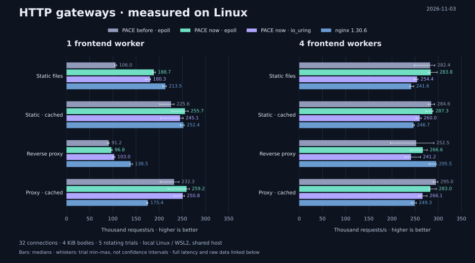

<!-- source-hash: 6c9f61743b1d -->
# 网关优化 · 本地 Linux · 2026 年 11 月 3 日

[English](gateway-optimization-2026-11-03.md) · [文档](../../README.zh.md) · [网关 API 与限制](../../reference/gateway/README.zh.md) · [较早的 nginx 对比](../http-gateway.zh.md) · [TCP/Asio/libuv 结果](../README.zh.md)

这是在本地 Linux / WSL2 上同一会话内、轮换顺序进行的**优化前/优化后**对比，而不是与另一次运行的数字作比较。
这份较早的优化报告保留其冻结的前后对比证据。[0.5.0 完整结果](../README.zh.md)包含更新的代理工作以及主页上的
PACE/Asio/libuv 对比。这里展示了全部四个网关场景和两种工作线程数。



[全部 160 次试验、延迟百分位、CPU、内存以及源码/二进制指纹](../../../benchmarks/results/linux-gateway-2026-11-03/optimized.json)。
完整矩阵逐字节校验了 **2560 万个被测响应**。

## 结果与局限

在**一个前端工作线程**下，PACE epoll 的吞吐量在静态文件上提升了 **78.1%**，缓存静态文件提升 **13.3%**，
无缓存代理提升 **6.2%**，缓存代理提升 **11.6%**。静态服务每个请求的 CPU 时间从 9.44 μs 降到 5.25 μs
（减少 44.4%），这与“去掉了工作量，而不只是改变了调度”相符。缓存代理的中位数为 259.2k 请求/s，nginx 为 175.4k（+47.8%）。
nginx 在无缓存静态吞吐量（213.5k 对 188.7k）、无缓存代理吞吐量（138.5k 对 96.8k）以及静态服务的 p99 延迟上仍然领先。

在四个工作线程下，尽管服务器每个请求的 CPU 时间下降了，静态吞吐量却几乎持平；共享主机的调度和单个负载生成线程
限制了这个工作负载所能证明的结论。在完整矩阵中，缓存代理吞吐量**回归了 4.1%**（295.0k → 283.0k）。
一次更长的七组配对确认测试同样发现了 **3.1% 的回归**（296.7k → 287.3k；配对比值中位数 0.974），而服务器每个请求的
CPU 时间下降了。确认测试中单工作线程的提升依然存在（238.4k → 259.4k）。我们保留这一局限，而不声称扩展性普遍提升。
在完整矩阵中，PACE 的两个缓存代理中位数仍然高于 nginx 对应的中位数。io_uring 的表现依然好坏参半，Linux 的自动后端仍是 epoll。

[更长的缓存代理确认测试，全部 28 次试验](../../../benchmarks/results/linux-gateway-2026-11-03/proxy-cache-confirmation.json)。
每次试验测量 640,000 个请求（每条连接 20,000 个），而主矩阵为 160,000 个。这次较长运行的结果没有替换主图表中的任何柱子。

## 完整矩阵

五次试验的中位数。吞吐量及其观测到的最小–最大值单位为**千请求/s**；延迟单位为 μs。各百分位是每次试验对应百分位的中位数，
而不是合并样本后的结果。须线和范围都不是置信区间。CPU 是前端进程树的 CPU 时间除以完成的被测请求数，不包括客户端和源站。

| 场景 | 工作线程数 | 实现 | 吞吐量 | 最小–最大 | p50 | p95 | p99 | CPU μs/请求 |
|---|---:|---|---:|---:|---:|---:|---:|---:|
| static | 1 | PACE 优化前 / epoll | 106.0 | 104.0–108.3 | 282.6 | 428.2 | 588.7 | 9.44 |
| static | 1 | PACE 当前 / epoll | 188.7 | 185.9–191.8 | 156.7 | 293.5 | 332.5 | 5.25 |
| static | 1 | PACE 当前 / io_uring | 180.3 | 170.7–181.4 | 173.3 | 201.8 | 284.5 | 5.50 |
| static | 1 | nginx | 213.5 | 207.8–215.4 | 145.3 | 178.0 | 233.1 | 4.62 |
| static | 4 | PACE 优化前 / epoll | 282.4 | 248.1–292.6 | 108.8 | 148.0 | 197.0 | 11.31 |
| static | 4 | PACE 当前 / epoll | 283.8 | 279.2–297.5 | 103.1 | 154.3 | 196.8 | 8.56 |
| static | 4 | PACE 当前 / io_uring | 254.4 | 247.8–256.4 | 112.9 | 174.7 | 214.2 | 9.62 |
| static | 4 | nginx | 241.6 | 238.4–246.9 | 119.7 | 186.4 | 222.6 | 8.00 |
| static_cached | 1 | PACE 优化前 / epoll | 225.6 | 201.4–232.3 | 125.6 | 237.6 | 302.2 | 4.31 |
| static_cached | 1 | PACE 当前 / epoll | 255.7 | 227.5–262.6 | 113.8 | 213.7 | 254.7 | 3.94 |
| static_cached | 1 | PACE 当前 / io_uring | 245.1 | 203.1–251.8 | 125.5 | 150.4 | 238.8 | 4.06 |
| static_cached | 1 | nginx | 252.4 | 245.7–254.1 | 123.3 | 147.1 | 185.6 | 3.94 |
| static_cached | 4 | PACE 优化前 / epoll | 284.6 | 278.7–292.3 | 98.4 | 152.6 | 179.2 | 7.38 |
| static_cached | 4 | PACE 当前 / epoll | 287.3 | 273.5–288.8 | 98.7 | 155.0 | 179.8 | 6.94 |
| static_cached | 4 | PACE 当前 / io_uring | 260.0 | 252.2–263.1 | 108.3 | 169.9 | 203.8 | 7.81 |
| static_cached | 4 | nginx | 246.7 | 245.0–248.4 | 118.0 | 182.1 | 207.9 | 7.12 |
| proxy | 1 | PACE 优化前 / epoll | 91.2 | 88.5–91.9 | 340.8 | 478.7 | 632.6 | 10.94 |
| proxy | 1 | PACE 当前 / epoll | 96.8 | 96.0–98.5 | 320.9 | 443.2 | 519.7 | 10.25 |
| proxy | 1 | PACE 当前 / io_uring | 103.0 | 100.2–104.4 | 304.2 | 351.6 | 450.9 | 9.75 |
| proxy | 1 | nginx | 138.5 | 137.4–142.4 | 222.8 | 268.8 | 439.2 | 7.19 |
| proxy | 4 | PACE 优化前 / epoll | 252.5 | 197.0–290.6 | 105.7 | 156.7 | 236.3 | 12.69 |
| proxy | 4 | PACE 当前 / epoll | 266.6 | 240.1–276.4 | 104.4 | 153.0 | 222.2 | 12.38 |
| proxy | 4 | PACE 当前 / io_uring | 241.2 | 228.3–261.7 | 120.3 | 171.3 | 245.0 | 13.44 |
| proxy | 4 | nginx | 295.5 | 280.4–295.9 | 102.3 | 151.6 | 212.6 | 10.81 |
| proxy_cached | 1 | PACE 优化前 / epoll | 232.3 | 202.3–242.8 | 123.5 | 234.8 | 287.8 | 4.25 |
| proxy_cached | 1 | PACE 当前 / epoll | 259.2 | 219.2–265.0 | 113.1 | 213.6 | 248.0 | 3.81 |
| proxy_cached | 1 | PACE 当前 / io_uring | 250.8 | 232.4–254.3 | 123.4 | 149.6 | 206.8 | 3.94 |
| proxy_cached | 1 | nginx | 175.4 | 172.9–175.6 | 178.3 | 208.7 | 287.8 | 5.69 |
| proxy_cached | 4 | PACE 优化前 / epoll | 295.0 | 289.4–299.0 | 95.9 | 149.1 | 183.5 | 7.38 |
| proxy_cached | 4 | PACE 当前 / epoll | 283.0 | 280.5–295.9 | 100.3 | 157.8 | 188.9 | 7.19 |
| proxy_cached | 4 | PACE 当前 / io_uring | 266.1 | 257.9–275.8 | 106.0 | 166.6 | 200.9 | 7.94 |
| proxy_cached | 4 | nginx | 249.3 | 242.3–252.7 | 113.5 | 177.7 | 212.6 | 8.75 |

## 改了什么，为什么改

- **静态文件**：之前的 FNV-1a 循环对每个字节都有一次存在依赖的乘法。一个紧凑、可移植、种子为零的 XXH64 实现
  以 32 字节为块处理，并使用相互独立的累加器。它保留了基于内容的校验器，包括大小相同、时间戳相同的编辑；
  黄金向量来自上游 xxHash 0.8.3。普通路径还省去了一次多余的根目录 `dup/close`，HTTP 日期格式化也不再构造
  locale/iostream。符号链接的包含检查和文件大小限制依然保留。
- **HTTP/1**：预留线上缓冲区的容量，追加头部字段时不再拼接中间字符串，并避免条件表达式造成的响应体拷贝。
  读缓冲区不再把即将被 `read_some` 覆盖的字节清零。头部过滤以不区分大小写的方式比较视图；代理交互少用一层协程包装。
  现有的分帧校验、有界读取、取消和截止时间依然有效。
- **热缓存读取**：`get_copy()` 为每个缓存/反应器保留一个快照。连续命中时检查一个以读为主的分片代数（generation）
  和 steady-clock 过期时间，既不获取分片互斥锁，也不写入 CLOCK 元数据，也不增加快照的共享引用计数。
  计数器的写入归读者所有；统计信息包含活跃的和已退役的读者。任何修改都会使快速路径失效。通用的 `get()` 仍然可用。
- **CPU 缓存所有权**：代数存储通过 128 字节对齐与分片互斥锁和共享统计信息隔开，读者计数器也各自独立对齐。
  这样可以避免把互不相关的写者放在同一条 64/128 字节的缓存行上，而无需针对这款 CPU 型号调优。借用式的
  上下文服务查找在定位连接池或读者时，也避免了共享所有者计数的变化。没有使用 CPU 亲和性、特殊 ISA 要求或
  针对特定主机的缓存大小常量。
- **代理缓存的 Age**：Date/Age 在插入时规范化；命中时加上单调时钟计算的驻留时间，而不是反复解析同一个 Date。
  这仍是一个保守的 HTTP 缓存子集，而不是完整的 RFC 缓存实现。

这**并没有**消除所有争用。未命中和写入仍会锁定共享分片；交替访问的键会错过只有一项的本地备忘；
服务任务的所有权仍使用共享引用计数；网络、内存分配和内核也还有其他共享状态。另外做过一个按反应器划分服务所有权的实验，
它增加了一次查找，且没有带来稳定的净提升（单工作线程中位数变差了），因此**没有发布**。它的
[原始结果](../../../benchmarks/results/linux-gateway-2026-11-03/ownership-experiment.json)
和[确切的实验补丁](../../../benchmarks/results/linux-gateway-2026-11-03/ownership-experiment.patch)
都保留了下来，以便审查这一决定。

每个反应器在其下一次缓存查找或上下文销毁之前，可以为每个缓存钉住一个已被逐出的快照：最多为 `max_object_bytes`
的响应体，加上头部、键和读者元数据。这是额外保留的内存，而不是额外存储的缓存条目。上下文会一直保留缓存内部结构直到销毁，
因此服务应当在每个挂载点创建一次，而不是每个请求创建一次。缓存配置的预算并不是 RSS 上限。响应体仍会被拷贝，
未缓存的文件读取仍在反应器上同步执行。这些取舍在[参考文档](../../reference/gateway/README.zh.md)中有详细说明。

## 隔离的争用与哈希诊断

组件基准测试去掉了套接字、源站和 HTTP 负载生成器。两条缓存路径都针对同一个热键返回并校验同一份 4 KiB 响应副本。
`shared` 使用 `get()` 后再拷贝；`local` 在每个线程自己的反应器上使用 `get_copy()`。这项诊断中没有并发写入；
修改操作的正确性由测试单独覆盖。五次轮换顺序的试验，每次试验每个工作线程执行 200,000 次操作。
这些是**缓存操作，不是 HTTP 请求**。

| 工作线程数 | 共享路径 百万次拷贝/s | 本地快照 百万次拷贝/s | 中位数之比 |
|---:|---:|---:|---:|
| 1 | 8.99 | 9.97 | 1.11× |
| 2 | 4.61 | 19.68 | 4.26× |
| 4 | 4.79 | 38.92 | 8.13× |
| 8 | 3.59 | 66.60 | 18.56× |

在相同的 4 KiB 哈希工作负载下，FNV-1a 测得每秒 0.329 百万次哈希，XXH64 为每秒 6.379 百万次哈希（19.4×）。
每次迭代都会改变输入，以防止循环不变量外提。这单独衡量的是存在依赖的逐字节循环；端到端的静态文件提升要小得多，
因为打开文件、读取、HTTP 和套接字的工作依然存在。

[全部组件试验、校验和与 CPU 时间](../../../benchmarks/results/linux-gateway-2026-11-03/components-optimized.json)。
缓存结果衡量的是去掉共享锁、引用计数流量和元数据写入的综合效果；它并不能单独归因出仅由填充带来的加速。
这里无法使用硬件 `cache-misses` 计数器（`perf_event_open` 返回 ENOENT），因此**不声称测得了 LLC 未命中、
HITM 或缓存一致性流量的减少**。

## 验证

- ASan/UBSan：在 epoll 上全部 31 个协议/运行时测试通过，在 io_uring 上全部 31 个也通过。
- 新增了跨反应器的替换/清空屏障、并发修改/读取/退役压力测试、精确的命中统计、TTL 和存活快照逐出测试、
  响应副本独立性测试，以及服务/上下文销毁后惰性任务的生命周期检查。
- XXH64 黄金向量覆盖了空输入、未对齐的视图、块/尾部边界以及长内容。静态校验器能检测出保留时间戳的同大小编辑。
- 原生 Windows IOCP/WSAPoll、macOS、Linux、FreeBSD 以及包括大端 s390x 在内的 QEMU 目标验证的是正确性，
  而不是远程性能排名。移动平台任务只做编译。
- ThreadSanitizer 已构建，但无法在这台 WSL2 主机上启动：
  `FATAL: ThreadSanitizer: unexpected memory mapping`。这**不是**一次通过的 TSan 结果。

## 复现与解读

主矩阵使用 Linux 6.18.40.1 / WSL2、GCC 13.3 release 构建、nginx 1.30.6，32 条持久连接，每条同时只有一个未完成的 GET，
响应体 4096 字节，每条连接预热 200 个请求、测量 5000 个请求。它轮换四种实现，重复五次，每次都使用全新的进程和缓存。
观测到的主机一分钟负载在 1.48 到 5.03 之间；这是一台共享主机，不是隔离的容量测试。较早的筛选运行遇到了负载激增，
它作为[诊断数据](../../../benchmarks/results/linux-gateway-2026-11-03/optimization-screen-contended.json)保留链接，
没有替换到主表中。

旧二进制由 `94ed51dd6ca0b8407cf554bce72bcfe0fc37e3d7` 构建，优化后的实现由 `bf7e8c7` 构建，两者使用相同的 release 配置。
JSON 中的源文件和二进制哈希标识了每个被测构建。之后的所有权实验已被回退；后续改动只增加了测试和文档，
没有形成另一个被测实现。请为旧二进制使用单独的构建目录或检出目录。

```sh
xmake f -m release --uring=y --protocol_benchmarks=y --tests=n --examples=n -y
xmake -y
python3 scripts/run_gateway_benchmarks.py \
  --pace build/linux/x86_64/release/pace_http_gateway \
  --baseline /path/to/94ed51d/pace_http_gateway \
  --load build/linux/x86_64/release/pace_http_load --nginx /path/to/nginx \
  --backends baseline,epoll,io_uring,nginx --output /tmp/optimized.json
python3 scripts/run_gateway_components.py \
  --binary build/linux/x86_64/release/pace_gateway_components \
  --output /tmp/components.json
python3 scripts/plot_gateway_optimization.py /tmp/optimized.json /tmp/homepage.svg
python3 scripts/plot_gateway_optimization.py /tmp/optimized.json /tmp/all.svg --all-backends
```

独立的 epoll 负载生成器不链接任何 PACE 代码，会校验状态码、Content-Length 和每一个响应字节。它是闭环的，
不使用流水线，也不做协调遗漏校正。代理试验中，每个前端（包括旧二进制和 nginx）都使用相同的两个 PACE epoll 源站（各两个工作线程）。

nginx 启用 sendfile、TCP_NODELAY/reuseport 和上游 keep-alive，并关闭访问日志。各缓存实现并不相同：PACE 在内存中保存响应快照，
nginx 静态文件的 `open_file_cache` 保留描述符/元数据，数据则在操作系统页缓存中；nginx 代理缓存使用文件加共享键区。
两者都经过预热；确切的配置保存在每次试验中。这项对比衡量的是这些完整配置下的路径。

CPU 是在被测阶段前后采样的 `/proc` 进程树统计。VmHWM 之和包含启动和预热阶段，可能重复计算 nginx 的共享页面，
且不包含页缓存；它无法证明内存分配器的效率。其余局限请参阅
[原始方法说明](gateway-matrix-2026-11-03.zh.md#测试测量的内容)，那项独立的工作负载请参阅已归档的 TCP/Asio/libuv 研究。
