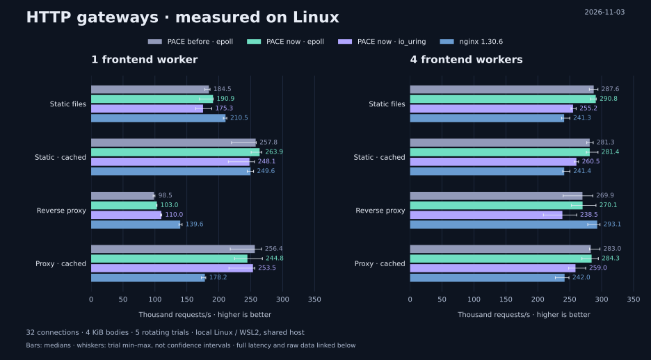

<!-- source-hash: f18094bc60de -->
# HTTP 网关：PACE 与 nginx

[English](http-gateway.md) · [性能](README.zh.md)

PACE 的[网关](../reference/gateway/README.zh.md)（静态文件、反向代理、缓存、负载均衡）在相同的 HTTP 负载下与 nginx
对比，基于 PACE 0.5.0 发布版源码，于 2026 年 11 月 3 日在本地 Linux（WSL2，Intel Core Ultra 7 270K Plus，GCC 13.3.0）
上测得。与 nginx 只比较 HTTP；与 Asio 和 libuv 的传输层对比见 [TCP 回显](tcp.zh.md)。

## 结果

32 条持久连接，4 KiB 响应体，每条连接同一时间只有一个未完成的 GET，每条连接计入测量的请求 10,000 个、预热请求
200 个，每种情形 5 次轮换试验。160 次试验构成的矩阵中，全部 **5,120 万个计入测量的响应**都由独立的 epoll 负载
生成器逐字节校验。每次试验都使用全新的前端和缓存。PACE 默认的后端是 epoll；io_uring 的结果单独列出，从不按择优
方式挑选。

“前一版”指上一个已经优化过的 PR head `a343fa6`，而不是更早的未优化网关。在这个矩阵中，两个版本使用同样的最终版
源站服务器。nginx 1.30.6 使用 sendfile、TCP_NODELAY、reuseport、持久的上游连接，不写访问日志，也不重试代理请求。
代理情形下，每个前端都使用两个相同的 PACE epoll 源站，每个源站两个工作线程。运行脚本保留了完整的 nginx 配置、
源码与二进制哈希、主机负载、每次试验以及资源测量。PACE 的响应缓存在内存中；nginx 的代理缓存使用其文件缓存，
nginx 的静态缓存使用 open_file_cache。这些策略并不是等价的缓存实现。

| 负载 | 工作线程 | 后端 | 请求/秒 | 试验最小–最大 | p50 µs | p95 µs | p99 µs | 前端 CPU µs/请求 |
|---|---:|---|---:|---:|---:|---:|---:|---:|
| static | 1 | PACE 前一版 · epoll | 184,487 | 178,149–186,246 | 158.88 | 298.37 | 373.00 | 5.38 |
| static | 1 | PACE 0.5 · epoll | 190,946 | 169,725–191,251 | 155.04 | 287.60 | 337.39 | 5.25 |
| static | 1 | PACE 0.5 · io_uring | 175,332 | 163,945–189,000 | 173.01 | 227.58 | 287.14 | 5.66 |
| static | 1 | nginx | 210,538 | 207,140–212,542 | 147.00 | 180.54 | 250.79 | 4.69 |
| static | 4 | PACE 前一版 · epoll | 287,613 | 280,739–294,223 | 105.37 | 155.49 | 196.77 | 9.09 |
| static | 4 | PACE 0.5 · epoll | 290,836 | 283,034–291,532 | 103.88 | 153.75 | 204.15 | 8.84 |
| static | 4 | PACE 0.5 · io_uring | 255,237 | 252,062–260,064 | 116.77 | 175.34 | 237.22 | 9.94 |
| static | 4 | nginx | 241,251 | 237,237–250,096 | 119.63 | 186.06 | 226.37 | 8.16 |
| static_cached | 1 | PACE 前一版 · epoll | 257,779 | 219,919–258,555 | 113.77 | 213.48 | 248.75 | 3.88 |
| static_cached | 1 | PACE 0.5 · epoll | 263,933 | 250,645–267,339 | 111.20 | 207.83 | 241.09 | 3.78 |
| static_cached | 1 | PACE 0.5 · io_uring | 248,081 | 214,933–255,798 | 122.94 | 156.36 | 228.47 | 4.00 |
| static_cached | 1 | nginx | 249,617 | 244,545–254,477 | 124.77 | 153.25 | 196.12 | 4.00 |
| static_cached | 4 | PACE 前一版 · epoll | 281,308 | 276,727–286,781 | 100.46 | 156.84 | 182.88 | 7.12 |
| static_cached | 4 | PACE 0.5 · epoll | 281,368 | 276,068–294,303 | 103.12 | 159.95 | 185.66 | 7.16 |
| static_cached | 4 | PACE 0.5 · io_uring | 260,508 | 256,960–263,847 | 107.98 | 169.63 | 197.83 | 7.69 |
| static_cached | 4 | nginx | 241,384 | 239,011–250,251 | 120.41 | 185.55 | 217.01 | 7.34 |
| proxy | 1 | PACE 前一版 · epoll | 98,546 | 97,121–99,982 | 314.73 | 439.59 | 525.57 | 10.16 |
| proxy | 1 | PACE 0.5 · epoll | 103,028 | 102,280–103,197 | 299.42 | 420.81 | 500.45 | 9.69 |
| proxy | 1 | PACE 0.5 · io_uring | 109,958 | 108,450–110,612 | 282.77 | 334.03 | 455.13 | 9.06 |
| proxy | 1 | nginx | 139,601 | 137,656–142,471 | 221.78 | 270.63 | 369.26 | 7.09 |
| proxy | 4 | PACE 前一版 · epoll | 269,945 | 239,782–286,135 | 104.80 | 152.46 | 239.87 | 12.28 |
| proxy | 4 | PACE 0.5 · epoll | 270,139 | 252,701–291,134 | 104.73 | 164.40 | 257.85 | 12.47 |
| proxy | 4 | PACE 0.5 · io_uring | 238,510 | 208,780–260,870 | 119.10 | 175.46 | 248.78 | 13.19 |
| proxy | 4 | nginx | 293,050 | 278,282–297,445 | 102.08 | 152.66 | 206.93 | 10.78 |
| proxy_cached | 1 | PACE 前一版 · epoll | 256,413 | 217,970–266,831 | 111.91 | 212.27 | 261.06 | 3.84 |
| proxy_cached | 1 | PACE 0.5 · epoll | 244,817 | 224,733–268,232 | 117.06 | 212.30 | 289.91 | 4.09 |
| proxy_cached | 1 | PACE 0.5 · io_uring | 253,515 | 215,893–256,257 | 120.97 | 164.76 | 223.34 | 3.94 |
| proxy_cached | 1 | nginx | 178,187 | 172,769–179,592 | 174.43 | 206.28 | 272.53 | 5.56 |
| proxy_cached | 4 | PACE 前一版 · epoll | 283,020 | 280,946–297,374 | 100.24 | 158.00 | 191.52 | 7.25 |
| proxy_cached | 4 | PACE 0.5 · epoll | 284,299 | 269,110–294,829 | 100.55 | 158.59 | 212.08 | 7.38 |
| proxy_cached | 4 | PACE 0.5 · io_uring | 259,037 | 248,411–274,988 | 109.72 | 174.36 | 227.24 | 7.81 |
| proxy_cached | 4 | nginx | 241,976 | 227,498–248,812 | 116.36 | 186.46 | 247.19 | 9.12 |

四个工作线程的无缓存代理，吞吐量基本持平（+0.1%），p99 则变差了（239.87 → 257.85 µs）。单工作线程的缓存代理在
这个完整矩阵中下降了 4.5%，各次试验的范围很宽且相互重叠；下文记录了一次更长的后续测量。多核情形下的小幅变化不应
解读为已证实的扩展性提升。这里 io_uring 在单工作线程的无缓存代理上优于 epoll，但在其他几种情形下落后；它仍然是
需要显式启用的选项。

## 更长时间的缓存代理确认

完整矩阵之后，用同一组冻结的二进制，在每种工作线程数下进行了 7 对交替的前一版/epoll 对比，每条连接计入测量的请求
20,000 个（总计 1,792 万个经过校验的响应）。这是一次单独的后续测量，不取代上面的矩阵及其图表。

| 工作线程 | 前一版 请求/秒 | 0.5.0 请求/秒 | 变化 | 配对比值中位数 |
|---:|---:|---:|---:|---:|
| 1 | 250,183 | 268,423 | +7.3% | 1.009 |
| 4 | 284,432 | 295,179 | +3.8% | 1.038 |

原矩阵中单工作线程的下降在这个更长的测量窗口里没有再出现；多核吞吐量仍然接近且波动较大。这既不能证明普遍的
提升，也不能消除已观察到的尾延迟退化。两次会话的数据都保持公开。
[全部确认试验](../../benchmarks/results/linux-release-0.5.0/proxy-cache-confirmation.json)。

## 反向代理为何仍落后于 nginx

前端 1 个工作线程时，PACE epoll 无缓存代理的吞吐量从 **98,546 变为 103,028 请求/秒（+4.5%）**。nginx 达到
139,601；在这种情形下 PACE 比它低 26.2%。

前端 4 个工作线程时，PACE epoll 无缓存代理的吞吐量从 **269,945 变为 270,139 请求/秒（+0.1%）**。nginx 达到
293,050；在这种情形下 PACE 比它低 7.8%。

剩余的差距来自可以指认的实现开销，而没有证据表明存在全局的代理锁。PACE 以字符串和 vector 的形式拥有每个请求和
响应，完整解析上游的 HTTP 消息，再为下游连接校验并重新编码。定长消息体仍要经过待处理/消息体缓冲区和编码后的
线路缓冲区。每次交换还各自拥有一个结构化取消边界、定时器和回调注册。nginx 在其专门的上游引擎中使用请求内存池和
缓冲区链（所测 nginx 源码中的 `ngx_http_request.c`、`ngx_http_upstream.c`）。这些设计差异说明了还有哪些工作可做；
本报告**不会**给每一项分配一个缺乏依据的 CPU 时间百分比。

这一轮迭代一次性预留头部存储，遍历 token 列表时不再创建临时的、拥有所有权的 vector，在完整的定长消息体已经缓冲
时绕过读取消息体的协程，并去掉了一个只做转发的上游协程。另一次 Linux/glibc 分配统计显示，在单个前端线程上，每次
交换的分配调用从 **62.03 降到 52.04（减少 16.1%）**。这项统计包括启动和预热，并且具有侵入性，其计时已被丢弃。它
统计的是调用次数，而不是分配的字节数、峰值内存、缓存未命中或 nginx 的分配行为。
[分配计数](../../benchmarks/results/linux-release-0.5.0/proxy-allocations.json)和
[探针源码](../../benchmarks/diagnostics/allocation_probe.c)均已保留。

每个工作线程的连接池和游标仍归反应器所有。早先引入的反应器本地缓存快照、隔离的命中计数器和基于代数的失效机制，
减少了对共享热点键的写入；见[缓存调查](history/gateway-optimization-2026-11-03.zh.md)。共享缓存的未命中和修改
仍然要对分片加锁，服务的所有权仍然带有共享的引用计数。这里不声称硬件缓存未命中或伪共享有任何改善：这台 WSL2 主机
不提供所需的 PMU 计数器。早先四工作线程缓存代理的退化仍记录在那份报告中；本次后续测量更换了基准，但并不抹去它。

专门的流式/缓冲区链代理可以去掉更多拷贝和拥有所有权的对象，但需要明确的背压、分帧、取消和缓存约定。这个版本
保留了有上限的完整消息体缓冲和总截止时间；它没有为了赢得基准测试而关闭校验、重试请求或放弃取消。

## 测量的局限

单线程的 HTTP 负载生成器和回环 TCP 可能限制扩展性；四工作线程的结果并不是服务器容量的上限。主机是共享的，因此
数值范围包含调度干扰。前端 CPU 取自测量屏障前后的 /proc 进程树，精度受时钟节拍限制，且不包括单独的源站进程。
网关的 JSON 还保留了各进程 VmHWM 之和：其中包含预热阶段，并可能重复计算共享页面；它不包括内核页缓存，也不能与
TCP 测试程序的内存数字相比较。这种闭环负载没有校正协调遗漏（coordinated omission），也不能预测广域网、TLS、
大消息体或服务过载时的延迟。

[每次网关试验与配置](../../benchmarks/results/linux-release-0.5.0/gateway.json) ·
[复现方法与探索性结果](../../benchmarks/results/linux-release-0.5.0/README.md) ·
[同一天更早的 nginx 矩阵](history/gateway-matrix-2026-11-03.zh.md) ·
[HTTP/WebSocket/HTTP2/HTTP3 调查](protocols.zh.md)

[所有权与路由器测量](history/ownership-review-2026-11.zh.md) · [QUIC 后端对比](../../benchmarks/results/quic-backends-2026-11-18/README.md)
