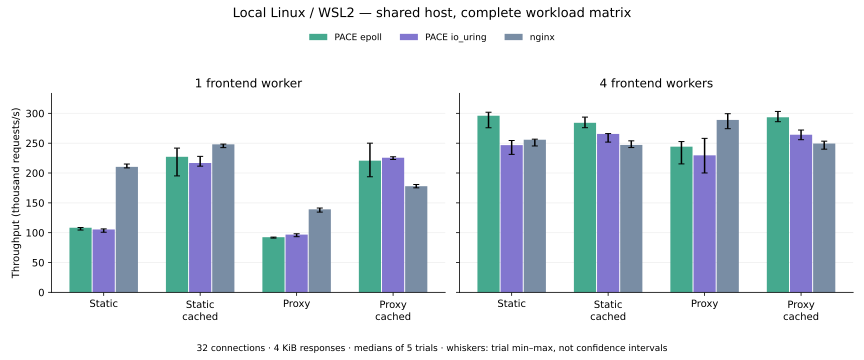

<!-- source-hash: 802fb901d3f4 -->
# 本地 Linux 网关与 nginx 对比

[English](http-gateway.md) · [性能](README.zh.md)

最新的单工作线程 优化、优化前后对比和争用诊断见[网关优化](history/gateway-optimization-2026-11-03.zh.md)。本页保留较早的测量结果。

测量于 2026-11-03，在一台**共享的本地 Linux / WSL2 主机**上进行。第一次运行恰逢大量
CPU 密集型后台任务。这些任务结束后，我们在后台负载较低的情况下把同一套完整矩阵重跑了一遍，
并记录了每轮试验时的主机负载快照。图表和表格展示的是第二次运行；两次完整运行的数据都附有链接。
两次运行都不是隔离裸机上的峰值，也不是生产环境的容量保证。
本页没有使用任何远程 runner 的性能数据。



[较低负载下的原始试验数据和完整指标](../../benchmarks/results/linux-gateway-2026-11-03/nginx.json) ·
[较早的争用运行，全部 120 次试验](../../benchmarks/results/linux-gateway-2026-11-03/nginx-contended.json)

每次完整运行都完成了 120 次试验，并校验了全部 1920 万个被测响应。
nginx 在单工作线程 静态文件吞吐量上领先，在两种工作线程数下的无缓存代理吞吐量上也领先。
PACE epoll 的缓存代理中位数在一个工作线程 时为 220.7k 请求/s，nginx 为 177.9k（+24.1%）；
四个工作线程 时为 293.4k 对 249.4k（+17.6%）。单工作线程 时 epoll 的 p99 更差（313 对 257 μs）；
四个工作线程 时则更好（178 对 229 μs）。在这次运行中，四工作线程 的静态场景同样是 PACE epoll
吞吐量占优。这是特定工作负载下的结果，并不代表库具有普遍优势。
io_uring 并没有稳定地优于 epoll，因此 Linux 上仍默认使用 epoll。

## 完整的吞吐量与 p99 结果

下列数字均为五次试验的中位数。最小–最大值一列是观测到的吞吐量范围，不是置信区间。
p50/p95、每次试验的 p99 以及资源测量见原始数据。吞吐量单位为**千请求/秒**；p99 单位为 μs。

| 场景 | 工作线程数 | 后端 | 吞吐量 | 最小–最大 | p99 μs |
|---|---:|---|---:|---:|---:|
| static | 1 | epoll | 108.3 | 104.5–108.7 | 576 |
| static | 1 | io_uring | 105.4 | 100.8–106.4 | 494 |
| static | 1 | nginx | 210.3 | 208.6–215.1 | 266 |
| static | 4 | epoll | 296.0 | 275.8–301.9 | 222 |
| static | 4 | io_uring | 246.7 | 231.3–254.5 | 226 |
| static | 4 | nginx | 255.8 | 245.3–256.7 | 215 |
| static_cached | 1 | epoll | 227.1 | 195.2–241.7 | 305 |
| static_cached | 1 | io_uring | 216.8 | 211.5–227.9 | 296 |
| static_cached | 1 | nginx | 248.1 | 242.6–248.5 | 225 |
| static_cached | 4 | epoll | 284.1 | 276.0–293.7 | 206 |
| static_cached | 4 | io_uring | 265.4 | 251.9–266.1 | 211 |
| static_cached | 4 | nginx | 247.1 | 242.7–254.0 | 218 |
| proxy | 1 | epoll | 92.4 | 90.9–92.6 | 573 |
| proxy | 1 | io_uring | 96.7 | 93.2–98.1 | 508 |
| proxy | 1 | nginx | 139.1 | 134.4–141.3 | 404 |
| proxy | 4 | epoll | 244.2 | 215.2–252.7 | 274 |
| proxy | 4 | io_uring | 229.6 | 200.0–258.1 | 280 |
| proxy | 4 | nginx | 288.9 | 274.2–299.4 | 240 |
| proxy_cached | 1 | epoll | 220.7 | 193.7–250.0 | 313 |
| proxy_cached | 1 | io_uring | 225.6 | 222.7–227.2 | 248 |
| proxy_cached | 1 | nginx | 177.9 | 175.1–180.8 | 257 |
| proxy_cached | 4 | epoll | 293.4 | 286.0–303.2 | 178 |
| proxy_cached | 4 | io_uring | 264.2 | 255.8–272.1 | 221 |
| proxy_cached | 4 | nginx | 249.4 | 239.9–253.3 | 229 |

## 测试测量的内容

- 本地 Linux 6.18.40.1 / WSL2，GCC 13.3，release 构建，不启用 sanitizer 和阶段性能剖析；nginx 1.30.6。确切的 CPU 信息以及编译器/nginx 的输出记录在 JSON 中。其中记录了源码 HEAD、工作区源文件哈希和二进制文件的 SHA-256 指纹；基准测试源码是在开发过程中定稿的，因此文件哈希能在 HEAD 之外进一步确定被测代码。
- 一个或四个前端工作线程（worker），32 条持久 TCP 连接，每条连接同时只有一个未完成的 GET，响应体 4096 字节。每条连接先预热 200 个请求，再完成 5000 个被测请求。每种组合进行五次试验，每次试验轮换后端顺序并使用全新进程。
- 一个独立的 C++ epoll 客户端，不链接任何 PACE 代码。它检查状态码、消息分帧、确切长度以及**每一个负载字节**。请求延迟从发送前开始计时，到完整校验响应后结束。计时从预热屏障之后开始；启动和建立连接不计入。
- 闭环工作负载，不使用流水线（pipelining），不做协调遗漏（coordinated omission）校正，也不产生开环过载。客户端与服务器共用同一台主机；客户端的调度/校验以及后台任务都可能限制吞吐量。
- 代理场景中所有前端都使用相同的两个 PACE epoll 源站（各两个工作线程），轮询选择、keep-alive 连接池、不重试、启用缓冲，公开响应完全相同。这比较的是一条完整的前端路径，而不是拿 nginx 的上游实现与自身比较。
- 所有前端都关闭访问日志。nginx 启用 sendfile、TCP_NODELAY 和 reuseport，并使用其常规事件后端构建。PACE 显式使用 epoll 或 io_uring，运行脚本会核实所选的后端。
- 缓存**并非同一种实现**：PACE 在内存中保存有界的响应快照；nginx 的 `open_file_cache` 缓存文件描述符/元数据，sendfile 则利用操作系统页缓存。nginx 的代理缓存使用文件缓存，配合热的操作系统页面和共享键区。每次试验都使用全新的缓存，并在测量前预热。两种缓存的配置和限制都保存在每次试验的数据中。
- PACE 中的静态文件读取是带缓冲的同步读取；nginx 的 sendfile 避免了这条拷贝路径。代理缓存命中则完全避免了与上游的交互。这些是应用层行为的变化，并不是对 CPU 缓存未命中的测量。
- 服务器 CPU 使用 `/proc` 进程树计数器，在预热屏障处和完成后各采样一次，不包括客户端和源站。RSS 数字是各进程 VmHWM 之和，包含启动和预热阶段；nginx 的共享页面可能被重复计算，且不包含页缓存内存。这两项指标都无法单独衡量库的内存分配，也不能用来支撑内存效率方面的结论。

## 复现

```sh
xmake f -m release --uring=y --protocol_benchmarks=y --tests=n --examples=n -y
xmake -y pace_http_gateway
xmake -y pace_http_load
python3 scripts/run_gateway_benchmarks.py \
  --pace build/linux/x86_64/release/pace_http_gateway \
  --load build/linux/x86_64/release/pace_http_load \
  --nginx /path/to/nginx \
  --output /tmp/gateway-results.json
python3 scripts/plot_gateway_benchmarks.py /tmp/gateway-results.json /tmp/gateway.svg
```

图表渲染脚本需要 matplotlib。测试运行脚本只使用 Python 标准库。
nginx 由官方 1.30.6 源码包编译，参数为
`--without-http_rewrite_module --without-http_gzip_module --with-threads`；
运行脚本会创建隔离的配置和目录，不会改动系统中的 nginx 服务。确切的构建参数见报告中的 `nginx -V` 输出。

做容量规划时请使用空闲、受控的主机。各实现之间要保持相同的 release 编译选项、连接数、
负载大小、CPU 分配和缓存状态。请查看所有场景和各个延迟百分位，而不要只挑出胜出的那根吞吐量柱子。
[网关契约与当前限制](../reference/gateway/README.zh.md)说明了已实现的内容；它并不是 nginx 功能或性能上的完整替代品。

## 描述符布局 A/B 实验

另一个 release 二进制只把 `src/runtime/io_context.cpp` 改回了之前基于节点的描述符映射表，
两者使用相同的缓存、HTTP 代码和 epoll。
[确切的基线补丁](../../benchmarks/results/linux-gateway-2026-11-03/layout-baseline.patch)
可以在单独的检出目录中应用到本分支。用相同的 release 选项构建，并通过
`--baseline PATH --backends baseline,epoll` 传入。

| 连接数 | 映射表基线中位数 k req/s | 密集槽位中位数 k req/s | 配对比值中位数 |
|---|---:|---:|---:|
| 32 | 114.9 | 138.2 | 1.112 |
| 256 | 217.9 | 217.5 | 0.969 |

[32 连接原始试验数据](../../benchmarks/results/linux-gateway-2026-11-03/layout-32.json) ·
[256 连接原始试验数据](../../benchmarks/results/linux-gateway-2026-11-03/layout-256.json)。
每组都使用一个工作线程、静态响应缓存、4 KiB 负载和五个轮换顺序的配对。这些运行期间主机的后台负载逐渐减弱，
导致结果波动很大，其中包括一个 2.24× 的离群配对。**本实验不能证明布局改动带来了普遍的加速。**
这项实现去掉了一次哈希查找和每个描述符的节点分配，但没有测量 CPU 缓存未命中，而且在更高并发下
吞吐量中位数没有提升。请把这一点与通过应用层缓存避免文件读取和上游交互所带来的大得多的收益区分开来。
