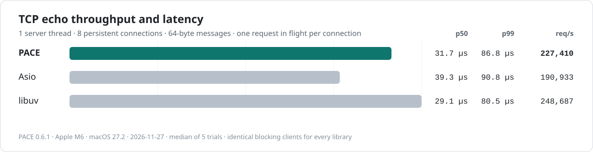
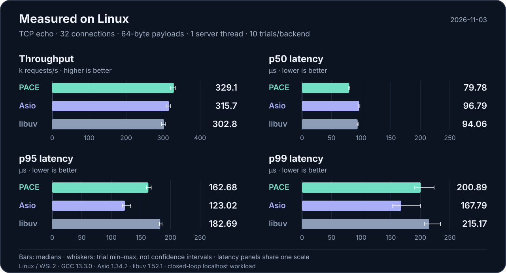

# TCP echo: PACE, Asio and libuv

[简体中文](tcp.zh.md) · [Performance](README.md)

The transport-level comparison: the same echo workload served by PACE, standalone Asio and libuv, with identical
blocking clients in the same run. TCP is the shared ground of the three libraries; this is not a score for HTTP,
TLS, DNS or QUIC.

## PACE 0.6.1 · macOS arm64

<picture>
  <source media="(prefers-color-scheme: dark)" srcset="../assets/readme/tcp-echo-dark.svg">
  
</picture>

One server thread, 8 persistent loopback connections, 64-byte messages, one request in flight per connection;
5,000 measured and 500 warm-up requests per connection in each of 5 trials per library. TCP_NODELAY for all.
Asio 1.34.2, libuv 1.52.1. Apple M6, macOS 27.2, Apple clang 21.0.0, 27 November 2026.

| Library | Requests/s | Trial min–max | p50 µs | p95 µs | p99 µs | Peak process MiB |
|:--|--:|--:|--:|--:|--:|--:|
| PACE | 227,410 | 224,496–229,171 | 31.71 | 60.38 | 86.75 | 6.53 |
| Asio | 190,933 | 188,009–192,276 | 39.29 | 68.00 | 90.79 | 6.45 |
| libuv | 248,687 | 246,947–250,917 | 29.12 | 55.79 | 80.50 | 6.42 |

On this machine libuv is ahead of PACE by 9% in throughput and has lower latency at every percentile; PACE is ahead
of Asio by 19%. Peak memory is the whole process (server, clients and stored latency samples) and differs by
about 0.1 MiB. [Summary](../../benchmarks/results/baseline-0.6.1-macos-arm64/tcp-echo/summary.md) ·
[every trial](../../benchmarks/results/baseline-0.6.1-macos-arm64/tcp-echo/raw.jsonl) ·
[environment](../../benchmarks/results/baseline-0.6.1-macos-arm64/tcp-echo/environment.json)

## PACE 0.5.0 · Linux x86_64



One server thread, 32 persistent loopback connections, 64-byte messages, one request in flight per connection;
60,000 measured and 5,000 warm-up requests per connection in each of 10 rotating trials per library, 57.6 million
validated round trips in total. Asio 1.34.2, libuv 1.52.1, GCC 13.3.0. Intel Core Ultra 7 270K Plus (24 logical
CPUs), Linux on WSL2 with a shared host, 3 November 2026.

| Library | Requests/s | Trial min–max | p50 µs | p95 µs | p99 µs | Peak process MiB |
|:--|--:|--:|--:|--:|--:|--:|
| PACE | 329,097 | 319,851–333,075 | 79.78 | 162.68 | 200.89 | 21.37 |
| Asio | 315,704 | 308,084–319,800 | 96.79 | 123.02 | 167.79 | 20.94 |
| libuv | 302,783 | 296,177–307,197 | 94.06 | 182.69 | 215.17 | 19.25 |

PACE's throughput was 4.2% above Asio and 8.7% above libuv, and its p50 17.6% and 15.2% lower. Asio had the better
p95 and p99, and PACE the highest peak memory. [Every trial, environment and commands](../../benchmarks/results/linux-release-0.5.0/tcp/report.json)

## Reading these numbers

- Table values are medians across trials. Latency columns are the median of each trial's percentile, not
  percentiles pooled over all requests. Min–max is the observed spread across trials, not a confidence interval.
- The two machines, connection counts and versions differ, so the two sections are not comparable with each other;
  only rows within one section are.
- A loopback echo with one request in flight measures per-request overhead in the library and the kernel. It does
  not predict throughput over a real network, with pipelining, or under overload.

## Reproduce

```sh
xmake f -c -m release -o build/bench --benchmarks=y --tests=n --examples=n -y
xmake -y
python3 scripts/run_benchmarks.py --executable build/bench/<plat>/<arch>/release/pace_bench --require-all \
    --repeats 5 --clients 8 --requests 5000 --warmup 500 --bytes 64 --label "<host>" --output <directory>
```

`scripts/run_baseline.py` runs this together with every other suite. [Benchmark methodology](../../benchmarks/README.md)

## See also

- [Runtime hot paths](runtime.md)
- [Earlier TCP studies](history/README.md)
