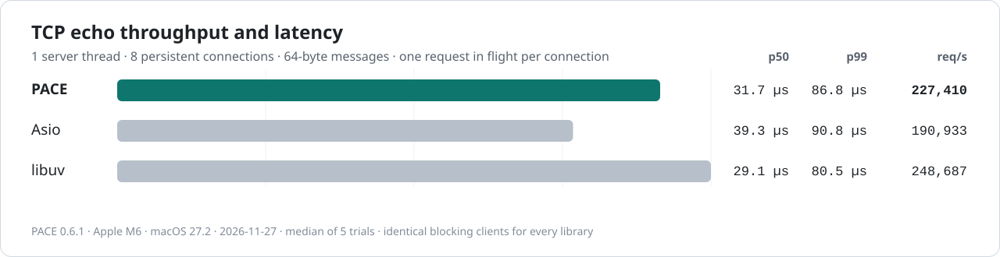
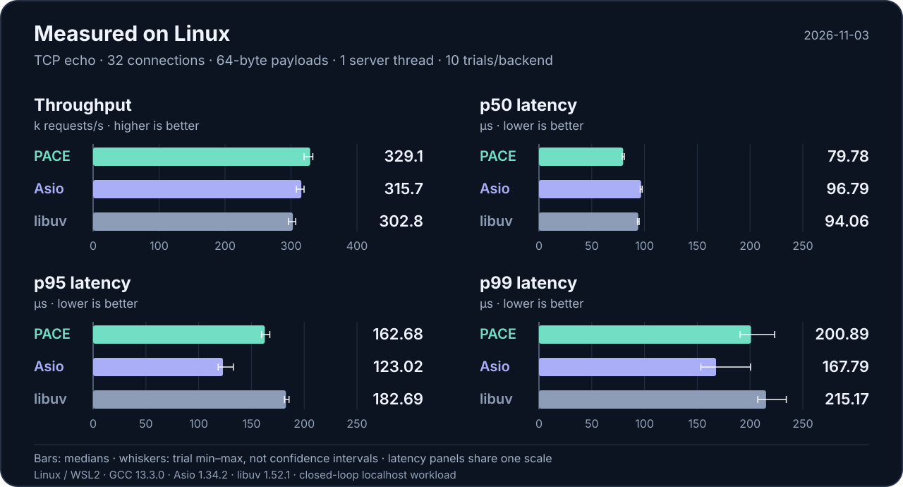

<!-- source-hash: 81e02d5779dd -->
# TCP 回显：PACE、Asio 与 libuv

[English](tcp.md) · [性能](README.zh.md)

传输层面的对比：同一个回显负载分别由 PACE、独立版 Asio 和 libuv 提供服务，在同一次运行中使用相同的阻塞式客户端。
TCP 是三个库共同的基础；这不是 HTTP、TLS、DNS 或 QUIC 的评分。

## PACE 0.6.1 · macOS arm64

<picture>
  <source media="(prefers-color-scheme: dark)" srcset="../assets/readme/tcp-echo-dark.svg">
  
</picture>

一个服务器线程，8 条持久的回环连接，64 字节消息，每条连接同一时间只有一个请求在途；每个库 5 次试验，每次试验中
每条连接计入测量的请求 5,000 个、预热请求 500 个。全部开启 TCP_NODELAY。Asio 1.34.2，libuv 1.52.1。Apple M6，
macOS 27.2，Apple clang 21.0.0，2026 年 11 月 27 日。

| 库 | 请求/秒 | 试验最小–最大 | p50 µs | p95 µs | p99 µs | 进程峰值 MiB |
|:--|--:|--:|--:|--:|--:|--:|
| PACE | 227,410 | 224,496–229,171 | 31.71 | 60.38 | 86.75 | 6.53 |
| Asio | 190,933 | 188,009–192,276 | 39.29 | 68.00 | 90.79 | 6.45 |
| libuv | 248,687 | 246,947–250,917 | 29.12 | 55.79 | 80.50 | 6.42 |

在这台机器上，libuv 的吞吐量比 PACE 高 9%，各个百分位的延迟也都更低；PACE 的吞吐量比 Asio 高 19%。峰值内存是
整个进程的（服务器、客户端和保存的延迟样本），三者相差约 0.1 MiB。
[汇总](../../benchmarks/results/baseline-0.6.1-macos-arm64/tcp-echo/summary.md) ·
[每次试验](../../benchmarks/results/baseline-0.6.1-macos-arm64/tcp-echo/raw.jsonl) ·
[环境](../../benchmarks/results/baseline-0.6.1-macos-arm64/tcp-echo/environment.json)

## PACE 0.5.0 · Linux x86_64



一个服务器线程，32 条持久的回环连接，64 字节消息，每条连接同一时间只有一个请求在途；每个库 10 次轮换试验，每次
试验中每条连接计入测量的请求 60,000 个、预热请求 5,000 个，总计 5,760 万次经过校验的往返。Asio 1.34.2，libuv
1.52.1，GCC 13.3.0。Intel Core Ultra 7 270K Plus（24 个逻辑 CPU），运行在共享主机上的 WSL2 Linux，2026 年 11 月 3 日。

| 库 | 请求/秒 | 试验最小–最大 | p50 µs | p95 µs | p99 µs | 进程峰值 MiB |
|:--|--:|--:|--:|--:|--:|--:|
| PACE | 329,097 | 319,851–333,075 | 79.78 | 162.68 | 200.89 | 21.37 |
| Asio | 315,704 | 308,084–319,800 | 96.79 | 123.02 | 167.79 | 20.94 |
| libuv | 302,783 | 296,177–307,197 | 94.06 | 182.69 | 215.17 | 19.25 |

PACE 的吞吐量比 Asio 高 4.2%，比 libuv 高 8.7%，p50 分别低 17.6% 和 15.2%。Asio 的 p95 和 p99 更好，PACE 的
峰值内存最高。[每次试验、环境与命令](../../benchmarks/results/linux-release-0.5.0/tcp/report.json)

## 如何解读这些数字

- 表中数值是各次试验的中位数。延迟各列是每次试验各自百分位数的中位数，而不是把所有请求合在一起计算的百分位数。
  最小–最大是各次试验之间观察到的离散范围，不是置信区间。
- 两台机器、连接数和版本都不同，所以两节之间不可比较；只有同一节内的各行可以相互比较。
- 每条连接只有一个在途请求的回环回显，测量的是库和内核在每个请求上的开销。它不能预测真实网络上、使用流水线或
  过载情况下的吞吐量。

## 复现

```sh
xmake f -c -m release -o build/bench --benchmarks=y --tests=n --examples=n -y
xmake -y
python3 scripts/run_benchmarks.py --executable build/bench/<plat>/<arch>/release/pace_bench --require-all \
    --repeats 5 --clients 8 --requests 5000 --warmup 500 --bytes 64 --label "<host>" --output <directory>
```

`scripts/run_baseline.py` 会把这项测量与其他所有测试套件一起运行。[基准测试方法](../../benchmarks/README.md)

## 参见

- [运行时热路径](runtime.zh.md)
- [早期的 TCP 研究](history/README.zh.md)
